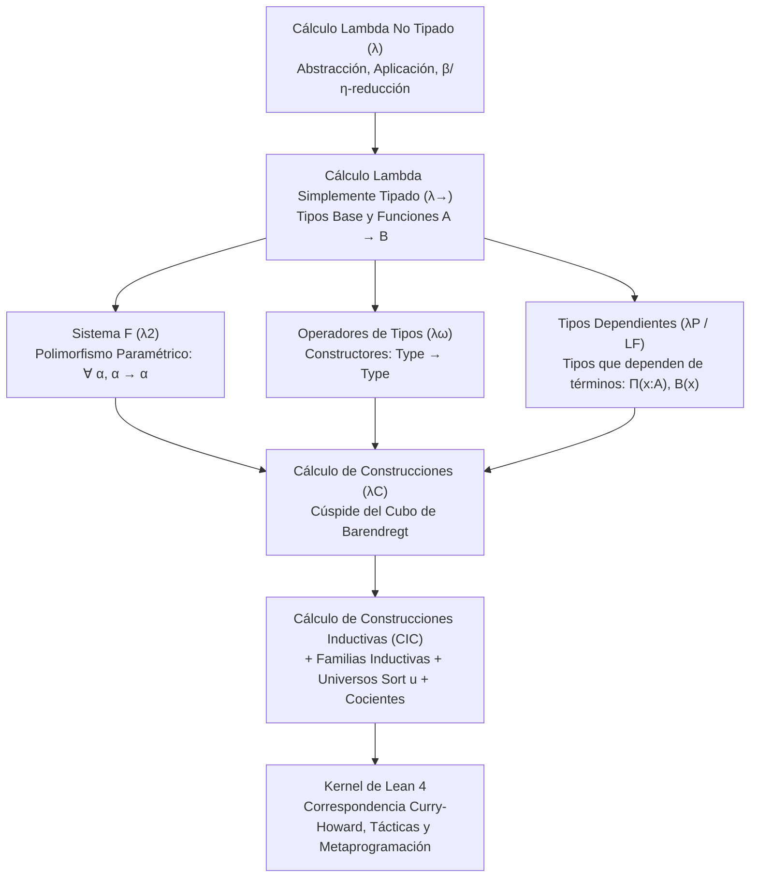

# Lean 4: Cálculo Lambda, Teoría de Tipos Dependientes y Demostración Formal (25 Módulos Ejecutables)

Bienvenido a este repositorio de referencia y aprendizaje profundo de **Lean 4** como **asistente de demostraciones** (*proof assistant*) y **lenguaje de programación funcional dependientemente tipado**, con una amplia extensión sobre sus fundamentos matemáticos e históricos en el **Cálculo Lambda ($\lambda$)** y la **Teoría de Tipos Dependientes (MLTT / CIC)**.

---

## Mapa Conceptual de la Arquitectura Teórica



---

## Estructura Completa del Repositorio

El repositorio está dividido en **dos áreas sincronizadas**:
1. **`docs/`** — **16 monografías teóricas y guías prácticas en Markdown** con explicaciones desde cero, antecedentes históricos, uso de VS Code, librerías del ecosistema (`Mathlib4`, `Batteries`, `Aesop`, `TauCeti`, `Verified-zkEVM`) y catálogo de aplicaciones.
2. **`LeanTT/`** — **25 módulos ejecutables en Lean 4 (`M01`–`M25`)** divididos en 4 bloques: fundamentos teóricos, metateoría/metaprogramación, **módulos especialmente didácticos paso a paso** y **ámbitos avanzados de aplicación** (estructuras de datos, ordenación, protocolos de red, compiladores verificados, circuitos ZK/SNARKs, teoría de categorías/Yoneda, HoTT, bases de datos SQL tipadas y lógica modal de Kripke).

### 1. Documentación Teórica y Guías (`docs/`)

| Doc | Guía Teórica (`docs/`) | Temas Principales |
| :---: | :--- | :--- |
| **00** | [00_vscode_ecosistema_y_tutoriales.md](docs/00_vscode_ecosistema_y_tutoriales.md) | **Lean 4 en VS Code** (Infoview, atajos Unicode, `lake`), **Librerías usuales** (`Mathlib4`, `Batteries`, `Aesop`, `Plausible`, Loogle/Moogle) y **Tutoriales/Libros** |
| **01** | [01_calculo_lambda.md](docs/01_calculo_lambda.md) | $\alpha/\beta/\eta/\delta/\iota/\zeta$-reducción, índices de De Bruijn, combinadores $S, K, I$, numerales de Church, PTS y Cubo de Barendregt |
| **02** | [02_tipos_dependientes_pi_sigma.md](docs/02_tipos_dependientes_pi_sigma.md) | Tipos $\Pi$, Tipos $\Sigma$, intuición geométrica de fibraciones, `HList`, subtipos `{x : A // P x}` y `printf` dependientemente tipado |
| **03** | [03_jerarquia_universos_y_prop.md](docs/03_jerarquia_universos_y_prop.md) | `Sort u`, `Prop` vs `Type u`, Paradoja de Girard/Hurkens, función `imax`, impredicatividad, *Proof Irrelevance* y eliminación de *subsingletons* |
| **04** | [04_curry_howard_y_logica.md](docs/04_curry_howard_y_logica.md) | Trinidad Curry-Howard-Lambek, lógica intuicionista vs clásica (`Classical.em`), traducción de doble negación de Gödel-Gentzen y Teorema de Diaconescu |
| **05** | [05_familias_inductivas_y_recursividad.md](docs/05_familias_inductivas_y_recursividad.md) | Familias inductivas indexadas (`Vec α n`, `Fin n`, `BalTree`), parámetros vs índices, eliminadores `rec`, `noConfusion`, positividad estricta y `WellFounded` |
| **06** | [06_igualdad_transporte_y_hott.md](docs/06_igualdad_transporte_y_hott.md) | Igualdad de Martin-Löf (`Eq`), eliminador $J$ (`Eq.rec`), cómo resolver `"motive is not type correct"`, `HEq`, `funext`, `propext`, cocientes (`Quot`) y UIP vs HoTT |
| **07** | [07_estructuras_clases_y_algebra.md](docs/07_estructuras_clases_y_algebra.md) | Telescopios de De Bruijn, estructuras *Bundled* vs *Semi-Bundled*, herencia diamante, síntesis tabulada de *Typeclasses*, `outParam` y coerciones |
| **08** | [08_tacticas_vs_terminos.md](docs/08_tacticas_vs_terminos.md) | El Criterio de De Bruijn, metavariables, tabla completa Tácticas $\leftrightarrow$ Términos $\lambda$, bloques `calc` y modo `conv` |
| **09** | [09_monadas_y_programacion_funcional.md](docs/09_monadas_y_programacion_funcional.md) | `Functor`, `Applicative`, `Monad`, `LawfulMonad`, desazucarado de `do`, transformadores (`StateT`, `ReaderT`, `ExceptT`) y Perceus |
| **10** | [10_metateoria_stlc_debruijn.md](docs/10_metateoria_stlc_debruijn.md) | Sintaxis intrínsecamente tipada del Cálculo $\lambda$ Simplemente Tipado (STLC) con índices de De Bruijn, debilitamiento, sustitución paralela y evaluador denotacional |
| **11** | [11_metateoria_calculo_lambda_no_tipado.md](docs/11_metateoria_calculo_lambda_no_tipado.md) | Semántica operacional de paso pequeño (*Small-Step*), paso grande (*Big-Step*), Progreso, Preservación y teorema de equivalencia |
| **12** | [12_metaprogramacion_y_kernel.md](docs/12_metaprogramacion_y_kernel.md) | El AST `Lean.Expr` del kernel, `CoreM`/`MetaM`/`TermElabM`/`TacticM`, macros higiénicas, DSLs y creación de tácticas propias |
| **13** | [13_enlaces_webs_proyectos_y_videos.md](docs/13_enlaces_webs_proyectos_y_videos.md) | **Enlaces web importantes** (`lean4.dev`, `lean-lang.org`, **[TauCeti](https://github.com/TauCetiProject/TauCeti)**), **Criptografía ZK / SNARKs** (**[ArkLib](https://github.com/Verified-zkEVM/ArkLib)**, **[VCV-io](https://github.com/Verified-zkEVM/VCV-io)**, **[CompPoly](https://github.com/Verified-zkEVM/CompPoly)**, **[Clean](https://github.com/Verified-zkEVM/clean)**, **[Verified-zkEVM](https://github.com/Verified-zkEVM)**) y **mejores vídeos de YouTube** |
| **14** | [**14_tratado_completo_teoria_tipos_dependientes.md**](docs/14_tratado_completo_teoria_tipos_dependientes.md) | **Tratado Completo de la Teoría de Tipos Dependientes desde Cero:** Historia y antecedentes (Frege, Russell, Brouwer, Church, Automath, Martin-Löf, Girard, Coquand), ZFC vs TTD, las 5 reglas canónicas, tipos $\Pi, \Sigma, W, \text{Id}$ y contractibilidad |
| **15** | [**15_catalogo_25_ejemplos_y_ambitos.md**](docs/15_catalogo_25_ejemplos_y_ambitos.md) | **Catálogo General de los 25 Módulos Ejecutables (`M01`–`M25`)** y guía de ámbitos de aplicación |

---

### 2. Los 25 Módulos Ejecutables en `LeanTT/`

| # | Archivo en `LeanTT/` | Bloque / Ámbito | Contenido Práctico y Teoremas Verificados |
| :-: | :--- | :--- | :--- |
| **01** | [M01_LambdaCalculus.lean](LeanTT/M01_LambdaCalculus.lean) | Núcleo $\lambda$ | Reducciones $\beta/\eta/\delta/\iota/\zeta$, combinadores $S, K, I, B, C$, booleanos y numerales de Church |
| **02** | [M02_DependentTypes.lean](LeanTT/M02_DependentTypes.lean) | Núcleo TTD | Familias dependientes, combinador $S$ dependiente, $\Sigma$-types, subtipos y `printf` tipado |
| **03** | [M03_UniversesAndProp.lean](LeanTT/M03_UniversesAndProp.lean) | Universos | `Sort u`, `ULift`, impredicatividad de `Prop`, irrelevancia de prueba y eliminación de subsingletons |
| **04** | [M04_CurryHoward.lean](LeanTT/M04_CurryHoward.lean) | Lógica | Curry-Howard con términos $\lambda$ puros, De Morgan, teorema de Glivenko (`¬¬(P ∨ ¬P)`) y lógica clásica |
| **05** | [M05_InductiveFamilies.lean](LeanTT/M05_InductiveFamilies.lean) | Inductivos | Predicado `EsPar`, ordinales `Fin' n`, vectores `Vec α n` con `get` seguro, `Nat.rec` y `termination_by` |
| **06** | [M06_EqualityAndTransport.lean](LeanTT/M06_EqualityAndTransport.lean) | Igualdad | Simetría/transitividad/congruencia con `Eq.rec`, `funext`, `propext` y construcción de $\mathbb{Z}$ como cociente |
| **07** | [M07_TypeClassesAndAlgebra.lean](LeanTT/M07_TypeClassesAndAlgebra.lean) | Álgebra | Jerarquía `Semigrupo` $\to$ `Monoide` $\to$ `Grupo`, unicidad del neutro, $(a^{-1})^{-1} = a$ y grupo producto |
| **08** | [M08_TacticsAndCalculationalProofs.lean](LeanTT/M08_TacticsAndCalculationalProofs.lean) | Tácticas | Término $\lambda$ vs `by`, fórmula de Gauss con `calc`, reescritura selectiva con `conv`, `simp`, `decide` y `omega` |
| **09** | [M09_MonadsAndEffects.lean](LeanTT/M09_MonadsAndEffects.lean) | Mónadas | Mónada `WriterNat`, demostración de `LawfulMonad`, coste verificado de pasos de Collatz y `ExceptT` + `StateM` |
| **10** | [M10_MetatheorySTLC.lean](LeanTT/M10_MetatheorySTLC.lean) | Metateoría | STLC intrínsecamente tipado con índices de De Bruijn, debilitamiento, sustitución paralela y evaluador denotacional |
| **11** | [M11_OperationalSemantics.lean](LeanTT/M11_OperationalSemantics.lean) | Semántica | Semánticas `BigStep` ($\Downarrow$), `Step` ($\longrightarrow$) y `MultiStep` ($\longrightarrow^*$), determinismo y adecuación |
| **12** | [M12_MetaprogrammingAndTactics.lean](LeanTT/M12_MetaprogrammingAndTactics.lean) | Metaprogramación | ASTs del kernel (`Lean.Expr`), `MetaM`, macros higiénicas, mini-DSL de conjuntos y táctica en `TacticM` |
| **13** | [M13_FoundationsOfDependentTypeTheory.lean](LeanTT/M13_FoundationsOfDependentTypeTheory.lean) | Fundamentos MLTT | *Large Elimination*, `VectorRecursivo`, eliminador $J$, contractibilidad del espacio basado y **$W$-Types** (`WNat`) |
| **14** | [**M14_DidacticStepByStepProofs.lean**](LeanTT/M14_DidacticStepByStepProofs.lean) | **Didáctico 1** | **"Tu Primera Demostración Paso a Paso":** Estado exacto del Infoview (`Γ ⊢ Meta`) comentado antes y después de cada táctica |
| **15** | [**M15_DidacticDependentTypesFromZero.lean**](LeanTT/M15_DidacticDependentTypesFromZero.lean) | **Didáctico 2** | **"Tipos Dependientes Cotidianos":** Menú del restaurante ($\Pi$), caja etiquetada ($\Sigma$), cuenta bancaria sin descubierto y ascensor tipado |
| **16** | [**M16_DidacticLambdaCubeAndPTS.lean**](LeanTT/M16_DidacticLambdaCubeAndPTS.lean) | **Didáctico 3** | **"Las 8 Esquinas del Cubo de Barendregt":** Un ejemplo ejecutable para cada uno de los 8 sistemas ($\lambda^\to$ a $\lambda C$) |
| **17** | [M17_VerifiedDataStructuresBST.lean](LeanTT/M17_VerifiedDataStructuresBST.lean) | Estructuras de Datos | Árboles Binarios de Búsqueda (`BST`), `mirror_mirror`, `mem_bstInsert_self` y `mem_bstInsert_of_mem` |
| **18** | [M18_VerifiedSortingAlgorithms.lean](LeanTT/M18_VerifiedSortingAlgorithms.lean) | Algoritmos | `insertionSort`, predicado inductivo `Sorted` y demostración completa de `sorted_insertionSort` |
| **19** | [M19_FiniteStateMachinesAndProtocols.lean](LeanTT/M19_FiniteStateMachinesAndProtocols.lean) | Protocolos / FSM | Mónada indexada por estados `Protocol s1 s2 α` (*Session Types*) para sesiones de red seguras por construcción |
| **20** | [M20_VerifiedCompilerAndStackMachine.lean](LeanTT/M20_VerifiedCompilerAndStackMachine.lean) | Compiladores | Compilador de expresiones a máquina de pila y demostración formal del **Teorema de McCarthy-Painter** (`compile_correct`) |
| **21** | [M21_NumberTheoryAndCryptography.lean](LeanTT/M21_NumberTheoryAndCryptography.lean) | Criptografía / ZK | Teoría de divisibilidad y verificación de **Soundness & Completeness** de puertas de circuitos R1CS/ZK (bit y multiplexor) |
| **22** | [M22_CategoryTheoryAndFunctors.lean](LeanTT/M22_CategoryTheoryAndFunctors.lean) | Categorías | Categorías dependientes, `Copresheaf`, transformaciones naturales y **demostración completa del Lema de Yoneda** |
| **23** | [M23_HoTTAndHomotopyPaths.lean](LeanTT/M23_HoTTAndHomotopyPaths.lean) | HoTT Sintética | Espacio de caminos `Path α a b` en `Type u`, leyes de $\infty$-grupoide, funtorialidad de `ap`, homotopías y equivalencias `α ≃ₕ β` |
| **24** | [M24_RelationalDatabasesAndTypedSQL.lean](LeanTT/M24_RelationalDatabasesAndTypedSQL.lean) | Bases de Datos SQL | Esquemas tipados, cálculo dependiente de filas `Row s`, `selectWhere`, `crossJoin` y equivalencia de filtros |
| **25** | [M25_ModalAndTemporalLogicDSL.lean](LeanTT/M25_ModalAndTemporalLogicDSL.lean) | Lógica Modal | Marcos de Kripke, operadores $\Box P$ y $\Diamond P$, axioma $K$ y los **3 Teoremas de Correspondencia de Sahlqvist-Kripke** ($T, 4, B$) |

---

## Inicio Rápido en Visual Studio Code

> Consulta la guía dedicada en [**`docs/00_vscode_ecosistema_y_tutoriales.md`**](docs/00_vscode_ecosistema_y_tutoriales.md) para todos los detalles sobre **VS Code**, **Mathlib4**, buscadores de teoremas (**Loogle**, **Moogle**, **LeanSearch**) y libros interactivos.

1. Instala la extensión **`lean4`** en Visual Studio Code.
2. Abre esta carpeta completa en VS Code con **`File -> Open Folder...`**.
3. Abre cualquier archivo dentro de `LeanTT/` (te recomendamos empezar por [`LeanTT/M14_DidacticStepByStepProofs.lean`](LeanTT/M14_DidacticStepByStepProofs.lean) y [`LeanTT/M15_DidacticDependentTypesFromZero.lean`](LeanTT/M15_DidacticDependentTypesFromZero.lean)) y coloca el cursor sobre los teoremas para ver el estado interactivo en el panel lateral **Lean Infoview**.
4. Para verificar los 25 módulos desde la terminal:
   ```bash
   lake build
   ```

---

## Licencia

Distribuido bajo la licencia incluida en [LICENSE](LICENSE).
