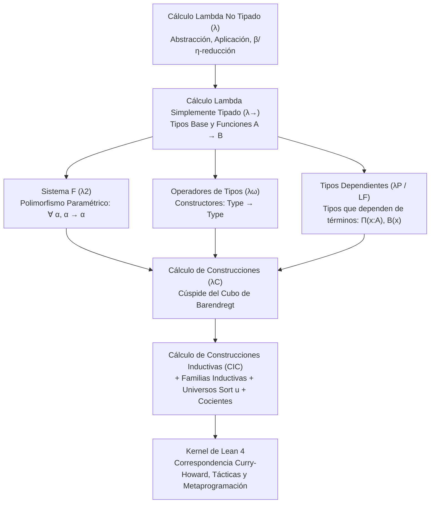

# Lean 4: Cálculo Lambda, Teoría de Tipos Dependientes y Demostración Formal

Bienvenido a este repositorio de referencia y aprendizaje profundo de **Lean 4** como **asistente de demostraciones** (*proof assistant*) y **lenguaje de programación funcional dependientemente tipado**, con especial énfasis en sus fundamentos matemáticos en el **Cálculo Lambda ($\lambda$)** y la **Teoría de Tipos Dependientes (MLTT / CIC)**.

---

## Mapa Conceptual de la Arquitectura Teórica



---

## Estructura Completa del Repositorio

El repositorio está dividido en **dos áreas sincronizadas**:
1. **`docs/`** — **13 monografías teóricas y guías prácticas en Markdown** con explicaciones detalladas, uso de VS Code, librerías del ecosistema (`Mathlib4`, `Batteries`, `Aesop`), reglas de inferencia y diagramas.
2. **`LeanTT/`** — **12 módulos ejecutables en Lean 4** repletos de ejemplos comentados paso a paso, demostraciones mediante términos $\lambda$ puros y mediante tácticas.

| Módulo | Guía Teórica (`docs/`) | Código Ejecutable (`LeanTT/`) | Temas Principales |
| :---: | :--- | :--- | :--- |
| **00** | [00_vscode_ecosistema_y_tutoriales.md](docs/00_vscode_ecosistema_y_tutoriales.md) | *(Guía de Entorno)* | **Lean 4 en VS Code** (Infoview, atajos Unicode, `lake`), **Librerías usuales** (`Mathlib4`, `Batteries`, `Aesop`, `Plausible`, buscadores Loogle/Moogle) y **Tutoriales/Libros** |
| **01** | [01_calculo_lambda.md](docs/01_calculo_lambda.md) | [M01_LambdaCalculus.lean](LeanTT/M01_LambdaCalculus.lean) | $\alpha/\beta/\eta/\delta/\iota/\zeta$-reducción, combinadores $S, K, I$, numerales y booleanos de Church, Cubo de Barendregt |
| **02** | [02_tipos_dependientes_pi_sigma.md](docs/02_tipos_dependientes_pi_sigma.md) | [M02_DependentTypes.lean](LeanTT/M02_DependentTypes.lean) | Tipos $\Pi$ (`(x : A) → B x`), Tipos $\Sigma$ (`(x : A) × B x`), subtipos `{x : A // P x}`, `printf` dependientemente tipado |
| **03** | [03_jerarquia_universos_y_prop.md](docs/03_jerarquia_universos_y_prop.md) | [M03_UniversesAndProp.lean](LeanTT/M03_UniversesAndProp.lean) | `Sort u`, `Prop` vs `Type u`, Paradoja de Girard, impredicatividad, *Proof Irrelevance*, eliminación de *subsingletons* |
| **04** | [04_curry_howard_y_logica.md](docs/04_curry_howard_y_logica.md) | [M04_CurryHoward.lean](LeanTT/M04_CurryHoward.lean) | Isomorfismo de Curry-Howard, lógica constructiva/intuicionista vs clásica (`Classical.em`), traducción de doble negación |
| **05** | [05_familias_inductivas_y_recursividad.md](docs/05_familias_inductivas_y_recursividad.md) | [M05_InductiveFamilies.lean](LeanTT/M05_InductiveFamilies.lean) | Familias inductivas indexadas (`Vec α n`, `Fin n`, `Even`), parámetros vs índices, eliminadores `rec`, positividad estricta y `WellFounded` |
| **06** | [06_igualdad_transporte_y_hott.md](docs/06_igualdad_transporte_y_hott.md) | [M06_EqualityAndTransport.lean](LeanTT/M06_EqualityAndTransport.lean) | Igualdad de Martin-Löf (`Eq`), eliminador $J$ (`Eq.rec`), transporte sobre fibraciones, `HEq`, `funext`, `propext`, cocientes (`Quot`) y UIP vs HoTT |
| **07** | [07_estructuras_clases_y_algebra.md](docs/07_estructuras_clases_y_algebra.md) | [M07_TypeClassesAndAlgebra.lean](LeanTT/M07_TypeClassesAndAlgebra.lean) | Estructuras como $\Sigma$-types, herencia, *Typeclasses*, síntesis de instancias, `outParam`, coerciones y jerarquía algebraica |
| **08** | [08_tacticas_vs_terminos.md](docs/08_tacticas_vs_terminos.md) | [M08_TacticsAndCalculationalProofs.lean](LeanTT/M08_TacticsAndCalculationalProofs.lean) | Modo término vs modo táctico (`by`), metavariables, pruebas calculacionales (`calc`), reescritura dirigida (`conv`) y catálogo de tácticas |
| **09** | [09_monadas_y_programacion_funcional.md](docs/09_monadas_y_programacion_funcional.md) | [M09_MonadsAndEffects.lean](LeanTT/M09_MonadsAndEffects.lean) | `Functor`, `Applicative`, `Monad`, demostración formal de leyes monádicas, notación `do`, `StateT`, `ReaderT`, `ExceptT` |
| **10** | [10_metateoria_stlc_debruijn.md](docs/10_metateoria_stlc_debruijn.md) | [M10_MetatheorySTLC.lean](LeanTT/M10_MetatheorySTLC.lean) | Formalización intrínsecamente tipada del Cálculo $\lambda$ Simplemente Tipado (STLC) con índices de De Bruijn, debilitamiento, sustitución y evaluador denotacional |
| **11** | [11_metateoria_calculo_lambda_no_tipado.md](docs/11_metateoria_calculo_lambda_no_tipado.md) | [M11_OperationalSemantics.lean](LeanTT/M11_OperationalSemantics.lean) | Semántica operacional de paso pequeño (*Small-Step*) y paso grande (*Big-Step*), clausuras reflexivo-transitivas y teoremas de determinismo y equivalencia |
| **12** | [12_metaprogramacion_y_kernel.md](docs/12_metaprogramacion_y_kernel.md) | [M12_MetaprogrammingAndTactics.lean](LeanTT/M12_MetaprogrammingAndTactics.lean) | El AST `Expr` del kernel, `MetaM`, `TacticM`, macros higiénicas, DSLs extensibles y construcción de tácticas personalizadas |

---

## Inicio Rápido en Visual Studio Code

> Consulta la guía dedicada en [**`docs/00_vscode_ecosistema_y_tutoriales.md`**](docs/00_vscode_ecosistema_y_tutoriales.md) para todos los detalles sobre **VS Code**, **Mathlib4**, buscadores de teoremas (**Loogle**, **Moogle**, **LeanSearch**) y libros interactivos.

1. Instala la extensión **`lean4`** en Visual Studio Code.
2. Abre esta carpeta completa en VS Code con **`File -> Open Folder...`**.
3. Abre cualquier archivo dentro de `LeanTT/` y coloca el cursor sobre los teoremas o comandos `#check` / `#eval` para ver el estado interactivo en el panel lateral **Lean Infoview**.
4. Para verificar todo el repositorio desde la terminal:
   ```bash
   lake build
   ```

---

## Glosario Esencial de Símbolos en Lean 4

| Símbolo | Abreviatura en VS Code | Significado en Teoría de Tipos / Lógica |
| :---: | :---: | :--- |
| `→` | `\to` o `\r` | Tipo función $A \to B$ o implicación lógica $P \to Q$ |
| `∀` | `\forall` | Tipo Producto Dependiente ($\Pi$-type: `∀ x : A, B x`) o cuantificador universal |
| `∃` | `\exists` | Cuantificador existencial en `Prop` |
| `Σ` / `(x : A) × B x` | `\Sigma` / `\times` | Tipo Suma Dependiente ($\Sigma$-type / par dependiente en `Type`) |
| `fun x => e` / `λ x => e` | `\lam` | Abstracción lambda ($\lambda x.\, e$) |
| `⟨a, b⟩` | `\<` y `\>` | Constructor anónimo (para estructuras, conjunciones `∧`, `∃` y $\Sigma$-types) |
| `∧`, `∨`, `¬`, `↔` | `\and`, `\or`, `\not`, `\iff` | Conectivas lógicas constructivas |
| `=` | `=` | Tipo Identidad proposicional de Martin-Löf (`Eq`) |
| `HEq` (`≍`) | `\heq` | Igualdad heterogénea (John Major equality) entre términos de tipos distintos |
| `⊢` | `\vdash` | Turnstile: separa las hipótesis del contexto $\Gamma$ de la conclusión en el Infoview |

---

## Licencia

Distribuido bajo la licencia incluida en [LICENSE](LICENSE).
