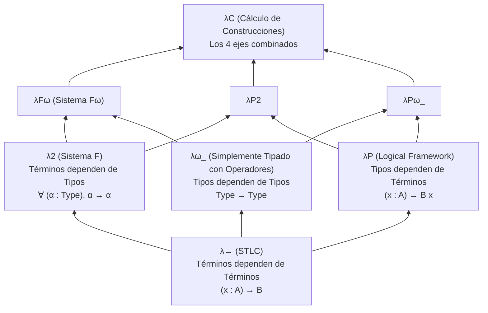

# Módulo 01: Del Cálculo Lambda ($\lambda$) al Cubo de Barendregt

> **Archivo Lean ejecutable asociado:** [`LeanTT/M01_LambdaCalculus.lean`](../LeanTT/M01_LambdaCalculus.lean)

---

## 1. El Cálculo Lambda No Tipado ($\lambda$)

Formulado por **Alonzo Church** en la década de 1930 como un sistema formal para investigar los fundamentos de las funciones, la aplicación funcional y la computabilidad, el **cálculo lambda** es el lenguaje nuclear de todos los asistentes de demostraciones basados en la teoría de tipos (Lean, Coq/Rocq, Agda, Idris).

### 1.1 Sintaxis Abstracta
El conjunto de términos $\Lambda$ del cálculo lambda puro se define inductivamente mediante tres construcciones:

$$
t, u ::= x \;\mid\; \lambda x.\, t \;\mid\; t\; u
$$

1. **Variables ($x$):** Identificadores simbólicos.
2. **Abstracción ($\lambda x.\, t$):** Crea una función anónima que liga la variable $x$ en el cuerpo $t$. En Lean 4 se escribe `fun x => t` o `λ x => t`.
3. **Aplicación ($t\; u$):** Evalúa la función $t$ sobre el argumento $u$. Es asociativa por la izquierda: $f\; x\; y$ significa $(f\; x)\; y$.

### 1.2 Variables Libres, Variables Ligadas y $\alpha$-Equivalencia
El conjunto de variables libres $\text{FV}(t)$ se define por recursión estructural:
* $\text{FV}(x) = \{x\}$
* $\text{FV}(\lambda x.\, t) = \text{FV}(t) \setminus \{x\}$
* $\text{FV}(t\; u) = \text{FV}(t) \cup \text{FV}(u)$

Dos términos que difieren únicamente en el nombre de sus variables ligadas se denominan **$\alpha$-equivalentes** ($t \equiv_\alpha u$):

$$\lambda x.\, x \;\equiv_\alpha\; \lambda y.\, y$$

> **Nota sobre el Kernel de Lean 4:** Internamente, el kernel de Lean utiliza **índices de De Bruijn** (`Expr.bvar i`) para las variables ligadas. Gracias a ello, dos términos $\alpha$-equivalentes tienen **exactamente la misma representación en memoria**, haciendo que la $\alpha$-equivalencia sea trivial.

---

## 2. Reglas de Reducción y Conversión en Lean 4

Cuando el verificador de tipos de Lean comprueba si dos expresiones son **definicionalmente iguales** ($t \equiv u$), reduce ambas hacia su forma normal utilizando seis reglas fundamentales:

| Regla | Nombre | Esquema Formal | Ejemplo en Lean 4 |
| :---: | :--- | :--- | :--- |
| **$\beta$** | Beta-reducción | $(\lambda x.\, t)\; u \longrightarrow_\beta t[x := u]$ | `(fun x => x + 1) 5` $\equiv$ `5 + 1` |
| **$\eta$** | Eta-conversión | $(\lambda x.\, f\; x) \equiv_\eta f \quad (x \notin \text{FV}(f))$ | `(fun x => Nat.succ x)` $\equiv$ `Nat.succ` |
| **$\delta$** | Delta-reducción | Despliegue de definiciones `def c := e` | Si `def doble x := x + x`, `doble 3` $\to_\delta$ `3 + 3` |
| **$\iota$** | Iota-reducción | Eliminador/recursor sobre constructor | `Nat.rec z s (Nat.succ n)` $\to_\iota$ `s n (Nat.rec z s n)` |
| **$\zeta$** | Zeta-reducción | Sustitución de ligaduras locales `let` | `let x := 4; x * x` $\to_\zeta$ `4 * 4` |
| **Proj** | Reducción de proyección | Proyección sobre constructor de estructura | `(Prod.mk a b).1` $\to$ `a` |

### Teorema de Church-Rosser (Confluencia)
Si $t \twoheadrightarrow u_1$ y $t \twoheadrightarrow u_2$, entonces existe un término $w$ tal que $u_1 \twoheadrightarrow w$ y $u_2 \twoheadrightarrow w$. En consecuencia, la forma normal de un término (si existe) es **única**.

---

## 3. Codificaciones de Church y Combinadores SKI

Incluso sin tipos primitivos para booleanos, números o pares, el cálculo lambda puede codificar cualquier estructura de datos mediante su **comportamiento como iterador o selector de orden superior** (Codificación de Böhm-Berarducci / Church):

* **Booleanos de Church:** $\text{true} \equiv \lambda t.\, \lambda f.\, t$, $\quad \text{false} \equiv \lambda t.\, \lambda f.\, f$.
* **Numerales de Church:** El número $n$ es el iterador que aplica una función $f$ exactamente $n$ veces a una semilla $x$:
  $$c_0 \equiv \lambda f.\, \lambda x.\, x, \qquad c_{n+1} \equiv \lambda f.\, \lambda x.\, f\;(c_n\; f\; x)$$
* **Cálculo Combinatorio SKI:** Todo término lambda cerrado puede expresarse sin variables ligadas combinando únicamente:
  * $I = \lambda x.\, x$
  * $K = \lambda x.\, \lambda y.\, x$
  * $S = \lambda f.\, \lambda g.\, \lambda x.\, f\; x\; (g\; x)$

---

## 4. El Problema de la No-Terminación y el Paso a los Tipos

En el cálculo lambda no tipado existe el combinador de autoaplicación $\Omega = (\lambda x.\, x\; x)(\lambda x.\, x\; x)$, que se reduce a sí mismo infinitamente, y el **combinador de punto fijo de Curry**:

$$Y = \lambda f.\, (\lambda x.\, f\;(x\; x))(\lambda x.\, f\;(x\; x))$$

Si interpretáramos los tipos como proposiciones lógicas en un sistema con $Y$, cualquier proposición $P$ sería demostrable mediante un término recursivo infinito $Y\;(\lambda p : P.\, p)$, haciendo el sistema **lógicamente inconsistente**.

Para garantizar la **consistencia lógica**, los asistentes de pruebas exigen **Normalización Fuerte**: toda secuencia de reducciones de un término bien tipado debe terminar en un número finito de pasos.

---

## 5. El Cubo de Barendregt ($\lambda$-Cube)

Henk Barendregt (1991) clasificó los sistemas de tipos puros (*Pure Type Systems*, PTS) según qué clases de dependencias se permiten entre **términos** ($* = \texttt{Type}$) y **tipos** ($\square = \texttt{Kind}$):

1. **$(*, *)$ — Términos que dependen de términos ($\lambda^\to$):** Funciones ordinarias `fun (x : Nat) => x + 1`.
2. **$(\square, *)$ — Términos que dependen de tipos ($\lambda 2$ / Sistema F):** Polimorfismo paramétrico `fun (α : Type) (x : α) => x`.
3. **$(\square, \square)$ — Tipos que dependen de tipos ($\lambda\underline{\omega}$):** Constructores de tipos `fun (α : Type) => α × α`.
4. **$(*, \square)$ — Tipos que dependen de términos ($\lambda P$):** **Tipos dependientes** `Vec : Type → Nat → Type`.

En el **Cálculo de Construcciones ($\lambda C$)** —y por tanto en **Lean 4**— una única construcción sintáctica, el **producto dependiente** $\Pi (x : A),\, B(x)$ (escrito `(x : A) → B x` o `∀ x : A, B x`), unifica las cuatro flechas del cubo.
