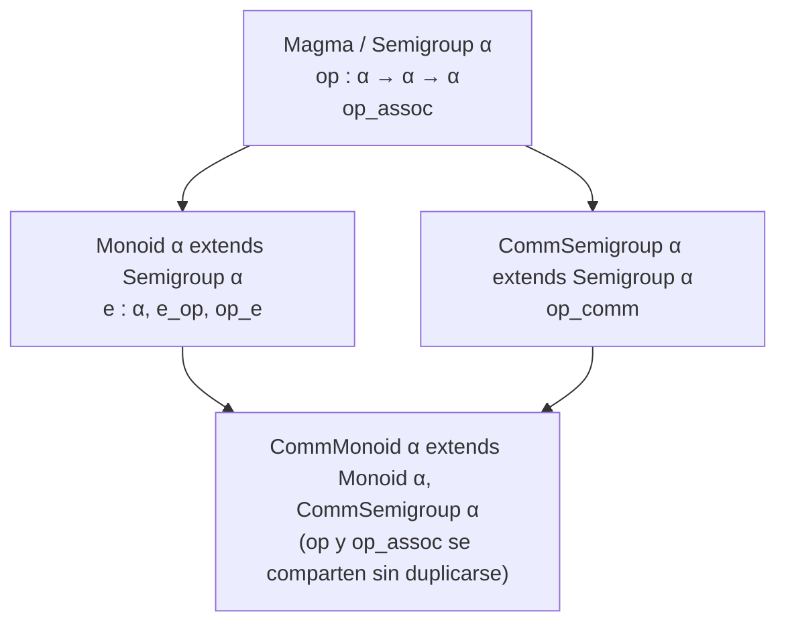

# Módulo 07: Estructuras como Tipos $\Sigma$, Clases de Tipos (*Typeclasses*) y Jerarquías Algebraicas

> **Archivo Lean ejecutable asociado:** [`LeanTT/M07_TypeClassesAndAlgebra.lean`](../LeanTT/M07_TypeClassesAndAlgebra.lean)

---

## 1. Estructuras (`structure`) como Tipos $\Sigma$ Iterados

En la teoría de tipos dependientes, una estructura matemática —como un **Semigrupo**, un **Grupo** o un **Espacio Topológico**— consta de:
1. Uno o más **datos portadores** o operaciones (por ejemplo, una operación binaria $\text{op} : \alpha \to \alpha \to \alpha$).
2. Una colección de **axiomas o leyes** cuyos tipos dependen de las operaciones anteriores (por ejemplo, $\forall a\, b\, c : \alpha,\, \text{op}(\text{op}(a, b), c) = \text{op}(a, \text{op}(b, c))$).

Desde el punto de vista de la teoría de tipos, esto no es más que un **tipo suma dependiente ($\Sigma$-type) anidado** o un tipo inductivo con un único constructor (`mk`):

```lean
structure Point (α : Type u) where
  x : α
  y : α
```

Para cualquier `structure`, Lean genera automáticamente:
* El constructor `Point.mk : α → α → Point α` (que también puede invocarse con `{ x := ..., y := ... }` o `⟨..., ...⟩`).
* Las funciones de proyección `Point.x : Point α → α` y `Point.y : Point α → α`.
* **Extensionalidad definicional ($\eta$ para estructuras):** Para cualquier `p : Point α`, el kernel garantiza que `Point.mk p.x p.y` es **definicionalmente igual** a `p`.

---

## 2. Herencia Múltiple y Resolución del Problema del Diamante (`extends`)

En matemáticas, un **Anillo** extiende simultáneamente a un **Grupo Abeliano Aditivo** y a un **Monoide Multiplicativo**, y ambos extienden a un tipo portador con estructura básica. Si se duplicaran los campos compartidos en el diamante de herencia, tendríamos dos operaciones o dos elementos neutros distintos que no serían definicionalmente iguales.

En Lean 4, la cláusula `extends` **aplana y fusiona automáticamente** los campos compartidos en una única estructura subyacente, garantizando que las proyecciones hacia las superestructuras conmuten **definicionalmente (`rfl`)**:



---

## 3. Clases de Tipos (`class`) y Síntesis Tabulada de Instancias

Una `class` en Lean 4 es exactamente una `structure` marcada con el atributo `@[class]`, lo que habilita al motor de **síntesis de instancias** para rellenar automáticamente argumentos entre corchetes `[inst : C α]`.

### 3.1 Cómo funciona el motor de síntesis (Tabled Typeclass Resolution)
Cuando Lean necesita sintetizar una instancia de `[Add (α × β)]`:
1. Busca en la tabla de instancias registradas aquellas cuya conclusión unifique con `Add (?α × ?β)`.
2. Si encuentra `instance [Add α] [Add β] : Add (α × β)`, genera dos submetas `[Add α]` y `[Add β]` y las resuelve recursivamente mediante búsqueda en profundidad con **tabulación (memoización)** (lo que evita bucles infinitos en diamantes algebraicos).

### 3.2 Parámetros de Salida (`outParam`)
En una clase multiparamétrica como `HMul (α : Type u) (β : Type v) (γ : outParam (Type w))` (que modela la multiplicación heterogénea $a \cdot b$, como escalar por vector), marcar `γ` como `outParam` le indica a Lean que **no necesita conocer el tipo de retorno `γ` antes de iniciar la búsqueda** de la instancia: en cuanto conoce `α` y `β`, la instancia determina unívocamente `γ`.

---

## 4. Coerciones Dependientes (`Coe`, `CoeSort`, `CoeFun`)

En la práctica matemática escribimos "sea $G$ un grupo y sea $g \in G$" (tratando la estructura $G$ como si fuera su conjunto subyacente) o "sea $f : A \simeq B$ un isomorfismo y evaluemos $f(x)$" (tratando una estructura como si fuera una función). Lean 4 modela esto mediante tres clases de coerción:

1. **`Coe α β`:** Convierte valores de un tipo `α` en valores de un tipo `β` (ej. `Nat` $\to$ `Int`).
2. **`CoeSort α (Type u)`:** Permite usar una estructura (como `BundledGroup`) en posición de **tipo** `(g : G)`.
3. **`CoeFun α (fun x => β x)`:** Permite aplicar un término `f : α` como una **función dependiente** `f a` aunque `α` sea una estructura empaquetada (por ejemplo, un homomorfismo de grupos o un bijección).
