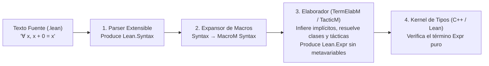

# Módulo 12: Arquitectura Interna del Kernel de Lean 4 (`Lean.Expr`), `MetaM` y Creación de Tácticas

> **Archivo Lean ejecutable asociado:** [`LeanTT/M12_MetaprogrammingAndTactics.lean`](../LeanTT/M12_MetaprogrammingAndTactics.lean)

---

## Índice del Módulo
1. [Del Texto Fuente al Kernel: Las 4 Fases de Procesamiento en Lean 4](#1-del-texto-fuente-al-kernel-las-4-fases-de-procesamiento-en-lean-4)
2. [Radiografía Completa de `Lean.Expr` con Ejemplos Construidos a Mano](#2-radiografía-completa-de-leanexpr-con-ejemplos-construidos-a-mano)
3. [Variables Ligadas (`bvar`), Variables Libres (`fvar`) y Metavariables (`mvar`)](#3-variables-ligadas-bvar-variables-libres-fvar-y-metavariables-mvar)
4. [Operaciones Nucleares en `MetaM`: `inferType`, `isDefEq`, `whnf`, `forallTelescope`](#4-operaciones-nucleares-en-metam-infertype-isdefeq-whnf-foralltelescope)
5. [Cotización Sintáctica (`Syntax` Quoting `` `( ... ) ``) y Macros Higiénicas](#5-cotización-sintáctica-syntax-quoting-----y-macros-higiénicas)
6. [Recetario para Escribir Tácticas Personalizadas en `TacticM`](#6-recetario-para-escribir-tácticas-personalizadas-en-tacticm)

---

## 1. Del Texto Fuente al Kernel: Las 4 Fases de Procesamiento en Lean 4



---

## 2. Radiografía Completa de `Lean.Expr` con Ejemplos Construidos a Mano

Veamos cómo se representan en `Lean.Expr` las construcciones esenciales de la teoría de tipos dependientes:

```lean
import Lean
open Lean

-- 1. Universo `Prop` (`Sort 0`) y `Type 0` (`Sort 1`):
def eProp  : Expr := .sort .zero
def eType0 : Expr := .sort (.succ .zero)

-- 2. Constante global `Nat`:
def eNat : Expr := .const ``Nat []

-- 3. Tipo función no dependiente `Nat → Nat`:
--    En el kernel, `A → B` es un `forallE` donde el cuerpo `B` no usa `bvar 0`!
def eNatToNat : Expr :=
  .forallE `_ eNat eNat .default

-- 4. Π-Type dependiente `∀ (α : Type), α → α`:
--    - El primer `forallE` introduce `α : Type 0`.
--    - El segundo `forallE` introduce `x : α` (aquí `α` es `.bvar 0`).
--    - En el cuerpo final, `α` está a distancia 1 (`.bvar 1`) y `x` a distancia 0 (`.bvar 0`).
def ePolyIdType : Expr :=
  .forallE `α eType0
    (.forallE `x (.bvar 0) (.bvar 1) .default)
    .implicit

-- 5. Término polimórfico `fun {α : Type} (x : α) => x`:
def ePolyIdTerm : Expr :=
  .lam `α eType0
    (.lam `x (.bvar 0) (.bvar 0) .default)
    .implicit
```

---

## 3. Variables Ligadas (`bvar`), Variables Libres (`fvar`) y Metavariables (`mvar`)

Lean 4 utiliza una representación **localmente sin nombres (*Locally Nameless*)**:
* **Dentro de un término cerrado**, las variables bajo un $\lambda$ o $\Pi$ son **índices de De Bruijn (`.bvar i`)**.
* **Cuando abrimos un ligador** para inspeccionar su cuerpo en `MetaM` (por ejemplo, con `forallTelescope` o `lambdaTelescope`), Lean instancia `.bvar 0` por una **variable libre única (`.fvar id`)** registrada en el contexto local `LocalContext` (`lctx`). Esto evita tener que desplazar (*shift*) constantemente los índices de De Bruijn al manipular subtérminos.
* **Los objetivos de prueba pendientes** y los argumentos implícitos aún no inferidos son **metavariables (`.mvar id`)** registradas en el `MetavarContext` (`mctx`).

---

## 4. Operaciones Nucleares en `MetaM`: `inferType`, `isDefEq`, `whnf`, `forallTelescope`

```lean
import Lean
open Lean Meta

def ejemploMetaM : MetaM String := do
  -- 1. Crear una metavariable fresca `?m : Nat`
  let mvar ← mkFreshExprMVar (mkConst ``Nat)
  -- 2. Unificar `?m` con `Nat.add 20 22` usando `isDefEq`
  let termino := mkAppN (mkConst ``Nat.add) #[mkNatLit 20, mkNatLit 22]
  let ok ← isDefEq mvar termino
  -- 3. Reducir a forma normal de cabeza débil (`whnf`)
  let reducido ← whnf mvar
  return s!"¿Unificó?: {ok}, Valor reducido de ?m: {← ppExpr reducido}"

#eval ejemploMetaM -- "¿Unificó?: true, Valor reducido de ?m: 42"
```
