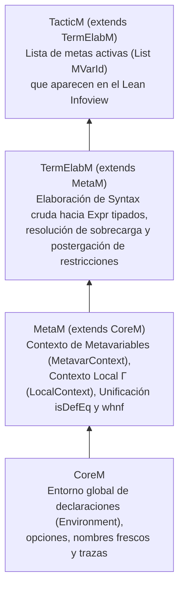

# Módulo 12: Arquitectura del Kernel de Lean 4 (`Expr`), Macros y Creación de Tácticas

> **Archivo Lean ejecutable asociado:** [`LeanTT/M12_MetaprogrammingAndTactics.lean`](../LeanTT/M12_MetaprogrammingAndTactics.lean)

---

## 1. Lean 4 está Escrito en Lean 4

Una de las revoluciones de **Lean 4** frente a Lean 3 y Coq es que su compilador, elaborador, sistema de macros y motor de tácticas están **implementados en el propio Lean 4**. Esto significa que extender la sintaxis del lenguaje o programar una nueva táctica no requiere aprender un lenguaje separado (como Ltac en Coq o ML en Isabelle): se escribe en Lean 4 ordinario.

---

## 2. El Tipo `Lean.Expr`: El Cálculo Lambda del Kernel al Desnudo

Toda expresión que llega al kernel de Lean —sea un número, una función, un tipo dependiente, un universo o una demostración completa— es una instancia del tipo algebraico `Lean.Expr` (que consta de solo 12 constructores):

```lean
inductive Expr where
  | bvar    (deBruijnIndex : Nat)                         -- Variable ligada x (índice de De Bruijn)
  | fvar    (fvarId : FVarId)                             -- Variable libre del contexto local Γ
  | mvar    (mvarId : MVarId)                             -- Metavariable (?m, un hueco por rellenar)
  | sort    (u : Level)                                   -- Universo Sort u (Prop = .sort .zero)
  | const   (declName : Name) (us : List Level)           -- Constante global definida (ej. Nat.add)
  | app     (fn : Expr) (arg : Expr)                      -- Aplicación (f a)
  | lam     (binderName : Name) (binderType : Expr)       -- Abstracción λ (x : A) => body
            (body : Expr) (binderInfo : BinderInfo)
  | forallE (binderName : Name) (binderType : Expr)       -- Producto Dependiente Π (x : A), body
            (body : Expr) (binderInfo : BinderInfo)
  | letE    (declName : Name) (type : Expr) (value : Expr)-- Ligadura local: let x : A := v in body
            (body : Expr) (nonDep : Bool)
  | lit     (value : Literal)                             -- Literal nativo optimizado (Nat o String)
  | mdata   (data : MData) (expr : Expr)                  -- Metadatos anotados
  | proj    (typeName : Name) (idx : Nat) (struct : Expr) -- Proyección primitiva de estructura (.1, .2)
```

> **Observación crucial:** En `Lean.Expr` **no existe una distinción sintáctica entre términos, tipos y pruebas**:
> * Tanto la función `A → B`, como la implicación `P → Q`, como el cuantificador universal `∀ x : A, P x` se representan con el **mismo constructor `Expr.forallE`**.

---

## 3. La Escalera de Mónadas del Elaborador de Lean 4

Cuando programas metaprogramas o tácticas en Lean 4, trabajas en una torre de mónadas donde cada capa añade estado y capacidades sobre la anterior:



---

## 4. Tres Niveles para Extender Lean 4

1. **Notaciones (`notation`, `infixl`, `prefix`):** Azúcar sintáctico rápido para operadores matemáticos.
2. **Macros Higiénicas (`syntax` + `macro` / `macro_rules`):** Transformaciones puramente sintácticas (`Syntax → MacroM Syntax`) que garantizan higiene automática de nombres (las variables introducidas por la macro nunca colisionan con las del usuario).
3. **Elaboradores y Tácticas (`elab` / `TacticM`):** Tienen acceso completo a los tipos de las hipótesis en el contexto local $\Gamma$ y a la meta actual `getMainGoal`/`getMainTarget`, permitiendo inspeccionar la estructura del objetivo y construir términos de prueba a medida.
