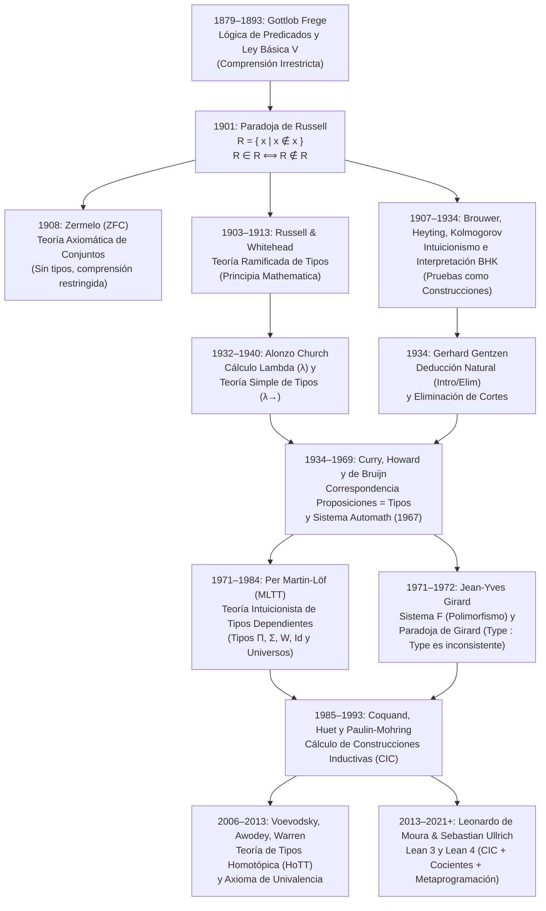
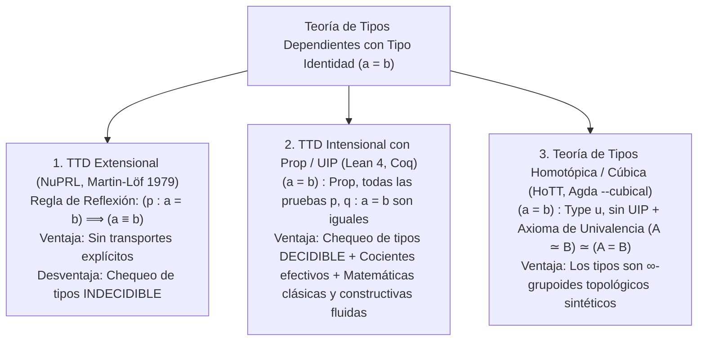

# Módulo 14: Tratado Completo de la Teoría de Tipos Dependientes — Desde sus Orígenes Históricos y Filosóficos hasta el Kernel de Lean 4

> **Archivo Lean ejecutable asociado:** [`LeanTT/M13_FoundationsOfDependentTypeTheory.lean`](../LeanTT/M13_FoundationsOfDependentTypeTheory.lean)

Este documento ofrece una exposición exhaustiva, autocontenida y **desde cero absoluto** de la **Teoría de Tipos Dependientes (TTD)**. No asume conocimientos previos de lógica matemática avanzada ni de teoría de categorías: comienza explicando **por qué nació la teoría de tipos**, recorre toda su **historia intelectual (1879–presente)** y construye **paso a paso** cada pieza del edificio formal que hoy impulsa a **Lean 4**.

---

## Índice General del Tratado
1. [¿Qué Problema Viene a Resolver la Teoría de Tipos? (Desde el Principio)](#1-qué-problema-viene-a-resolver-la-teoría-de-tipos-desde-el-principio)
2. [Historia y Antecedentes: De Frege y Russell a Martin-Löf y Lean 4 (1879–Presente)](#2-historia-y-antecedentes-de-frege-y-russell-a-martin-löf-y-lean-4-1879presente)
3. [Teoría de Conjuntos (ZFC) vs. Teoría de Tipos Dependientes: El Cambio de Paradigma](#3-teoría-de-conjuntos-zfc-vs-teoría-de-tipos-dependientes-el-cambio-de-paradigma)
4. [Los Cimientos Formales: Contextos Dependientes (Telescopios) y los 4 Juicios](#4-los-cimientos-formales-contextos-dependientes-telescopios-y-los-4-juicios)
5. [La Anatomía Universal de Todo Tipo: Las 5 Reglas Canónicas](#5-la-anatomía-universal-de-todo-tipo-las-5-reglas-canónicas)
6. [Construcción Paso a Paso de los Constructores de Tipos Fundamentales](#6-construcción-paso-a-paso-de-los-constructores-de-tipos-fundamentales)
   * [6.1 Los Tipos Finitos ($\mathbf{0}$, $\mathbf{1}$, $\mathbf{2}$) y la Eliminación Dependiente (*Large Elimination*)](#61-los-tipos-finitos-mathbf0-mathbf1-mathbf2-y-la-eliminación-dependiente-large-elimination)
   * [6.2 Familias de Tipos e Indexación: Cómo un Valor Se Convierte en un Tipo](#62-familias-de-tipos-e-indexación-cómo-un-valor-se-convierte-en-un-tipo)
   * [6.3 El Producto Dependiente ($\Pi$-Type): Funciones Cuyo Tipo de Salida Cambia con la Entrada](#63-el-producto-dependiente-pi-type-funciones-cuyo-tipo-de-salida-cambia-con-la-entrada)
   * [6.4 La Suma Dependiente ($\Sigma$-Type): Pares Donde el Tipo del Segundo Depende del Primero](#64-la-suma-dependiente-sigma-type-pares-donde-el-tipo-del-segundo-depende-del-primero)
   * [6.5 Los Tipos de Árboles Bien Fundados ($W$-Types de Martin-Löf)](#65-los-tipos-de-árboles-bien-fundados-w-types-de-martin-löf)
   * [6.6 El Tipo Identidad ($\text{Id}_A(a, b)$): La Igualdad como Espacio de Evidencias y el Eliminador $J$](#66-el-tipo-identidad-textid_aa-b-la-igualdad-como-espacio-de-evidencias-y-el-eliminador-j)
7. [Teoría de Tipos Intensional vs. Extensional vs. Homotópica (HoTT)](#7-teoría-de-tipos-intensional-vs-extensional-vs-homotópica-hott)
8. [Laboratorio Práctico de Ejemplos Completos en Lean 4](#8-laboratorio-práctico-de-ejemplos-completos-en-lean-4)

---

## 1. ¿Qué Problema Viene a Resolver la Teoría de Tipos? (Desde el Principio)

Imagina que escribes en una pizarra la expresión matemática:

$$\frac{\text{"Hola mundo"}}{0} + \sqrt{\text{Verdadero}}$$

Cualquier matemático o programador dirá inmediatamente que esa expresión **carece de sentido**, antes siquiera de intentar calcular su valor. No es que sea "falsa": es **gramaticalmente absurda desde el punto de vista de la naturaleza de los objetos involucrados** (no se puede dividir una frase entre un número ni extraer la raíz cuadrada de un valor de verdad).

### 1.1 El Primer Nivel: Tipos Simples (Evitar Operaciones Absurdas)
Un **sistema de tipos** clasifica cada objeto matemático o computacional asignándole una etiqueta llamada su **tipo** (`Nat`, `String`, `Bool`, `Nat → Nat`). Una operación como la suma `+ : Nat → Nat → Nat` exige que sus dos entradas sean números naturales.

Sin embargo, los **tipos simples** (como los de C, Java o el cálculo $\lambda^\to$ de Church) tienen una limitación enorme: **son ciegos a los valores concretos**.
* Para un lenguaje de tipos simples, una lista vacía `[]` y una lista con cien números `[1, 2, ..., 100]` tienen exactamente el mismo tipo `List Nat`.
* Una matriz de $3 \times 4$ y una matriz de $10 \times 10$ tienen el mismo tipo `Matrix Float`.
* Por tanto, el compilador de un lenguaje de tipos simples **no puede impedir en tiempo de compilación** que extraigas el primer elemento de una lista vacía (`head []`), ni que multipliques dos matrices de dimensiones incompatibles, ni puede expresar en el tipo de una función `ordenar : List Nat → List Nat` la garantía de que la lista devuelta **está realmente ordenada y tiene los mismos elementos que la original**.

### 1.2 El Salto Cuántico: Tipos Dependientes (Los Tipos Pueden Depender de los Valores)
La **Teoría de Tipos Dependientes** elimina la frontera entre los tipos y los valores:
* Permite que un tipo esté parametrizado por valores ordinarios: `Vec α n` (el tipo de los vectores de elementos de tipo `α` y longitud exacta `n : Nat`), o `Matrix ℝ m n` (matrices de $m$ filas y $n$ columnas).
* Permite que una proposición matemática sobre un valor $x$ (por ejemplo, $\text{EsPrimo}(x)$ o $x > 0$) sea ella misma un **tipo dependiente de $x$**, cuyos habitantes son las **demostraciones formales** de que $x$ cumple esa propiedad.

En una frase:
> **En la Teoría de Tipos Dependientes, programar, especificar propiedades y demostrar teoremas matemáticos son una única actividad unificada dentro del mismo lenguaje.**

---

## 2. Historia y Antecedentes: De Frege y Russell a Martin-Löf y Lean 4 (1879–Presente)

La teoría de tipos dependientes no surgió como una herramienta de ingeniería de software, sino como respuesta a la **mayor crisis intelectual de la historia de las matemáticas modernas**.



### 2.1 Etapa 1: Frege y el Colapso por la Paradoja de Russell (1879–1903)
En su *Begriffsschrift* (1879) y en *Grundgesetze der Arithmetik* (1893/1903), **Gottlob Frege** inventó la lógica cuantificacional moderna ($\forall, \exists$) con el objetivo del **Logicismo**: reducir todas las matemáticas a la lógica pura. Para ello postuló la **Ley Básica V**, que permitía que cualquier predicado $P(x)$ definiera un conjunto (su extensión $\{x \mid P(x)\}$) y que los conjuntos pudieran aplicarse a sí mismos sin restricción de nivel.

En junio de 1901, **Bertrand Russell** escribió a Frege una carta devastadora de una sola página: si definimos el predicado $R(x) :\equiv x \notin x$ ("el conjunto de todos los conjuntos que no se pertenecen a sí mismos"), entonces al preguntarnos si $R \in R$ obtenemos:
$$R \in R \iff R \notin R$$
El sistema de Frege era **inconsistente**: a partir de una contradicción se puede demostrar cualquier enunciado.

### 2.2 Etapa 2: La Teoría de Tipos de Russell y *Principia Mathematica* (1903–1926)
Para bloquear los círculos viciosos (*"ninguna totalidad puede contener miembros definidos en términos de sí misma"* — el **Principio del Círculo Vicioso** de Poincaré y Russell), Russell propuso estratificar el universo matemático en **Tipos**:
* **Nivel 0:** Individuos ($a, b, c$).
* **Nivel 1:** Propiedades de individuos ($P, Q$).
* **Nivel 2:** Propiedades de propiedades de individuos ($\mathcal{F}, \mathcal{G}$), etc.

En esta jerarquía, la expresión $x \in x$ (o $P(P)$) ni siquiera es falsa: **es sintácticamente ilegal (mal tipada)**, porque un predicado de nivel $n$ solo puede aplicarse a objetos de nivel $n-1$.

En *Principia Mathematica* (1910–1913), Russell y Whitehead complicaron aún más esta idea creando la **Teoría Ramificada de Tipos**, donde cada nivel se subdividía además en "órdenes" según qué cuantificadores aparecían en la definición de un predicado (para evitar también paradojas semánticas como la paradoja del mentiroso). Como esto hacía imposible definir el supremo de un conjunto de números reales, tuvieron que añadir el artificial *Axioma de Reducibilidad*. En 1926, **Frank P. Ramsey** demostró que las paradojas semánticas no pertenecen a la lógica formal y que bastaba con la **Teoría Simple de Tipos**.

### 2.3 Etapa 3: El Intuicionismo (Brouwer-Heyting-Kolmogorov) y la Deducción Natural de Gentzen (1907–1935)
En paralelo, el topólogo **L. E. J. Brouwer** desafió el platonismo matemático sosteniendo que la verdad matemática reside en la **construcción efectiva**. Sus discípulos **Arend Heyting** (1930) y **Andrey Kolmogorov** (1932) formalizaron la lógica intuicionista mediante la **interpretación BHK**:
* Una prueba de $A \land B$ es un **par** $(p, q)$ donde $p$ prueba $A$ y $q$ prueba $B$.
* Una prueba de $A \to B$ es un **método efectivo (función)** que transforma cualquier prueba de $A$ en una prueba de $B$.
* Una prueba de $\forall x \in S,\, P(x)$ es una **función** que a cada elemento $a \in S$ le asocia una prueba de $P(a)$.
* Una prueba de $\exists x \in S,\, P(x)$ es un **par** $(a, p)$ donde $a \in S$ es un testigo concreto y $p$ es una prueba de $P(a)$.

En 1934, **Gerhard Gentzen** formuló la **Deducción Natural**, observando que cada conectiva lógica queda definida por:
1. Sus **Reglas de Introducción** (cómo construir una prueba de la conectiva).
2. Sus **Reglas de Eliminación** (cómo usar una prueba de la conectiva).
3. El principio de **Inversión / Normalización** (introducir una conectiva y eliminarla inmediatamente es un rodeo superfluo que puede simplificarse).

### 2.4 Etapa 4: Church, Curry, de Bruijn (`Automath`) y Howard (1932–1969)
* **Alonzo Church (1940)** combinó su cálculo $\lambda$ con la teoría simple de tipos de Ramsey, creando el **Cálculo Lambda Simplemente Tipado ($\lambda^\to$)**.
* **Haskell Curry (1934/1958)** observó que los tipos de los combinadores $K : A \to B \to A$ y $S : (A \to B \to C) \to (A \to B) \to A \to C$ coinciden exactamente con los axiomas de la lógica implicacional de Hilbert.
* **Nicolaas Govert de Bruijn (1967–1968)**, un matemático neerlandés interesado en verificar mecánicamente demostraciones por ordenador, diseñó el lenguaje **Automath**. En Automath, tanto las proposiciones como los conjuntos se representaban como tipos dependientes de variables previas, y las demostraciones eran términos $\lambda$. ¡Automath fue el **primer verificador de pruebas de la historia basado en tipos dependientes**!
* **William Alvin Howard (1969)** hizo circular su célebre manuscrito *"The formulae-as-types notion of construction"*, extendiendo la observación de Curry a los **cuantificadores de primer orden ($\forall$ y $\exists$)** y a la aritmética constructiva: demostró que traducir $\forall x,\, P(x)$ y $\exists x,\, P(x)$ al cálculo lambda **exigía introducir tipos dependientes** ($\Pi$-types y $\Sigma$-types) y que la eliminación de cortes de Gentzen era idéntica a la $\beta$-reducción de Church.

### 2.5 Etapa 5: Per Martin-Löf y la Teoría Intuicionista de Tipos (1971–1984)
El lógico y estadístico sueco **Per Martin-Löf** unificó todas las corrientes anteriores (Brouwer/Heyting, Gentzen, Church y Howard) en una fundación constructiva completa para las matemáticas: la **Teoría de Tipos de Martin-Löf (MLTT)**.
* Introdujo la notación y axiomatización moderna de los **Productos Dependientes ($\Pi x : A,\, B(x)$)**, las **Sumas Dependientes ($\Sigma x : A,\, B(x)$)**, los tipos finitos ($\mathbf{0}, \mathbf{1}, \mathbf{2}$), los **Tipos de Árboles Bien Fundados ($W$-types)** y, crucialmente, el **Tipo Identidad Intensional ($\text{Id}_A(a, b)$)** gobernado por el **eliminador $J$**.
* Tras el descubrimiento por **Jean-Yves Girard (1972)** de que el axioma `Type : Type` de su borrador de 1971 conducía a una paradoja, Martin-Löf introdujo en 1973/1975 la **jerarquía predicativa infinita de universos** $\mathcal{U}_0 : \mathcal{U}_1 : \mathcal{U}_2 : \dots$

### 2.6 Etapa 6: Del Cálculo de Construcciones (Coquand-Huet) a Lean 4 (1985–Presente)
* **Thierry Coquand y Gérard Huet (1985–1988)** crearon en el INRIA el **Cálculo de Construcciones (CoC)**, combinando la teoría de tipos dependientes de Martin-Löf con el polimorfismo impredicativo del Sistema $F_\omega$ de Girard.
* **Christine Paulin-Mohring y Thierry Coquand (1989–1993)** añadieron esquemas primitivos para **tipos y familias inductivas** y la jerarquía de universos predicativos sobre un universo impredicativo `Prop`, dando lugar al **Cálculo de Construcciones Inductivas (CIC)** (base de Coq/Rocq).
* **Leonardo de Moura** (junto con Soonho Kong, Jeremy Avigad, Floris van Doorn, Jakob von Raumer y posteriormente **Sebastian Ullrich** para Lean 4) diseñó **Lean** (2013) y **Lean 4** (2021) tomando una versión limpia y minimalista del **CIC** enriquecida con:
  1. **Irrelevancia de prueba definicional** en `Prop`.
  2. **Tipos cociente primitivos (`Quot`)** con reducción computacional.
  3. Un compilador nativo con gestión de memoria por conteo de referencias y reutilización destructiva (**Perceus**) en el que el propio Lean 4 está escrito en Lean 4.

---

## 3. Teoría de Conjuntos (ZFC) vs. Teoría de Tipos Dependientes: El Cambio de Paradigma

Para entender por qué piensa como piensa un usuario de Lean, es fundamental contrastar la **Teoría de Conjuntos de Zermelo-Fraenkel (ZFC)** con la **Teoría de Tipos Dependientes (TTD)**:

| Dimensión | Teoría de Conjuntos (ZFC) | Teoría de Tipos Dependientes (MLTT / CIC / Lean 4) |
| :--- | :--- | :--- |
| **Capas del sistema** | **Dos capas separadas:** Primero se construye la Lógica de Primer Orden (FOL) y encima se postulan los 9 axiomas de pertenencia $\in$. | **Una sola capa unificada:** La lógica *emerge* de los propios constructores de tipos ($\Pi, \Sigma, +, \times, \mathbf{0}, \mathbf{1}, \text{Id}$). |
| **Naturaleza de $a \in A$ vs $a : A$** | $a \in A$ es una **proposición** que puede ser verdadera o falsa para cualesquiera dos objetos $a$ y $A$ del universo (puedes preguntar si $\pi \in \sqrt{2}$). | $a : A$ es un **juicio gramatical intrínseco**: ningún término existe sin su tipo. Un término no puede pertenecer a tipos arbitrarios sin conversión explícita. |
| **Codificación de objetos** | Todo es un conjunto puro de conjuntos vacíos ($0 = \emptyset$, $1 = \{\emptyset\}$, $(a, b) = \{\{a\}, \{a, b\}\}$). Permite "accidentes de codificación" como $1 \in 2$ o $\emptyset \subset \mathbb{R} \times \mathbb{R}$. | **Tipado nominal/estructural abstracto:** `Nat`, `Bool` y `Nat × Nat` son tipos disjuntos; preguntar si `0 ∈ (1, 2)` ni siquiera compila. |
| **Funciones** | Una función $f : A \to B$ se reduce a su grafo estático $\Gamma_f \subseteq A \times B$. Carece de noción primitiva de cómputo. | Una función $f : A \to B$ es una **regla computacional primitiva ($\lambda x.\, t$)** que se ejecuta por $\beta$-reducción. |
| **Verificación por ordenador** | Comprobar si un término denota un elemento de un conjunto requiere demostrar un teorema arbitrario (indecidible). | El chequeo de tipos $\Gamma \vdash t : A$ es **100% decidible algorítmicamente** por un kernel diminuto. |

---

## 4. Los Cimientos Formales: Contextos Dependientes (Telescopios) y los 4 Juicios

Entremos ahora en la mecánica formal desde cero.

### 4.1 ¿Qué es un Contexto $\Gamma$ en Teoría de Tipos Dependientes?
En lógica elemental o álgebra simple, las variables libres $x : A,\; y : B,\; z : C$ tienen tipos independientes entre sí.
En **Teoría de Tipos Dependientes**, el tipo de una variable puede **depender de las variables declaradas a su izquierda**:

$$\Gamma \;\equiv\; \big( \alpha : \texttt{Type},\; n : \texttt{Nat},\; v : \texttt{Vec }\alpha\; n,\; i : \texttt{Fin }n \big)$$

Observa cómo:
1. Primero declaramos qué tipo de elementos tendremos ($\alpha : \texttt{Type}$).
2. Luego declaramos un número natural ($n : \texttt{Nat}$).
3. Luego declaramos un vector $v$, cuyo tipo $\texttt{Vec }\alpha\; n$ **usa las variables previas $\alpha$ y $n$**.
4. Luego declaramos un índice $i$, cuyo tipo $\texttt{Fin }n$ **usa la variable previa $n$**.

Esta secuencia encadenada se llama un **telescopio** (porque cada segmento se despliega apoyándose en el anterior). Un contexto $\Gamma$ solo es válido si el tipo de cada nueva variable está bien formado respecto a las variables que la preceden:

$$
\frac{}{\vdash () \text{ ctx}} \text{ (Ctx-Vacío)}
\qquad\qquad
\frac{\vdash \Gamma \text{ ctx} \qquad \Gamma \vdash A : \texttt{Sort } u}{\vdash (\Gamma,\; x : A) \text{ ctx}} \text{ (Ctx-Extensión)}
$$

### 4.2 Los Cuatro Juicios de Martin-Löf
Bajo un contexto válido $\Gamma$, todo el razonamiento del kernel se expresa mediante cuatro formas de juicio:

1. **Juicio de Tipo ($\Gamma \vdash A : \texttt{Sort } u$):** "$A$ es un tipo válido en el universo $u$ bajo las hipótesis $\Gamma$".
2. **Juicio de Tipado de Términos ($\Gamma \vdash a : A$):** "El término $a$ es un habitante bien tipado del tipo $A$".
3. **Igualdad Definicional de Tipos ($\Gamma \vdash A \equiv B : \texttt{Sort } u$):** "Los tipos $A$ y $B$ se reducen computacionalmente al mismo tipo".
4. **Igualdad Definicional de Términos ($\Gamma \vdash a \equiv b : A$):** "Los términos $a$ y $b$ se reducen computacionalmente al mismo valor de tipo $A$".

---

## 5. La Anatomía Universal de Todo Tipo: Las 5 Reglas Canónicas

En la Teoría de Tipos Dependientes, cada vez que presentamos un nuevo constructor de tipos (sea $\Pi$, $\Sigma$, $+$, $\mathbb{N}$ o la igualdad $\text{Id}$), lo especificamos respondiendo siempre a **las mismas 5 preguntas (las 5 Reglas Canónicas)**:

| # | Nombre de la Regla | Pregunta a la que Responde | Equivalente en Programación / Lógica |
| :---: | :--- | :--- | :--- |
| **1** | **Formación (*Formation*)** | ¿Con qué ingredientes se construye este **tipo** y en qué universo vive? | Declaración de la firma del tipo |
| **2** | **Introducción (*Introduction*)** | ¿Cuáles son los **constructores canónicos** para fabricar un habitante de este tipo? | Constructores de datos / Reglas de introducción lógica |
| **3** | **Eliminación (*Elimination*)** | Si alguien nos da un habitante genérico de este tipo, ¿cómo lo **usamos o consumimos** para definir una función o demostrar una propiedad dependiente (*motivo*)? | Aplicación, proyecciones, `match` o principio de inducción (`rec`) |
| **4** | **Computación ($\beta$-reducción)** | ¿Qué ocurre cuando aplicamos inmediatamente el **eliminador** (3) a un **constructor** (2)? | Paso de evaluación / reducción computacional |
| **5** | **Unicidad ($\eta$-conversión)** | ¿Queda todo elemento de este tipo unívocamente determinado al descomponerlo con sus eliminadores y volverlo a ensamblar con sus constructores? | Extensionalidad definicional |

---

## 6. Construcción Paso a Paso de los Constructores de Tipos Fundamentales

Apliquemos ahora esta plantilla universal de 5 reglas a cada pieza de la teoría de tipos dependientes.

---

### 6.1 Los Tipos Finitos ($\mathbf{0}$, $\mathbf{1}$, $\mathbf{2}$) y la Eliminación Dependiente (*Large Elimination*)

#### A. El Tipo Vacío ($\mathbf{0}$: `Empty` en `Type`, `False` en `Prop`)
1. **Formación:** $\texttt{Empty} : \texttt{Type 0}$ y $\texttt{False} : \texttt{Prop}$.
2. **Introducción:** **Ninguna regla** (0 constructores). No existe forma canónica de construir un término cerrado de tipo $\mathbf{0}$.
3. **Eliminación (*Ex Falso Quodlibet* dependiente):** Dada cualquier familia de tipos $C : \mathbf{0} \to \texttt{Sort } u$ (el **motivo**) y un término hipotético $e : \mathbf{0}$, podemos producir un término $\text{rec}_{\mathbf{0}}(C, e) : C(e)$ **sin tener que cubrir ningún caso**.
4. **Computación ($\beta$):** Ninguna (porque no hay constructores).

```lean
-- En Lean 4, `Empty.elim` (o `nomatch e`) implementa el eliminador dependiente del tipo vacío:
def funcionDesdeVacio {C : Empty → Type} (e : Empty) : C e :=
  nomatch e
```

#### B. El Tipo Unitario ($\mathbf{1}$: `Unit` en `Type`, `True` en `Prop`)
1. **Formación:** $\texttt{Unit} : \texttt{Type 0}$.
2. **Introducción:** Un único constructor sin argumentos: $\texttt{unit} : \texttt{Unit}$ (escrito `()`).
3. **Eliminación:** Para definir una sección de $C : \texttt{Unit} \to \texttt{Sort } u$ en un punto $x : \texttt{Unit}$, basta con dar el valor en el punto canónico $c : C(())$.
4. **Computación ($\beta$):** $\text{rec}_{\mathbf{1}}(C, c, ()) \equiv c$.
5. **Unicidad ($\eta$):** Todo término $u : \texttt{Unit}$ es **definicionalmente igual** a `()` ($u \equiv ()$).

```lean
-- Verificación en Lean 4 de la regla η para `Unit`:
-- ¡Cualquier variable `u : Unit` es definicionalmente igual a `()` por `rfl`!
example (u : Unit) : u = () := rfl
example (u v : Unit) : u = v := rfl
```

#### C. El Tipo Booleano ($\mathbf{2}$: `Bool`) y el Nacimiento de los Tipos Dependientes
1. **Formación:** $\texttt{Bool} : \texttt{Type 0}$.
2. **Introducción:** Dos constructores constantes: $\texttt{false} : \texttt{Bool}$ y $\texttt{true} : \texttt{Bool}$.
3. **Eliminación Dependiente (`Bool.rec`):**
   $$\frac{C : \texttt{Bool} \to \texttt{Sort } u \qquad c_f : C(\texttt{false}) \qquad c_t : C(\texttt{true}) \qquad b : \texttt{Bool}}{\texttt{Bool.rec}(C, c_f, c_t, b) : C(b)}$$
4. **Computación ($\beta$):**
   * $\texttt{Bool.rec}(C, c_f, c_t, \texttt{false}) \equiv c_f$
   * $\texttt{Bool.rec}(C, c_f, c_t, \texttt{true}) \equiv c_t$

> **¡Observa qué ocurre cuando el motivo $C$ elige a `Type 0` como universo de llegada ($\texttt{Sort } 1$)!**
> Entonces $C : \texttt{Bool} \to \texttt{Type 0}$ es un eliminador que devuelve un **tipo distinto** para `false` y para `true`. Esto se conoce como **Eliminación Grande (*Large Elimination*)** y es el mecanismo que permite crear familias de tipos por análisis de casos sobre datos.

```lean
-- Primero usamos Large Elimination (`C : Bool → Type`) para crear una familia de tipos:
def FibraBooleana : Bool → Type
  | false => Nat × Nat
  | true  => String

-- Y ahora usamos de nuevo el eliminador dependiente de `Bool` sobre el motivo `FibraBooleana`
-- para construir un elemento de `FibraBooleana b` para cada `b : Bool`:
def seccionBooleana (b : Bool) : FibraBooleana b :=
  Bool.rec
    (motive := FibraBooleana)
    (10, 20)                  -- tiene tipo `FibraBooleana false` ≡ `Nat × Nat`
    "Habitante de la fibra"   -- tiene tipo `FibraBooleana true`  ≡ `String`
    b
```

---

### 6.2 Familias de Tipos e Indexación: Cómo un Valor Se Convierte en un Tipo

En la Teoría de Tipos Dependientes existen **dos mecanismos complementarios** para definir una familia de tipos $B : A \to \texttt{Type } u$ indexada por un tipo $A$:

#### Mecanismo 1: Familias Definidas por Recursión (*Large Elimination*)
Definimos una función ordinaria en Lean cuyo tipo de retorno es `Type u`, haciendo reconocimiento de patrones sobre $a : A$:
```lean
/-- `VectorRecursivo α n` calcula el tipo `α × (α × ... × Unit)` por recursión sobre `n` -/
def VectorRecursivo (α : Type u) : Nat → Type u
  | 0     => PUnit
  | n + 1 => α × VectorRecursivo α n

-- Ventaja: `VectorRecursivo α (2 + 1)` se reduce por simple cálculo en el kernel!
-- `head` y `tail` son simples proyecciones `.1` y `.2`:
def headRec {α : Type u} {n : Nat} (v : VectorRecursivo α (n + 1)) : α :=
  v.1
```

#### Mecanismo 2: Familias Inductivas Indexadas (Esquema de Dybjer)
Declaramos un nuevo constructor inductivo `inductive Vec (α : Type u) : Nat → Type u` cuyos constructores especifican en qué índice aterrizan.
* **Ventaja de las Familias Inductivas:** Soportan índices no libres (por ejemplo, `EsPar : Nat → Prop` donde el constructor salta de `n` a `n + 2`, o grafos dirigidos `Camino : V → V → Type` indexados por dos vértices origen y destino).

---

### 6.3 El Producto Dependiente ($\Pi$-Type): Funciones Cuyo Tipo de Salida Cambia con la Entrada

El tipo $\Pi (x : A),\, B(x)$ (escrito `(x : A) → B x` o `∀ x : A, B x`) es el corazón del Cálculo de Construcciones. Veamos sus 5 reglas canónicas:

1. **Formación:** Si $\Gamma \vdash A : \texttt{Sort } u$ y $\Gamma, x : A \vdash B(x) : \texttt{Sort } v$, entonces:
   $$\Gamma \vdash \big((x : A) \to B(x)\big) : \texttt{Sort }(\text{imax}(u, v))$$
2. **Introducción ($\lambda$-abstracción):** Para construir una función dependiente $f : (x : A) \to B(x)$, asumimos una variable arbitraria $x : A$ y construimos una expresión $t(x)$ cuyo tipo es $B(x)$:
   $$\frac{\Gamma, x : A \vdash t(x) : B(x)}{\Gamma \vdash (\texttt{fun } x : A \Rightarrow t(x)) : (x : A) \to B(x)}$$
3. **Eliminación (Aplicación dependiente):** Si tenemos $f : (x : A) \to B(x)$ y un argumento concreto $a : A$, al aplicar $f$ a $a$, **sustituimos $x$ por $a$ dentro del tipo de retorno $B(x)$**:
   $$\frac{\Gamma \vdash f : (x : A) \to B(x) \qquad \Gamma \vdash a : A}{\Gamma \vdash f\; a : B(a)}$$
4. **Computación ($\beta$):** $(\texttt{fun } x \Rightarrow t(x))\; a \;\equiv\; t(a) : B(a)$.
5. **Unicidad ($\eta$):** $(\texttt{fun } x \Rightarrow f\; x) \;\equiv\; f : (x : A) \to B(x)$.

```lean
-- Ejemplo en Lean 4: una función dependiente que para cada `n : Nat`
-- devuelve el vector `[0, 1, ..., n - 1]` de longitud exacta `n`:
def rangoTipado : (n : Nat) → VectorRecursivo Nat n
  | 0     => PUnit.unit
  | k + 1 => (k, rangoTipado k)

#eval rangoTipado 0 -- PUnit.unit : VectorRecursivo Nat 0
#eval rangoTipado 3 -- (2, (1, (0, PUnit.unit))) : VectorRecursivo Nat 3
```

---

### 6.4 La Suma Dependiente ($\Sigma$-Type): Pares Donde el Tipo del Segundo Depende del Primero

Dado $A : \texttt{Type } u$ y $B : A \to \texttt{Type } v$, el tipo $\Sigma (x : A),\, B(x)$ (escrito `(x : A) × B x` o `Σ x : A, B x`) tiene las siguientes 5 reglas canónicas:

1. **Formación:** $\Sigma (x : A),\, B(x) : \texttt{Type }(\max(u, v))$.
2. **Introducción (Par dependiente):** Si $a : A$ y $b : B(a)$ (¡observa que para comprobar el tipo de $b$ primero debemos enchufar el valor $a$ en la familia $B$!), entonces:
   $$\langle a, b \rangle : \Sigma (x : A),\, B(x)$$
3. **Eliminación (Proyecciones dependientes o Inducción `Sigma.rec`):**
   * Primera proyección: $\text{fst}(p) : A$.
   * Segunda proyección: $\text{snd}(p) : B(\text{fst}(p))$. *(¡El tipo de la segunda proyección depende de la primera proyección del mismo par $p$!)*.
4. **Computación ($\beta$):** $\text{fst}(\langle a, b \rangle) \equiv a$ y $\text{snd}(\langle a, b \rangle) \equiv b$.
5. **Unicidad ($\eta$):** $\langle \text{fst}(p), \text{snd}(p) \rangle \equiv p$.

```lean
-- Ejemplo: El tipo de todos los polígonos regulares donde empaquetamos el número de lados `n`
-- junto con las coordenadas de sus `n` vértices y la garantía `n ≥ 3`:
structure PoligonoEmpaquetado where
  lados    : Nat
  alMenos3 : lados ≥ 3
  vertices : VectorRecursivo (Int × Int) lados

def miTriangulo : PoligonoEmpaquetado where
  lados    := 3
  alMenos3 := by decide
  vertices := ((0, 0), ((1, 0), ((0, 1), PUnit.unit)))
```

---

### 6.5 Los Tipos de Árboles Bien Fundados ($W$-Types de Martin-Löf)

Una pregunta profunda de los fundamentos de la teoría de tipos es: **¿es necesario añadir una regla nueva al kernel cada vez que inventamos un tipo inductivo (naturales, listas, árboles binarios, sintaxis abstracta)?**

En 1979, Per Martin-Löf demostró que **no**: cualquier tipo inductivo simple puede construirse a partir de los tipos finitos, $\Pi$, $\Sigma$ y un único constructor universal de árboles bien fundados llamado el **Tipo $W$**:

$$\mathsf{W} (a : A),\, B(a)$$

* **$A : \texttt{Type } u$ es el tipo de las etiquetas de los nodos (formas de los constructores):** Por ejemplo, para los números naturales $A = \texttt{Bool}$ (`false` representa `zero` y `true` representa `succ`).
* **$B : A \to \texttt{Type } v$ es la familia de aridades (cuántos hijos tiene cada constructor):**
  * Si un constructor $a : A$ es una hoja (como `zero`), su fibra de aridad es vacía: $B(a) = \texttt{Empty}$ ($0$ hijos).
  * Si un constructor $a : A$ es unario (como `succ`), su fibra de aridad es unitaria: $B(a) = \texttt{Unit}$ ($1$ hijo).
  * Si un constructor $a : A$ es binario (como un nodo de árbol binario), su fibra de aridad es $B(a) = \texttt{Bool}$ ($2$ hijos: hijo izquierdo `false` e hijo derecho `true`).

La definición completa del tipo universal $\mathsf{W}$ en Lean 4 ocupa **dos líneas**:

```lean
/-- El Tipo Universal de Árboles Bien Fundados de Martin-Löf (`W-Type`) -/
inductive WType (A : Type u) (B : A → Type v) : Type (max u v) where
  | sup (a : A) (f : B a → WType A B) : WType A B

-- Codificación de los Números Naturales como un W-Type donde `A = Bool`:
-- - Si `a = false` (constructor `zero`), la aridad es `Empty` (0 subárboles).
-- - Si `a = true`  (constructor `succ`), la aridad es `Unit`  (1 subárbol).
def NatAridad : Bool → Type
  | false => Empty
  | true  => Unit

abbrev WNat := WType Bool NatAridad

def wZero : WNat :=
  WType.sup false (fun e => nomatch e)

def wSucc (n : WNat) : WNat :=
  WType.sup true (fun _ => n)
```

---

### 6.6 El Tipo Identidad ($\text{Id}_A(a, b)$): La Igualdad como Espacio de Evidencias y el Eliminador $J$

Llegamos a la joya conceptual de la Teoría de Tipos Dependientes: **¿cómo se define la igualdad $a =_A b$ entre dos elementos $a, b : A$?**

En un lenguaje de programación ordinario, `a == b` es una función booleana que devuelve `true` o `false`. Pero en matemáticas:
1. No todos los tipos tienen igualdad decidible algorítmicamente (por ejemplo, dos funciones reales $f, g : \mathbb{R} \to \mathbb{R}$ o dos secuencias infinitas `Nat → Nat`).
2. Más importante aún: si sabemos que $a = b$, necesitamos poder **sustituir $a$ por $b$ dentro de cualquier tipo dependiente $P(a)$ para obtener $P(b)$**. Un simple booleano `true` no transporta habitantes entre tipos distintos.

La idea genial de Martin-Löf (1973) fue definir $\text{Id}_A(a, b)$ (escrito `a = b` en Lean) como una **familia de tipos indexada por los elementos de $A$**:

1. **Formación:** Dados $A : \texttt{Sort } u$ y dos términos $a, b : A$, existe el tipo de las identificaciones entre $a$ y $b$:
   $$(a =_A b) : \texttt{Prop}$$
2. **Introducción (Reflexividad):** La única forma canónica de construir una prueba de igualdad desde cero es observar que cualquier objeto es igual a sí mismo:
   $$\texttt{rfl}_a : a =_A a$$
3. **Eliminación (El Principio de Inducción sobre la Igualdad — Regla $J$):**
   Supongamos que queremos demostrar una propiedad o construir una función dependiente
   $$C : (x : A) \to (y : A) \to (p : x =_A y) \to \texttt{Sort } v$$
   para cualesquiera puntos $x, y : A$ conectados por una prueba de igualdad $p : x =_A y$.
   Como la familia de tipos `=` fue generada libremente por el único constructor $\texttt{rfl}_x : x =_A x$, **basta con definir qué hace nuestra construcción cuando $y$ es el mismo punto $x$ y la prueba $p$ es $\texttt{rfl}_x$**:
   $$\frac{d : (x : A) \to C(x, x, \texttt{rfl}_x) \qquad a, b : A \qquad p : a =_A b}{J(C, d, a, b, p) : C(a, b, p)}$$
4. **Computación ($\beta$ para $J$):** Cuando aplicamos $J$ a la prueba reflexiva $\texttt{rfl}_a$, se reduce inmediatamente al caso diagonal:
   $$J(C, d, a, a, \texttt{rfl}_a) \;\equiv\; d(a)$$

> **Intuición Geométrica de la Regla $J$ (Contracción de Caminos):**
> Imagina que $a$ está fijo y que el par $(b, p)$ (un punto $b$ junto con un camino $p : a = b$ que lo une a $a$) es como el extremo libre de una cuerda atada al clavo $a$. Cualquier propiedad continua sobre el extremo libre $(b, p)$ puede comprobarse recogiendo la cuerda hasta que el extremo libre $b$ coincida con el clavo $a$ y la cuerda tenga longitud cero ($\texttt{rfl}_a$).

---

## 7. Teoría de Tipos Intensional vs. Extensional vs. Homotópica (HoTT)

La presencia del tipo identidad $\text{Id}_A(a, b)$ junto a la igualdad definicional $a \equiv b$ da lugar a las **tres grandes escuelas modernas** de la Teoría de Tipos Dependientes:



---

## 8. Laboratorio Práctico de Ejemplos Completos en Lean 4

Todos los conceptos de este tratado están implementados y verificados en el módulo ejecutable [`LeanTT/M13_FoundationsOfDependentTypeTheory.lean`](../LeanTT/M13_FoundationsOfDependentTypeTheory.lean). A continuación mostramos tres ejemplos clave autocontenidos:

### Ejemplo 8.1: El Eliminador $J$ de Martin-Löf Definido Explícitamente y Usado para Demostrar las Leyes de Grupoide de la Igualdad
```lean
universe u v

/-- Formulación clásica de Martin-Löf del eliminador `J` con ambos extremos libres: -/
def martinLofJ {A : Sort u}
    (C : (x y : A) → (x = y) → Sort v)
    (diag : (x : A) → C x x rfl)
    {a b : A} (p : a = b) : C a b p :=
  match p with
  | rfl => diag a

/-- Demostración del inverso de un camino (`symm`) usando `martinLofJ`: -/
def invCamino {A : Sort u} {a b : A} (p : a = b) : b = a :=
  martinLofJ (fun x y _ => y = x) (fun x => rfl) p

/-- Demostración de la composición de caminos (`trans`) usando `martinLofJ`: -/
def compCamino {A : Sort u} {a b c : A} (p : a = b) (q : b = c) : a = c :=
  martinLofJ (fun x y _ => (y = c) → (x = c)) (fun _ r => r) p q
```

### Ejemplo 8.2: ElEspacio Total de Caminos $\Sigma (y : A),\, (a = y)$ es Contráctil
En teoría de tipos dependientes (y en HoTT), el lema fundamental que explica por qué funciona el eliminador $J$ es que el **espacio total de todos los puntos $y : A$ unidos a un punto base fijo $a : A$ mediante un camino $p : a = y$**, es decir:
$$\text{BasadoEn}(a) :\equiv \Sigma (y : A),\, (a = y)$$
tiene un único elemento salvo igualdad: el centro de contracción $\langle a, \texttt{rfl}_a \rangle$.

```lean
/-- El espacio de caminos con origen fijo en `a` -/
def EspacioBasado {A : Type u} (a : A) : Type u :=
  (y : A) × (a = y)

/-- El centro de contracción `(a, rfl)` -/
def centroBasado {A : Type u} (a : A) : EspacioBasado a :=
  ⟨a, rfl⟩

/-- Teorema de Contractibilidad del Espacio Basado:
    Todo par dependiente `⟨y, p⟩ : (y : A) × (a = y)` es igual al centro `⟨a, rfl⟩`! -/
theorem espacioBasado_contractil {A : Type u} {a : A} ( w : EspacioBasado a ) :
    w = centroBasado a := by
  rcases w with ⟨y, rfl⟩
  rfl
```

### Ejemplo 8.3: Construcción Completa de `Nat` y la Suma Mediante $W$-Types de Martin-Löf
```lean
inductive W (A : Type u) (B : A → Type v) : Type (max u v) where
  | sup (a : A) (hijos : B a → W A B) : W A B

/-- Principio de inducción general sobre cualquier `W-Type`:
    Si una propiedad `P` se cumple para `W.sup a hijos` siempre que se cumpla
    para todos sus subárboles `hijos b`, entonces se cumple para todo árbol `w : W A B`. -/
def W.ind {A : Type u} {B : A → Type v} {P : W A B → Sort w}
    (step : ∀ (a : A) (hijos : B a → W A B), (∀ b : B a, P (hijos b)) → P (W.sup a hijos)) :
    (w : W A B) → P w
  | W.sup a hijos => step a hijos (fun b => W.ind step (hijos b))
```
