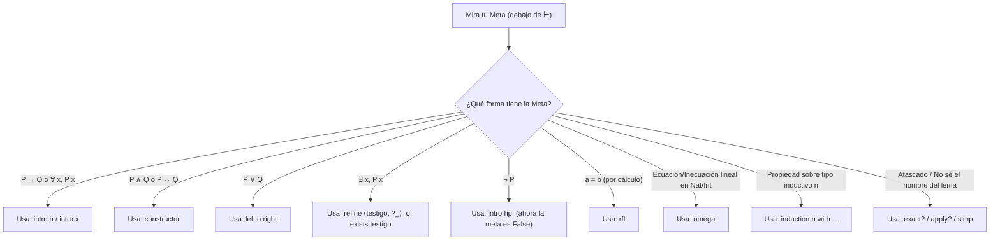

# Módulo 16: Árbol de Decisión de Tácticas y Solución de Errores Frecuentes (*Cheat Sheet*)

Esta hoja de referencia rápida responde a las dos preguntas más habituales al programar y demostrar en Lean 4:
1. **¿Qué táctica debo escribir ahora mismo según lo que veo en el Infoview?**
2. **¿Qué significa este mensaje de error del compilador y cómo lo arreglo?**

---

## 1. Árbol de Decisión Visual: "¿Qué Táctica Uso Ahora?"

---

## 2. Tabla Rápida: Introducir vs. Usar Cada Conectiva

| Conectiva / Tipo | Si está en la **Meta (`⊢ ...`)** *(Para demostrarla)* | Si está en una **Hipótesis (`h : ...`)** *(Para usarla)* |
| :--- | :--- | :--- |
| **Implicación** `P → Q` | `intro hp` | `apply h` *(hacia atrás)* o `have hq := h hp` *(hacia adelante)* |
| **Universal** `∀ x : A, P x` | `intro x` | `have hpx := h a` o `apply h` |
| **Conjunción** `P ∧ Q` | `constructor` o `exact ⟨hp, hq⟩` | `rcases h with ⟨hp, hq⟩` (o `h.1`, `h.2`) |
| **Doble Implicación** `P ↔ Q` | `constructor` *(abre `mp` y `mpr`)* | `rw [h]` o `h.mp` / `h.mpr` |
| **Disyunción** `P ∨ Q` | `left` o `right` | `rcases h with hp \| hq` |
| **Existencial** `∃ x : A, P x` | `exact ⟨a, ha⟩` o `refine ⟨a, ?_⟩` | `rcases h with ⟨x, hx⟩` |
| **Negación** `¬ P` | `intro hp` *(la meta pasa a ser `False`)* | `exact h hp` (o `contradiction`) |
| **Falsedad** `False` | `contradiction` (o aplicar una hipótesis `¬P`) | `nomatch h` / `cases h` / `contradiction` |
| **Igualdad** `a = b` | `rfl`, `simp`, `omega`, `calc`, `funext`, `ext` | `rw [h]` *(izq $\to$ der)*, `rw [← h]` *(der $\to$ izq)* o `subst h` |

---

## 3. Diagnóstico de los 7 Errores Más Frecuentes en Lean 4

| Mensaje de Error en el Infoview | Causa Exacta | Cómo Solucionarlo |
| :--- | :--- | :--- |
| **`motive is not type correct`** | Intentaste hacer `rw [h]` sobre una variable `n` de la que depende el tipo de otra variable `v : Vec α n` en el contexto o en la meta. | 1) Si `h : n = m` tiene un extremo libre, usa **`subst h`**. 2) O haz `revert v` antes de `rw [h]`. |
| **`recursor '...casesOn' can only eliminate into Prop`** | Intentaste hacer `match` o `cases` sobre un `Or` (`∨`) o `Exists` (`∃`) (que viven en `Prop`) para construir un dato en `Type` (`Nat`, `Bool`, etc.). | Usa `Decidable` (`if h : P then ... else ...`), o cambia `∃` por el subtipo `{ x : α // P x }` / suma dependiente `(x : α) × P x`. |
| **`failed to synthesize instance Decidable P`** | Usaste `if P then ... else ...` o `decide` sobre una proposición `P` que no tiene un algoritmo de decisión registrado. | Si estás en una prueba o definición no computable, añade `open Classical in` arriba para tener `[Decidable P]` clásico. |
| **`fail to show termination for ...`** | Escribiste una función recursiva cuya llamada recursiva no es sobre un subtérmino sintáctico directo. | Añade al final de la función `termination_by medida` y opcionalmente `decreasing_by omega` (o `simp_wf`). |
| **`type mismatch: has type A but is expected to have type B`** | El término que entregaste a `exact` o a una función tiene tipo `A`, que no es definicionalmente igual a `B`. | Comprueba si necesitas transportar con `h ▸ termino` o si olvidaste pasar un argumento. |
| **`unsolved goals`** | Terminó el bloque `by` pero quedaron submetas abiertas sin demostrar. | Coloca el cursor al final de cada rama `·` para ver en el Infoview qué submeta falta cerrar. |
| **`unknown identifier '...'`** | El teorema o tipo está en un `namespace` cerrado o falta un `import`. | Abre el espacio de nombres (`open Nombre`) o usa el nombre calificado completo (`Nat.add_comm`). |
