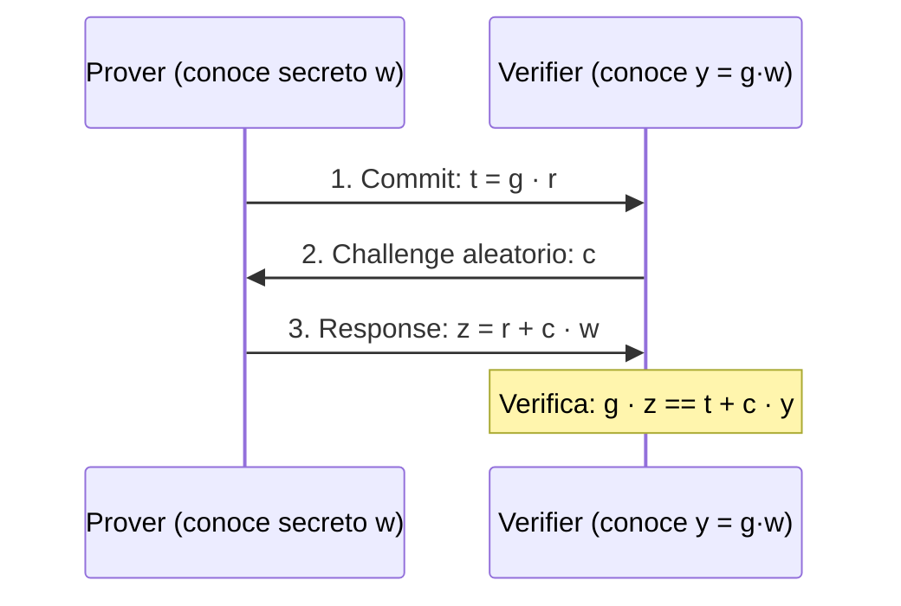

# Módulo 19: Verificación Formal de Sistemas Críticos, Criptografía ZK y Consenso Distribuido (`M41`–`M49`)

Esta monografía acompaña a los módulos **`M41` a `M49`**, donde aplicamos la Teoría de Tipos Dependientes de Lean 4 a los problemas más exigentes de la ingeniería de seguridad, la criptografía moderna y los sistemas distribuidos.

---

## 1. Flujo de Información y el Teorema de No-Interferencia (`M41`)

En seguridad de sistemas, el control de acceso (`M43`) regula **quién** puede ejecutar una operación, mientras que el **Control de Flujo de Información (IFC)** regula **hacia dónde pueden fluir los datos confidenciales** una vez leídos.

1. **Retículo de Seguridad ($\mathcal{L}, \sqsubseteq, \sqcup$):**
   $$\mathsf{pub} \sqsubseteq \mathsf{sec}$$
   El operador supremo ($\ell_1 \sqcup \ell_2$) etiqueta cualquier operación binaria con el nivel más restrictivo de sus operandos.
2. **Indistinguibilidad Pública ($\approx_{\Gamma}$):**
   Dos memorias $m_1, m_2$ son públicamente equivalentes ($m_1 \approx_\Gamma m_2$) si coinciden en todas las variables públicas:
   $$\forall x,\; \Gamma(x) = \mathsf{pub} \implies m_1(x) = m_2(x)$$
3. **Teorema de No-Interferencia (`LeanTT.M41.non_interference`):**
   $$\text{inferSec}(\Gamma, e) = \mathsf{pub} \;\land\; m_1 \approx_\Gamma m_2 \implies \llbracket e \rrbracket_{m_1} = \llbracket e \rrbracket_{m_2}$$
   Esto garantiza matemáticamente la ausencia total de canales laterales directos de datos secretos hacia salidas públicas.

---

## 2. Protocolos $\Sigma$, Soundness Especial y Simulación Zero-Knowledge (`M42`)

Un **Protocolo $\Sigma$** (Schnorr, 1989) permite demostrar el conocimiento de un testigo secreto $w$ tal que $y = g \cdot w$ mediante una interacción de tres pasos $(\text{commit } t, \text{challenge } c, \text{response } z)$ verificada por $g \cdot z = t + c \cdot y$.

En [`M42_FiatShamirAndSigmaProtocols.lean`](../LeanTT/M42_FiatShamirAndSigmaProtocols.lean) demostramos las tres propiedades que fundamentan `Verified-zkEVM/ArkLib`:
* **`sigma_completeness`:** Si $y = g \cdot w$, el Prover honesto satisface siempre la ecuación del Verifier.
* **`sigma_special_soundness`:** Dadas dos transcripciones aceptadas $(t, c_1, z_1)$ y $(t, c_2, z_2)$ con el mismo compromiso $t$, se cumple $g(z_1 - z_2) = (c_1 - c_2)y$, permitiendo extraer el testigo secreto.
* **`sigma_hvzk_simulator_valid`:** El simulador elige primero $(c, z)$ y define $t := g \cdot z - c \cdot y$, produciendo transcripciones válidas **sin conocer el secreto $w$**.

---

## 3. Motores de Políticas de Autorización al Estilo AWS Cedar (`M43`)

Inspirado en **[`cedar-policy/cedar-spec`](https://github.com/cedar-policy/cedar-spec)** (el motor de autorización de AWS verificado en Lean 4), el módulo [`M43_AuthorizationPolicyEngineCedar.lean`](../LeanTT/M43_AuthorizationPolicyEngineCedar.lean) formaliza y demuestra:
* **Denegación por Defecto (`default_deny`):** `evaluatePolicy [] req = .deny`.
* **Prevalencia Absoluta de `forbid` (`forbid_overrides_permit`):** Si existe al menos una regla `.forbid` aplicable, el motor devuelve `.deny` sin importar cuántas reglas `.permit` coincidan.
* **Congelación de Emergencia (`global_freeze_denies_all`):** Anteponer una regla `forbid` comodín bloquea matemáticamente cualquier solicitud.

---

## 4. Árboles de Merkle Indexados y Compromisos Criptográficos (`M44`)

En [`M44_MerkleTreesAndCryptographicCommitments.lean`](../LeanTT/M44_MerkleTreesAndCryptographicCommitments.lean), el tipo `MerkleTree h` y las pruebas de inclusión `MerkleProof h` están indexados por la altura exacta $h : \mathbb{N}$:
* **`merkle_inclusion_completeness`:** Reconstruir la raíz desde cualquier hoja con su prueba generada devuelve siempre `computeRoot H t`.
* **`merkle_binding_collision`:** Si dos hojas distintas verifican contra la misma raíz y el mismo hermano, se obtiene constructivamente un par de colisión explícito para la función hash $H$.

---

## 5. Tipos de Refinamiento (`M45`), Mónadas Libres (`M46`), Consenso (`M47`), Árboles Rojo-Negro (`M48`) y Probabilidad (`M49`)

| Módulo | Concepto Central | Teorema Insignia Demostrado en Lean 4 |
| :---: | :--- | :--- |
| **`M45`** | **Tipos de Refinamiento (`{x : α // P x}`)** | `clamp` y `midpoint` certifican intrínsecamente la pertenencia al intervalo `[lo, hi]`. |
| **`M46`** | **Mónadas Libres y Efectos Algebraicos** | `bind_assoc`, `handler_read_after_write` y homomorfismo de `handleState`. |
| **`M47`** | **Consenso Distribuido y Quórums** | `quorum_agreement` y `chosen_unique`: imposibilidad de *fork* bajo intersección de quórums honestos. |
| **`M48`** | **Árboles Rojo-Negro de Okasaki** | `mem_balance` y `mem_insert`: las 4 rotaciones preservan exactamente el conjunto de claves. |
| **`M49`** | **Distribuciones Discretas y Markov** | `totalMass_map` y `totalMass_bind_const`: conservación de masa de probabilidad en cadenas de Markov. |
