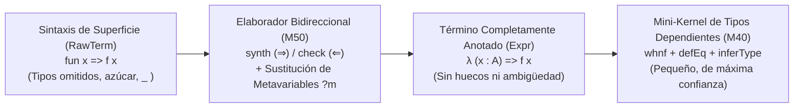

# Módulo 20: Arquitectura del Elaborador Bidireccional (`synth` / `check`), Metavariables y el Kernel (`M40` + `M50`)

¿Qué ocurre exactamente desde que escribes `fun x => x` en VS Code hasta que el **Kernel de Lean 4** acepta el teorema?
Los dos proyectos cumbre del repositorio (**`M40`** y **`M50`**) implementan en Lean 4 las dos mitades de esta arquitectura siguiendo el **Criterio de De Bruijn**.

---

## 1. La División de Responsabilidades: Elaborador (`M50`) vs. Kernel (`M40`)

| Componente | Módulo en `LeanTT/` | Entrada | Qué Hace | Nivel de Confianza |
| :--- | :---: | :--- | :--- | :--- |
| **Elaborador Bidireccional** | [`M50_BidirectionalElaboratorAndUnification.lean`](../LeanTT/M50_BidirectionalElaboratorAndUnification.lean) | `RawTerm` (con lambdas sin anotación `fun x => ...`) y `MetaTy` (con metavariables `?m_i`) | Propaga tipos esperados hacia adentro (`check ⇐`), sintetiza tipos hacia afuera (`synth ⇒`) y resuelve sustituciones de metavariables | No necesita ser parte del núcleo de confianza (su salida será auditada por el Kernel) |
| **Kernel de Tipos Dependientes** | [`M40_MiniDependentTypeChecker.lean`](../LeanTT/M40_MiniDependentTypeChecker.lean) | `Expr` (donde toda abstracción $\lambda$ y producto $\Pi$ están explícitamente tipados) | Calcula formas normales débiles (`whnf`), verifica conversión (`defEq`) y aplica la regla dependiente $(f\;a) : B[x := a]$ | **Núcleo TCB (*Trusted Computing Base*)** |

---

## 2. Tipado Bidireccional (Pierce & Turner / Coquand) en `M50`

En el cálculo lambda ordinario, una abstracción sin anotación `fun x => body` tiene infinitos tipos posibles. Si intentamos inferir su tipo de abajo hacia arriba (*bottom-up*), nos atascamos inmediatamente porque no sabemos qué tipo asignar a `x` en el contexto $\Gamma$.

El **Tipado Bidireccional** resuelve este problema separando dos juicios:

1. **Juicio de Síntesis ($\Gamma \vdash e \Rightarrow \tau$ — función `synth`):**
   El tipo $\tau$ es una **salida** calculada a partir de $e$. Se aplica a variables ($x \in \Gamma$), literales, anotaciones explícitas $(e : \tau)$ y aplicaciones $(f\;a)$.
2. **Juicio de Comprobación ($\Gamma \vdash e \Leftarrow \tau$ — función `check`):**
   El tipo $\tau$ es una **entrada conocida** que se empuja hacia adentro de $e$. Cuando comprobamos una lambda sin anotación contra un tipo flecha $\sigma \Rightarrow \rho$:
   $$\frac{\Gamma, x : \sigma \vdash \text{body} \Leftarrow \rho}{\Gamma \vdash (\lambda x.\, \text{body}) \Leftarrow (\sigma \Rightarrow \rho)}$$
   ¡El elaborador toma el dominio $\sigma$ del tipo esperado, lo inyecta en el contexto $\Gamma$ y construye automáticamente la lambda explícitamente tipada $\lambda (x : \sigma).\, \text{body}_{\text{core}}$ para el Kernel!

---

## 3. Álgebra de Sustituciones de Metavariables (`MetaTy.Subst`)

En [`M50_BidirectionalElaboratorAndUnification.lean`](../LeanTT/M50_BidirectionalElaboratorAndUnification.lean) formalizamos también las sustituciones sobre tipos con metavariables `?m_i` y demostramos que forman un **monoide de acción** sobre `MetaTy`:
* **Identidad (`applySubst_id`):** $\text{applySubst}(\text{idSubst}, \tau) = \tau$.
* **Composición (`applySubst_comp`):** $\text{applySubst}(\sigma_2, \text{applySubst}(\sigma_1, \tau)) = \text{applySubst}(\sigma_2 \circ_s \sigma_1, \tau)$.
