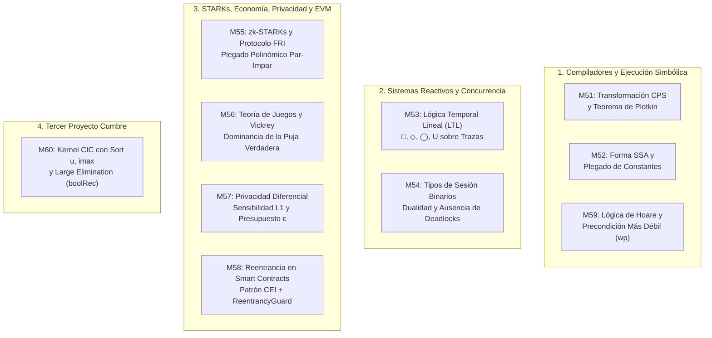

# Monografía 21: Compiladores (CPS / SSA), Lógica Temporal (LTL), Tipos de Sesión, STARKs/FRI, Teoría de Juegos, Privacidad Diferencial y el Kernel Polimórfico (`M51`–`M60`)

> **Archivos Lean 4 ejecutables asociados:** [`M51`](../LeanTT/M51_ContinuationPassingStyleCPS.lean) a [`M60`](../LeanTT/M60_UniversePolymorphicKernelAndInductives.lean) y el [**Taller 04 (`E04` / `S04`)**](../LeanTT/Exercises/E04_WorkoutCompilersSTARKsAndGames.lean).

Esta monografía presenta los fundamentos teóricos y matemáticos del bloque **`M51`–`M60`**, que extiende el repositorio hasta **60 módulos ejecutables** cubriendo compiladores de producción, concurrencia, criptografía ZK transparente (STARKs), economía algorítmica, privacidad estadística, seguridad contra reentrancia en contratos inteligentes, lógica de Hoare y el **Tercer Proyecto Cumbre (`M60`)**: un mini-kernel con jerarquía de universos `Sort u`, `imax` y *Large Elimination*.

---

## Mapa Conceptual del Bloque `M51`–`M60`

---

## 1. Compiladores Verificados: CPS (`M51`), SSA (`M52`) y Dijkstra `wp` (`M59`)

### 1.1 Estilo de Paso de Continuaciones (CPS — [`M51`](../LeanTT/M51_ContinuationPassingStyleCPS.lean))
En la transformación CPS de Gordon Plotkin (1975), una expresión $e$ que devuelve un valor de tipo $V$ se convierte en un computo parametrizado por su **continuación** $k : V \to \alpha$ (lo que resta por hacer con el resultado):
$$\llbracket e \rrbracket_{\text{CPS}}(k) \;=\; k(\llbracket e \rrbracket_{\text{Direct}})$$
En `M51` demostramos por inducción estructural generalizando la continuación $k$ (`induction e generalizing k`) que `evalCPS e k = k (evalDirect e)` para todo árbol con sumas, productos y saltos condicionales `ifPos`.

### 1.2 Asignación Única Estática (SSA) y *Constant Folding* ([`M52`](../LeanTT/M52_StaticSingleAssignmentAndRegisterAlloc.lean))
Modelamos un bloque básico de instrucciones de tres direcciones `dst := op1 ⊕ op2` sobre un banco de registros funcional `RegFile := RegId → Nat` y demostramos que el optimizador `foldProg` (que evalúa en tiempo de compilación operaciones entre constantes inmediatas y simplifica elementos neutros `r + 0 = r`, `r * 1 = r`) preserva el estado de todos los registros (`execProg_foldProg`).

### 1.3 Lógica de Hoare y Precondición Más Débil (`wp` — [`M59`](../LeanTT/M59_SymbolicExecutionAndWP.lean))
El transformador de predicados de Edsger W. Dijkstra (1975) reduce la validez de cualquier tripleta de Hoare $\{P\}\; c\; \{Q\}$ a una implicación lógica pura en el estado inicial:
$$\{P\}\; c\; \{Q\} \;\Longleftrightarrow\; \forall s,\; P(s) \to \text{wp}(c, Q)(s)$$
Gracias al teorema `hoareTriple_iff_imp_wp`, verificamos automáticamente con `omega` el algoritmo de intercambio aritmético de registros sin variable auxiliar (`x := x + y; y := x - y; x := x - y`).

---

## 2. Lógica Temporal Lineal LTL (`M53`) y Dualidad de Tipos de Sesión (`M54`)

### 2.1 *Model Checking* sobre Trazas Infinitas en LTL ([`M53`](../LeanTT/M53_LinearTemporalLogicModelChecking.lean))
Sobre el espacio de trazas infinitas $\tau : \mathbb{N} \to \text{State}$ con el operador de desplazamiento $\text{drop}_k(\tau)(t) = \tau(k + t)$, definimos:
* $\bigcirc \varphi (\tau) :\equiv \varphi(\text{drop}_1(\tau))$
* $\Box \varphi (\tau) :\equiv \forall k \in \mathbb{N},\; \varphi(\text{drop}_k(\tau))$
* $\Diamond \varphi (\tau) :\equiv \exists k \in \mathbb{N},\; \varphi(\text{drop}_k(\tau))$
* $(\varphi \;\mathcal{U}\; \psi)(\tau) :\equiv \exists k \in \mathbb{N},\; \psi(\text{drop}_k(\tau)) \land \forall j < k,\; \varphi(\text{drop}_j(\tau))$

Demostramos la ecuación de punto fijo $\Box \varphi \leftrightarrow (\varphi \land \bigcirc \Box \varphi)$ (`always_unfold_iff`) y la regla de inducción de invariantes de estado (`trace_invariant_induction`).

### 2.2 Tipos de Sesión Binarios de Honda ([`M54`](../LeanTT/M54_ConcurrentProcessCalculusAndSessionDuality.lean))
Un tipo de sesión $S \in \{\text{end}, !T.S, ?T.S, S_1 \oplus S_2, S_1 \,\&\, S_2\}$ especifica el protocolo de un canal bidireccional. Demostramos que la función de dualización $\overline{S}$ es una involución ($\overline{\overline{S}} = S$, `dual_dual`) y que todo par de extremos compatibles $(S, \overline{S})$ progresa sin interbloqueo preservando la dualidad en el estado siguiente (`send_syncStep_progress_and_preservation`).

---

## 3. zk-STARKs / FRI (`M55`), Subastas de Vickrey (`M56`), Privacidad Diferencial (`M57`) y Anti-Reentrancia EVM (`M58`)

### 3.1 Plegado Polinómico de Bajo Grado en FRI ([`M55`](../LeanTT/M55_STARKsAndFRILowDegreeFolding.lean))
En cada ronda del protocolo **FRI** (núcleo de los sistemas **zk-STARK**), un polinomio $P(X)$ se descompone en sus partes par e impar $P(X) = P_{\text{even}}(X^2) + X \cdot P_{\text{odd}}(X^2)$ y se pliega con el escalar aleatorio $\alpha$ del verificador en $P_{\text{fold}}(Y) = P_{\text{even}}(Y) + \alpha \cdot P_{\text{odd}}(Y)$. En `M55` (y `E04`) demostramos las tres identidades algebraicas fundamentales sobre $\mathbb{Z}$:
1. $P(x) = P_{\text{even}}(x^2) + x \cdot P_{\text{odd}}(x^2)$ (`fri_even_odd_decomposition`)
2. $P(x) + P(-x) = 2 \cdot P_{\text{even}}(x^2)$ (`fri_symmetric_sum`)
3. $P(x) - P(-x) = 2 \cdot x \cdot P_{\text{odd}}(x^2)$ (`ej3_fri_symmetric_diff`)

### 3.2 Teorema de Vickrey y Diseño de Mecanismos ([`M56`](../LeanTT/M56_GameTheoryNashEquilibriumAndVCG.lean))
Demostramos formalmente el **Teorema de Vickrey (1961)**: en una subasta de segundo precio donde la utilidad del jugador con valoración verdadera $v_1$ al pujar $b_1$ contra $b_2$ es $u(v_1, b_1, b_2) = \text{if } b_2 \le b_1 \text{ then } v_1 - b_2 \text{ else } 0$, pujar la verdad ($b_1 = v_1$) domina débilmente a cualquier puja mentirosa $b_1'$ (`vickrey_truthful_dominant`) y garantiza utilidad no negativa (`vickrey_individual_rationality`).

### 3.3 Sensibilidad $L_1$ y Composición en Privacidad Diferencial ([`M57`](../LeanTT/M57_DifferentialPrivacyAndSensitivity.lean))
Demostramos que la sensibilidad global $\Delta q = \sup_{D_1 \sim D_2} |q(D_1) - q(D_2)|$ es invariante por traslaciones constantes, subaditiva bajo suma de consultas ($\Delta(q_1 + q_2) \le \Delta q_1 + \Delta q_2$) y que la composición paralela sobre particiones disjuntas ($\max(\varepsilon_1, \varepsilon_2)$) nunca supera el coste de privacidad de la composición secuencial ($\varepsilon_1 + \varepsilon_2$).

### 3.4 Protección contra Reentrancia con CEI + `ReentrancyGuard` ([`M58`](../LeanTT/M58_SmartContractReentrancyAndCEI.lean))
Formalizamos una bóveda de fondos con el patrón **Checks-Effects-Interactions (CEI)** y cerrojo `locked : Bool`, demostrando que toda llamada reentrante en mitad de un retiro es bloqueada (`reentrant_call_blocked`), que es imposible realizar un doble retiro reentrante (`double_reentrant_withdraw_impossible`), que el patrimonio del usuario se conserva exactamente (`cei_user_wealth_conservation`) y que la solvencia del contrato se preserva siempre (`cei_preserves_solvency`).

---

## 4. Tercer Proyecto Cumbre (`M60`): El Kernel con Jerarquía de Universos `Sort u`, `imax` y *Large Elimination*

En [`LeanTT/M60_UniversePolymorphicKernelAndInductives.lean`](../LeanTT/M60_UniversePolymorphicKernelAndInductives.lean) culminamos la trilogía de implementación de Lean 4 (`M40` + `M50` + `M60`):
* Incorporamos la jerarquía infinita de universos al estilo de Russell `.sort u` con la regla $\texttt{Sort } u : \texttt{Sort }(u + 1)$.
* Implementamos la función `imaxLevel u v` que gobierna la regla de formación del producto dependiente $\Pi (x : A), B$:
  $$\text{imax}(u, v) = \begin{cases} 0 & \text{si } v = 0 \;\;(\text{impredicatividad de }\texttt{Prop} = \texttt{Sort } 0) \\ \max(u, v) & \text{si } v > 0 \;\;(\text{predicatividad de }\texttt{Type}) \end{cases}$$
* Incorporamos el eliminador inductivo dependiente `.boolRec motive tFalse tTrue scrut` con su regla de $\iota$-reducción en `whnf` y su regla de inferencia dependiente en `inferType`, demostrando mediante `kernel_verifies_large_elimination_dependent_types` que el mini-kernel evalúa familias de tipos definidas por *Large Elimination* en tiempo de chequeo de tipos.
