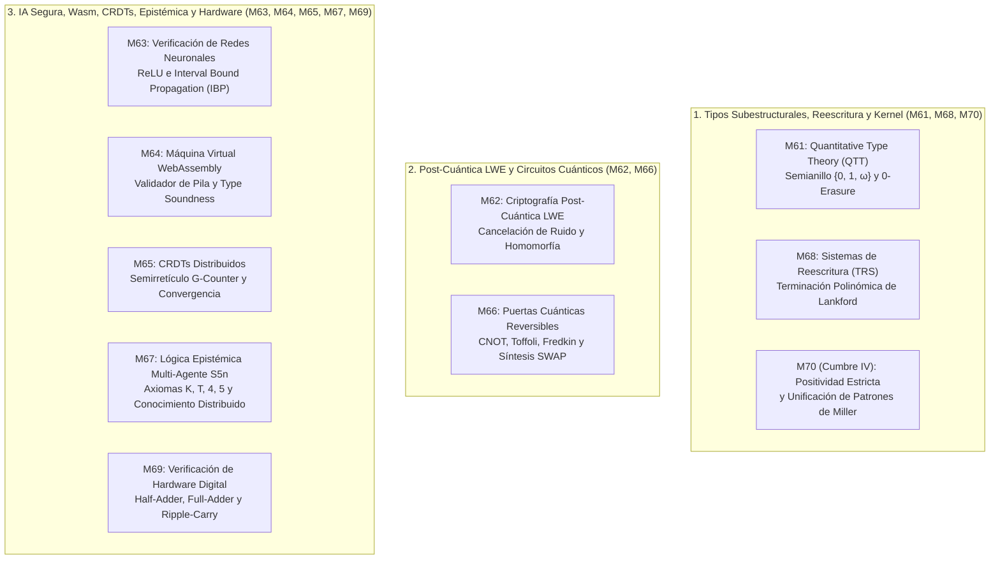

# Monografía 22: Teoría de Tipos Cuantitativa (QTT), Criptografía Post-Cuántica (LWE), IA Segura (ReLU/IBP), WebAssembly, CRDTs, Computación Reversible, Lógica Epistémica, TRS, Hardware y Positividad Estricta (`M61`–`M70`)

> **Archivos Lean 4 ejecutables asociados:** [`M61`](../LeanTT/M61_QuantitativeTypeTheoryQTT.lean) a [`M70`](../LeanTT/M70_PatternUnificationAndStrictPositivity.lean) y el [**Taller 05 (`E05` / `S05`)**](../LeanTT/Exercises/E05_WorkoutQTTPostQuantumAndHardware.lean).

Esta monografía documenta los fundamentos matemáticos y algorítmicos del bloque **`M61`–`M70`**, que eleva el proyecto hasta **70 módulos ejecutables** y **5 talleres prácticos**, completando además la **Tetralogía de Arquitectura Interna de Lean 4 (`M40` + `M50` + `M60` + `M70`)**.

---

## Mapa Conceptual del Bloque `M61`–`M70`

---

## 1. Teoría de Tipos Cuantitativa QTT (`M61`), Reescritura Polinómica (`M68`) y el Cuarto Proyecto Cumbre (`M70`)

### 1.1 Semianillo de Multiplicidades $\{0, 1, \omega\}$ en QTT ([`M61`](../LeanTT/M61_QuantitativeTypeTheoryQTT.lean))
En la **Teoría de Tipos Cuantitativa (QTT)** de Atkey y McBride (base de **Idris 2**), las anotaciones de uso $\pi \in \{0, 1, \omega\}$ forman un semianillo conmutativo donde $1 + 1 = \omega$ y $0 \cdot \pi = 0$.
En `M61` demostramos las leyes del semianillo y el teorema `scaleCtx_zero_eq_zeroCtx`: cuando una variable lineal $x :_1 A$ se utiliza dentro de un tipo dependiente $B(x)$ (cuya formación está escalada por la multiplicidad $0$), el consumo en tiempo de ejecución de $x$ es $0 \cdot 1 = 0$, permitiendo que los tipos dependan de recursos lineales sin consumirlos.

### 1.2 Terminación de Sistemas de Reescritura por Interpretaciones Polinómicas ([`M68`](../LeanTT/M68_TermRewritingSystemsAndTermination.lean))
La regla distributiva $a \cdot (b + c) \longrightarrow (a \cdot b) + (a \cdot c)$ incrementa el número de nodos sintácticos del árbol, por lo que una inducción ingenua sobre el tamaño falla. Mediante la interpretación polinómica de **Dallas Lankford (1979)**:
$$\llbracket x_i \rrbracket = 2, \qquad \llbracket A + B \rrbracket = \llbracket A \rrbracket + \llbracket B \rrbracket + 1, \qquad \llbracket A \cdot B \rrbracket = \llbracket A \rrbracket \cdot \llbracket B \rrbracket$$
demostramos en `M68` (`polyNorm_distrib_left_strict_decrease` y `polyNorm_distrib_right_strict_decrease`) que toda aplicación de la regla distributiva disminuye estrictamente la norma natural $\llbracket \cdot \rrbracket \ge 2$.

### 1.3 Cuarto Proyecto Cumbre: Positividad Estricta y Unificación de Miller ([`M70`](../LeanTT/M70_PatternUnificationAndStrictPositivity.lean))
En `M70` cerramos la arquitectura del verificador y elaborador de Lean 4 verificando:
1. **`isStrictlyPositive`:** El filtro del kernel que garantiza que en cada constructor de un tipo inductivo $I$, el tipo $I$ jamás aparezca a la izquierda de una flecha (`.arrow dom cod` exige `!occurs I dom`), bloqueando la paradoja de Curry (`kernel_rejects_negative_occurrence`).
2. **`miller_pattern_unification_sound`:** El teorema de corrección del algoritmo de abstracción para el fragmento de patrones de orden superior de Dale Miller ($?m(x) \doteq rhs \implies ?m := \lambda z.\, rhs[z/x]$).

---

## 2. Criptografía Post-Cuántica LWE (`M62`) y Puertas Cuánticas Reversibles (`M66`)

### 2.1 *Learning With Errors* (LWE) con Ruido Acotado ([`M62`](../LeanTT/M62_PostQuantumLatticeCryptoLWE.lean))
En el esquema de Regev (base de **ML-KEM / Kyber**), un bit $m \in \{0, 1\}$ se cifra como $c = a \cdot s + e + m \cdot (2K)$ con ruido $|e| < K$. Demostramos (`lwe_decrypt_correct`) que al desenmascarar $v = c - a \cdot s = e + m \cdot (2K)$, la desigualdad $-K < e < K$ separa disjuntamente las regiones $v < K$ (cuando $m = 0$) y $v \ge K$ (cuando $m = 1$), garantizando desencriptado exacto, además de la propiedad homomórfica aditiva (`lweUnmask_homomorphic_add`).

### 2.2 Puertas Cuánticas Reversibles y Síntesis de `SWAP` ([`M66`](../LeanTT/M66_ReversibleAndQuantumGateLogic.lean))
Demostramos que `cnot12`, `toffoli` (`CCNOT`) y `fredkin` (`CSWAP`) son involuciones reversibles, que la puerta de Fredkin conserva el peso de Hamming (`fredkin_preserves_hammingWeight`) y que tres puertas `CNOT` alternadas sintetizan exactamente una puerta `SWAP` de 2 qubits (`three_cnots_eq_swap2`).

---

## 3. IA Segura (`M63`), WebAssembly (`M64`), CRDTs (`M65`), Lógica Epistémica (`M67`) y Hardware (`M69`)

* **Propagación de Intervalos en Redes Neuronales ([`M63`](../LeanTT/M63_VerifiedNeuralNetworkReLURobustness.lean)):** Demostramos la monotonía e idempotencia de $\text{ReLU}(x) = \max(0, x)$ y la solidez formal de *Interval Bound Propagation* (`reluIBP_sound` y `residual_bias_relu_ibp_sound`) para certificar robustez frente a perturbaciones en $[l, u]$.
* **Seguridad de Tipos de WebAssembly ([`M64`](../LeanTT/M64_WebAssemblyStackTypeValidator.lean)):** Demostramos `wasm_instr_type_soundness` (Progreso + Preservación): toda instrucción aprobada por el validador estático de pila `typecheckInstr` se ejecuta sin *stack underflow* y preserva `TypedStack`.
* **Convergencia Eventual Fuerte en CRDTs ([`M65`](../LeanTT/M65_ConflictFreeReplicatedDataTypesCRDT.lean)):** Demostramos que la operación `merge` componente a componente ($\max$) de un `GCounter3` forma un semirretículo de unión conmutativo, asociativo e idempotente, convergiendo al mismo estado frente a duplicados y reordenaciones (`strong_eventual_convergence_with_duplicates`).
* **Lógica Epistémica Multi-Agente $S5_n$ ([`M67`](../LeanTT/M67_MultiAgentEpistemicLogicS5.lean)):** Demostramos los axiomas epistémicos $K$ (distribución), $T$ (veracidad: $K_a \varphi \to \varphi$), $4$ (introspección positiva: $K_a \varphi \to K_a K_a \varphi$) y $5$ (introspección negativa: $\neg K_a \varphi \to K_a \neg K_a \varphi$), así como la cadena $E \varphi \to K_a \varphi \to D \varphi$.
* **Verificación de Sumadores de Hardware Digital ([`M69`](../LeanTT/M69_VerifiedHardwareAdderAndALU.lean)):** Demostramos la corrección aritmética a nivel de puertas booleanas del *Half-Adder*, del *Full-Adder* (`fullAdder_correct`) y del sumador en cascada *Ripple-Carry* (`rippleAdder2_correct`).
