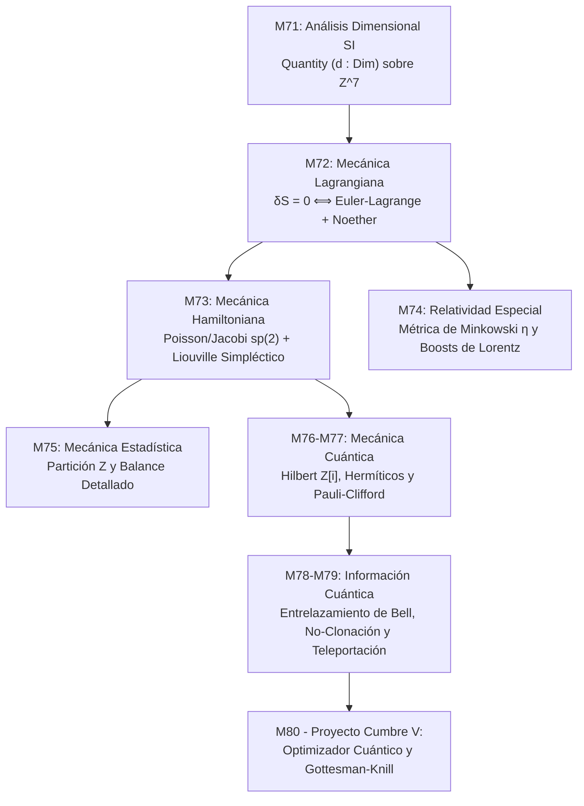

# Módulo 23: Física Matemática, Mecánica Lagrangiana/Hamiltoniana, Relatividad Especial y Computación Cuántica en Lean 4 (`M71`–`M80`)

> **Archivos Lean 4 ejecutables asociados:**
> * **Física Clásica, Relatividad y Estadística:** [`M71_DimensionalAnalysisAndSIUnits.lean`](../LeanTT/M71_DimensionalAnalysisAndSIUnits.lean), [`M72_LagrangianMechanicsAndEulerLagrange.lean`](../LeanTT/M72_LagrangianMechanicsAndEulerLagrange.lean), [`M73_HamiltonianMechanicsAndPoissonBrackets.lean`](../LeanTT/M73_HamiltonianMechanicsAndPoissonBrackets.lean), [`M74_SpecialRelativityAndMinkowskiMetric.lean`](../LeanTT/M74_SpecialRelativityAndMinkowskiMetric.lean), [`M75_StatisticalMechanicsAndEntropy.lean`](../LeanTT/M75_StatisticalMechanicsAndEntropy.lean).
> * **Mecánica Cuántica, Información Cuántica y Proyecto Cumbre V:** [`M76_QuantumHilbertSpacesAndBraKet.lean`](../LeanTT/M76_QuantumHilbertSpacesAndBraKet.lean), [`M77_PauliCliffordAlgebraAndUnitarity.lean`](../LeanTT/M77_PauliCliffordAlgebraAndUnitarity.lean), [`M78_QuantumEntanglementAndBellStates.lean`](../LeanTT/M78_QuantumEntanglementAndBellStates.lean), [`M79_NoCloningTeleportationAndDeutschJozsa.lean`](../LeanTT/M79_NoCloningTeleportationAndDeutschJozsa.lean), [`M80_VerifiedQuantumCircuitCompilerAndStabilizers.lean`](../LeanTT/M80_VerifiedQuantumCircuitCompilerAndStabilizers.lean).
> * **Taller Práctico 06:** [`E06_WorkoutPhysicsAndQuantumMechanics.lean`](../LeanTT/Exercises/E06_WorkoutPhysicsAndQuantumMechanics.lean) y [`S06_WorkoutPhysicsAndQuantumMechanics.lean`](../LeanTT/Solutions/S06_WorkoutPhysicsAndQuantumMechanics.lean).
> * **Mini-Curso Paso a Paso Asociado:** [**Mini-Curso IV — Física Matemática y Cuántica en Lean 4 (`docs/curso_fisica_matematica_lean4/`)**](curso_fisica_matematica_lean4/00_indice_minicurso_fisica_lean4.md).

---

## Índice de la Monografía
1. [El Sexto Problema de Hilbert Hoy: Física Formalizada en Lean 4 (`PhysLean` y `SciLean`)](#1-el-sexto-problema-de-hilbert-hoy-física-formalizada-en-lean-4-physlean-y-scilean)
2. [Análisis Dimensional Dependiente ($\mathbb{Z}^7$ SI) y Seguridad Estática de Unidades (`M71`)](#2-análisis-dimensional-dependiente-mathbbz7-si-y-seguridad-estática-de-unidades-m71)
3. [Principio de Mínima Acción de Hamilton, Euler-Lagrange y Teorema de Noether (`M72`)](#3-principio-de-mínima-acción-de-hamilton-euler-lagrange-y-teorema-de-noether-m72)
4. [Geometría Simpléctica, Álgebra de Lie-Poisson e Integradores de Liouville-Verlet (`M73`)](#4-geometría-simpléctica-álgebra-de-lie-poisson-e-integradores-de-liouville-verlet-m73)
5. [Relatividad Especial de Minkowski $\mathbb{R}^{1,3}$, Grupo de Lorentz y Cono de Luz (`M74`)](#5-relatividad-especial-de-minkowski-mathbbr13-grupo-de-lorentz-y-cono-de-luz-m74)
6. [Mecánica Estadística, Función de Partición y Balance Detallado de Boltzmann (`M75`)](#6-mecánica-estadística-función-de-partición-y-balance-detallado-de-boltzmann-m75)
7. [Espacios de Hilbert Cuánticos, Bra-Ket, Observables Hermíticos y Pauli-Clifford (`M76`–`M77`)](#7-espacios-de-hilbert-cuánticos-bra-ket-observables-hermíticos-y-pauli-clifford-m76m77)
8. [Entrelazamiento de Bell, No-Clonación, Teleportación Cuántica y Deutsch (`M78`–`M79`)](#8-entrelazamiento-de-bell-no-clonación-teleportación-cuántica-y-deutsch-m78m79)
9. [Proyecto Cumbre V (`M80`): Compilador de Circuitos Cuánticos y Teorema de Gottesman-Knill](#9-proyecto-cumbre-v-m80-compilador-de-circuitos-cuánticos-y-teorema-de-gottesman-knill)

---

## 1. El Sexto Problema de Hilbert Hoy: Física Formalizada en Lean 4 (`PhysLean` y `SciLean`)

En el Congreso Internacional de Matemáticos de París de **1900**, **David Hilbert** enunció su célebre **Sexto Problema**: *axiomatizar rigurosamente aquellas disciplinas de la física en las que la matemática desempeña ya un papel preponderante, en primer lugar la teoría de probabilidades y la mecánica*.

Más de un siglo después, la **Teoría de Tipos Dependientes en Lean 4** ha convertido el programa de Hilbert en una disciplina computacional viva a través de tres grandes ecosistemas:
* **[PhysLean (anteriormente HepLean)](https://github.com/HEPLean/PhysLean):** Librería abierta en Lean 4 dedicada a formalizar la cinemática relativista (grupo de Lorentz y álgebra de tensores de Minkowski), el Modelo Estándar de física de partículas (cancelación de anomalías gauge $U(1) \times SU(2) \times SU(3)$), mecánica clásica y electromagnetismo.
* **[SciLean](https://github.com/lecopivo/SciLean):** Computación científica y simulación física diferenciable en Lean 4, donde las ecuaciones variacionales y hamiltonianas se transforman simbólicamente con garantías formales.
* **Compilación Cuántica Verificada (estilo VOQC / SQIR):** Uso de asistentes de pruebas para certificar que las pasadas de optimización de puertas cuánticas preservan exactamente la matriz unitaria denotada y los cuadros estabilizadores.



---

## 2. Análisis Dimensional Dependiente ($\mathbb{Z}^7$ SI) y Seguridad Estática de Unidades (`M71`)

En 1999 la sonda *Mars Climate Orbiter* de la NASA se desintegró en la atmósfera marciana porque un módulo de software emitía impulsos en `lbf · s` mientras otro leía `N · s` como simples `Float`. En [`LeanTT/M71_DimensionalAnalysisAndSIUnits.lean`](../LeanTT/M71_DimensionalAnalysisAndSIUnits.lean) indexamos cada magnitud por su exponente en el grupo abeliano $\mathbb{Z}^7$ del SI (`L, M, T, I, Θ, N, J`):

```lean
namespace DemoFisicaSI

structure Dim where
  L : Int := 0
  M : Int := 0
  T : Int := 0
  deriving Repr, DecidableEq

def Dim.mul (d1 d2 : Dim) : Dim := ⟨d1.L + d2.L, d1.M + d2.M, d1.T + d2.T⟩
def Dim.inv (d : Dim) : Dim     := ⟨-d.L, -d.M, -d.T⟩

def Length   : Dim := { L := 1 }
def Mass     : Dim := { M := 1 }
def Time     : Dim := { T := 1 }
def Velocity : Dim := Dim.mul Length (Dim.inv Time)
def Force    : Dim := { L := 1, M := 1, T := -2 }
def Energy   : Dim := Dim.mul Force Length

structure Quantity (d : Dim) where
  val : Int
  deriving Repr, DecidableEq

-- Suma SOLO permitida para la misma dimensión `d`:
def qadd {d : Dim} (x y : Quantity d) : Quantity d := ⟨x.val + y.val⟩

-- Producto dependiente: suma los exponentes dimensionales en el tipo!
def qmul {d1 d2 : Dim} (x : Quantity d1) (y : Quantity d2) : Quantity (Dim.mul d1 d2) :=
  ⟨x.val * y.val⟩

theorem mv2_tiene_dimension_energia :
    Dim.mul Mass (Dim.mul Velocity Velocity) = Energy := by
  decide

#eval qmul (⟨15⟩ : Quantity Force) (⟨4⟩ : Quantity Length) -- 60 Julios : Quantity Energy

end DemoFisicaSI
```

---

## 3. Principio de Mínima Acción de Hamilton, Euler-Lagrange y Teorema de Noether (`M72`)

En [`LeanTT/M72_LagrangianMechanicsAndEulerLagrange.lean`](../LeanTT/M72_LagrangianMechanicsAndEulerLagrange.lean) modelamos la mecánica variacional discreta de Marsden-West: dada una acción de dos pasos $S(q_0, q_1, q_2) = L_d(q_0, q_1) + L_d(q_1, q_2)$ con extremos fijos ($\delta q_0 = \delta q_2 = 0$), demostramos:
1. **Principio de Hamilton (`stationary_action_iff_euler_lagrange`):** $\forall \delta q_1,\, \delta S = 0 \iff D_2 L_d(q_0, q_1) + D_1 L_d(q_1, q_2) = 0$.
2. **Teorema de Emmy Noether (`noether_momentum_conservation`):** si $L_d$ es invariante bajo traslaciones espaciales ($D_1 L_d + D_2 L_d = 0$), el momento canónico $p^+ = D_2 L_d$ permanece constante a lo largo de toda trayectoria física:

```lean
namespace DemoNoether

structure LagDiscreto where
  d1 : Int → Int → Int
  d2 : Int → Int → Int

def SimetriaTraslacion (sys : LagDiscreto) : Prop :=
  ∀ qa qb : Int, sys.d1 qa qb + sys.d2 qa qb = 0

def EulerLagrange (sys : LagDiscreto) (q0 q1 q2 : Int) : Prop :=
  sys.d2 q0 q1 + sys.d1 q1 q2 = 0

-- Teorema de Noether en 4 líneas de Lean 4:
theorem teorema_noether {sys : LagDiscreto} (hSym : SimetriaTraslacion sys)
    {q0 q1 q2 : Int} (hEL : EulerLagrange sys q0 q1 q2) :
    sys.d2 q0 q1 = sys.d2 q1 q2 := by
  have hLoc := hSym q1 q2
  dsimp [EulerLagrange] at hEL
  omega

end DemoNoether
```

---

## 4. Geometría Simpléctica, Álgebra de Lie-Poisson e Integradores de Liouville-Verlet (`M73`)

En [`LeanTT/M73_HamiltonianMechanicsAndPoissonBrackets.lean`](../LeanTT/M73_HamiltonianMechanicsAndPoissonBrackets.lean) verificamos:
* La **2-forma simpléctica** $\omega(u, v) = u_q v_p - u_p v_q$, la conservación autónoma $\{H, H\} = 0$ y la **Identidad de Jacobi completa** (`sp2_jacobi_identity`) para los generadores lineales hamiltonianos de $\mathfrak{sp}(2, \mathbb{Z})$.
* Por qué en mecánica celeste y dinámica molecular se usan **integradores simplécticos** (`symplecticEulerLinear` y `leapfrogStep` / Störmer-Verlet): demostramos formalmente el **Teorema de Liouville Discreto** ($\omega(\Phi(u), \Phi(v)) = \omega(u, v)$) y la **reversibilidad temporal exacta** de Leapfrog (`leapfrog_time_reversible`).

---

## 5. Relatividad Especial de Minkowski $\mathbb{R}^{1,3}$, Grupo de Lorentz y Cono de Luz (`M74`)

En [`LeanTT/M74_SpecialRelativityAndMinkowskiMetric.lean`](../LeanTT/M74_SpecialRelativityAndMinkowskiMetric.lean) formalizamos el espacio-tiempo de Minkowski con métrica $\eta(u, v) = u_t v_t - u_x v_x - u_y v_y - u_z v_z$ y *boosts* hiperbólicos exactos ($\gamma_s^2 - \pi_s^2 = s^2$):
* **`boostX_preserves_minkowskiDot`:** invariancia del producto escalar tetradimensional $\eta(\Lambda u, \Lambda v) = s^2 \eta(u, v)$.
* **`boostX_preserves_lightcone`:** todo fotón ($\eta(u, u) = 0$) permanece en el cono de luz en cualquier sistema de referencia inercial.
* **`einstein_energy_momentum_invariant`:** relación relativista $E^2 - p^2 = m_0^2$.
* **`subluminal_velocity_addition`:** composición de dos velocidades sublumínicas $|u| < c, |v| < c \implies |u \oplus_c v| < c$ mediante la identidad algebraica $(c \mp u)(c \mp v) > 0$.

---

## 6. Mecánica Estadística, Función de Partición y Balance Detallado de Boltzmann (`M75`)

En [`LeanTT/M75_StatisticalMechanicsAndEntropy.lean`](../LeanTT/M75_StatisticalMechanicsAndEntropy.lean) conectamos la dinámica microscópica con el equilibrio macroscópico:
* **`ground_state_energy_bound`:** para cualquier distribución de pesos de Boltzmann no negativos, la energía térmica media verifica $\langle E \rangle \ge E_0$.
* **`detailedBalance_implies_stationary`:** si las tasas de transición cumplen $w_1 t_{12} = w_2 t_{21}$ (condición de Metropolis-Hastings / Glauber), la distribución $(w_1, w_2)$ es un estado de equilibrio estacionario exacto de la ecuación maestra, con contracción monótona del desequilibrio (`symmetric_bath_imbalance_contraction`).

---

## 7. Espacios de Hilbert Cuánticos, Bra-Ket, Observables Hermíticos y Pauli-Clifford (`M76`–`M77`)

Usando el anillo exacto de enteros de Gauss $\mathbb{Z}[i]$ (`Cplx`), en [`M76`](../LeanTT/M76_QuantumHilbertSpacesAndBraKet.lean) y [`M77`](../LeanTT/M77_PauliCliffordAlgebraAndUnitarity.lean) demostramos sin errores de redondeo:
* **Identidad de Brahmagupta-Fibonacci** ($|z w|^2 = |z|^2 |w|^2$), **simetría conjugada** $\langle\psi\mid\phi\rangle = \langle\phi\mid\psi\rangle^*$ y **realidad estricta de valores esperados hermíticos** (`hermitian_expectation_is_real`: $A^\dagger = A \implies \text{Im}\langle\psi\mid A\psi\rangle = 0$).
* Álgebra de espín de Pauli ($X Y = i Z$, $\{X, Z\} = 0$), conjugación de Clifford ($\tilde{H} X \tilde{H} = 2 Z$, $S X S^\dagger = Y$) y **preservación unitaria del producto interno** (`scaledUnitary_preserves_braket`).

---

## 8. Entrelazamiento de Bell, No-Clonación, Teleportación Cuántica y Deutsch (`M78`–`M79`)

En [`M78`](../LeanTT/M78_QuantumEntanglementAndBellStates.lean) y [`M79`](../LeanTT/M79_NoCloningTeleportationAndDeutschJozsa.lean) demostramos cuatro pilares de la Información Cuántica:
1. **`all_bell_states_entangled`:** el invariante de Segre-Schmidt $\Delta(\Psi) = c_{00} c_{11} - c_{01} c_{10}$ se anula en todo producto tensorial $\lvert u\rangle \otimes \lvert v\rangle$, pero vale $\pm 1 \neq 0$ en $\lvert\Phi^\pm\rangle, \lvert\Psi^\pm\rangle$, probando constructivamente la imposibilidad de variables locales factorizables!
2. **`no_cloning_theorem`:** clonar unitariamente $\lvert\psi\rangle$ y $\lvert\phi\rangle$ exige $\langle\psi\mid\phi\rangle^2 = \langle\psi\mid\phi\rangle$, forzando $\langle\psi\mid\phi\rangle \in \{0, 1\}$.
3. **`teleportation_exact_recovery`:** verificación simbólica en $\mathbb{C}^8$ de las 4 ramas de medida del protocolo de Bennett et al. (1993).
4. **`deutsch_single_query_decides`:** interferencia cuántica y *phase kickback* para decidir en 1 consulta si $f : \text{Bool} \to \text{Bool}$ es constante o balanceada.

---

## 9. Proyecto Cumbre V (`M80`): Compilador de Circuitos Cuánticos y Teorema de Gottesman-Knill

En [`LeanTT/M80_VerifiedQuantumCircuitCompilerAndStabilizers.lean`](../LeanTT/M80_VerifiedQuantumCircuitCompilerAndStabilizers.lean) integramos toda la línea cuántica en dos motores certificados:
1. **Optimizador de Circuitos Cuánticos (`optimize1`):** cancela pares involutivos ($XX, YY, ZZ \to I$), inversos adjuntos ($S S^\dagger, S^\dagger S \to I$) y fusiona fases ($S S \to Z$), con prueba formal de equivalencia unitaria (`denoteCircuit1_optimize1`) y no-crecimiento de profundidad (`length_optimize1_le`), más síntesis exacta de `CZ` con `CNOT` y Hadamard (`cz_from_cnot_and_hadamard`).
2. **Simulador Estabilizador de Gottesman-Knill (`conjugatePauliSymbolic`):** propaga operadores de Pauli con signo $\pm\{I, X, Y, Z\}$ en tiempo constante $O(1)$ bajo generadores de Clifford $\{H, S, X, Z\}$ y certifica mediante `gottesman_knill_step_sound` que la actualización simbólica reproduce idénticamente el producto matricial cuántico $C P C^\dagger$.
