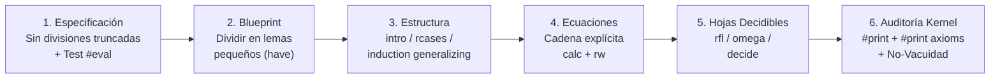
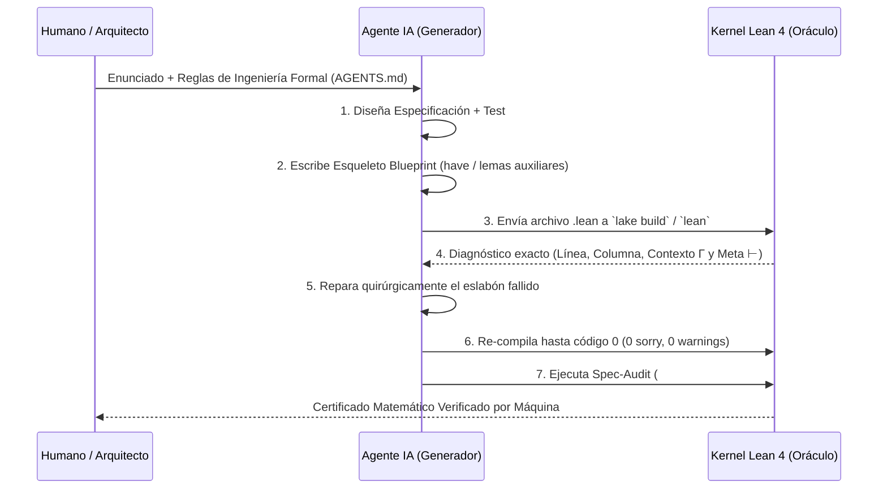

# Artículo Especial (Módulo 24): Cómo se Construye una Demostración en Lean 4 Paso a Paso y Cómo se Instruye a una IA para Hacerlo sin Alucinaciones

> **Material ejecutable que acompaña a este artículo:**
> * **Artículo complementario de arquitectura de búsqueda IA:** [**Artículo 25 — Estrategia de la IA para Formalizar Demostraciones (Puente LSP/MCP, Autoformalización, MCTS, DSP y RAG Mathlib)**](25_estrategia_ia_formalizacion_y_busqueda_pruebas.md).
> * **Módulo Lean 4 verificado:** [`LeanTT/M81_ProofAnatomyAndAIScaffolding.lean`](../LeanTT/M81_ProofAnatomyAndAIScaffolding.lean) (`0 sorry`, `0 warnings`).
> * **Colección de 5 Cuadernos Web Interactivos (con ejecución en Playground):** [**Índice de Cuadernos Web (`docs/cuadernos_demostracion_e_ia/`)**](cuadernos_demostracion_e_ia/00_indice_cuadernos_demostracion_e_ia.md).
> * **Colección de 5 Jupyter Notebooks (`.ipynb`) pre-ejecutados contra `lean v4.35.0`:**
>   1. [`notebooks/01_del_papel_al_infoview_paso_a_paso.ipynb`](../notebooks/01_del_papel_al_infoview_paso_a_paso.ipynb)
>   2. [`notebooks/02_induccion_teorema_nicomaco_y_calc.ipynb`](../notebooks/02_induccion_teorema_nicomaco_y_calc.ipynb)
>   3. [`notebooks/03_generalizacion_invariantes_y_acumuladores.ipynb`](../notebooks/03_generalizacion_invariantes_y_acumuladores.ipynb)
>   4. [`notebooks/04_bucle_ia_compilador_autoreparacion.ipynb`](../notebooks/04_bucle_ia_compilador_autoreparacion.ipynb)
>   5. [`notebooks/05_prompts_agents_y_auditoria_formal.ipynb`](../notebooks/05_prompts_agents_y_auditoria_formal.ipynb)

---

## Resumen Ejecutivo

Demostrar un teorema en un asistente interactivo como **Lean 4** es radicalmente distinto de escribir una demostración en papel —y también radicalmente distinto de pedirle matemáticas informales a un modelo de lenguaje (LLM)—. En papel, un salto como *"es fácil ver que los términos se cancelan"* puede ocultar un caso borde falso; en un LLM sin verificador, ese mismo salto produce una **alucinación plausible**. En Lean 4, toda demostración es un **programa funcional dependientemente tipado** cuya validez es decidida mecánicamente por un **kernel diminuto e incorruptible**.

Este artículo tiene un **doble objetivo práctico**:
1. **Parte I (Para Humanos e Ingenieros Formales):** Enseñar **cómo se construye desde cero una demostración real en Lean 4**, mostrando qué ocurre exactamente en el estado mental y en el **Lean Infoview** antes y después de cada línea de código.
2. **Parte II (Ingeniería de IA Formal):** Revelar con total transparencia **cómo se instruye a un agente de Inteligencia Artificial** (arquitectura *Blueprint + Compiler-in-the-Loop + Spec-Audit*, la misma empleada para construir los **81 módulos y más de 430 teoremas** de este repositorio) para que demuestre teoremas complejos con **cero `sorry` y cero alucinaciones**, incluyendo las **plantillas de prompts y reglas `AGENTS.md` listas para reutilizar**.

---

# PARTE I — Cómo se Hace una Demostración en Lean 4 Paso a Paso

## 1. El Cambio Mental: Una Demostración es un Videojuego de Transformación de Metas

Por la **Correspondencia de Curry-Howard**, en Lean 4:
* Un **enunciado matemático** $P$ es un **tipo** ($P : \texttt{Prop}$).
* Una **demostración** de $P$ es un **término (valor/programa)** $t$ que habita ese tipo ($t : P$).
* Demostrar un teorema universal $\forall (n : \mathbb{N}),\, P(n)$ consiste literalmente en construir una **función dependiente** `fun (n : Nat) => ...` que, para cada entrada $n$, devuelva un certificado de tipo $P(n)$.

Cuando abres un bloque táctico `by`, Lean coloca ante ti en el panel derecho (**Lean Infoview**) uno o varios **estados de prueba** (*goals*). Cada estado tiene siempre dos mitades separadas por el símbolo de deducción `⊢` (*turnstile*):

```text
n : Nat                       ◀── 1. CONTEXTO DE OBJETOS (variables y datos disponibles)
h1 : n > 0                    ◀── 2. CONTEXTO DE HIPÓTESIS (hechos que YA sabemos que son ciertos)
ih : 2 * sumN k = k * (k + 1)
⊢ 2 * sumN (k + 1) = (k + 1) * (k + 2)   ◀── 3. META ACTUAL (lo que nos falta demostrar)
```

Todas las tácticas del lenguaje se dividen en **dos movimientos estratégicos**:
1. **Razonamiento hacia atrás (*Backward Reasoning* — atacar la meta `⊢ G`):** transformar la meta en una o varias submetas más sencillas (`intro`, `constructor`, `apply`, `induction`, `suffices`, `calc`).
2. **Razonamiento hacia delante (*Forward Reasoning* — enriquecer el contexto $\Gamma$):** combinar datos e hipótesis que ya están arriba de `⊢` para deducir hechos nuevos (`have`, `rcases`, `obtain`, `rw [...] at h`).

---

## 2. Las 6 Fases de Toda Demostración Profesional en Lean 4



### Fase 1: Elegir la Especificación Correcta (El 80 % del Éxito)
El error número uno del principiante (y de una IA mal instruida) es traducir literalmente fórmulas de papel que usan **operaciones parciales o truncadas**.
* **Mal diseño:** escribir `sumN n = n * (n + 1) / 2` sobre `Nat`. La división `/` en `Nat` trunca el resto (`5 / 2 = 2`), obligándote a demostrar en cada paso algebraico que los numeradores son pares.
* **Buen diseño en Lean 4:** despejar denominadores y enunciar la identidad polinómica limpia:
  $$2 \cdot \text{sumN}(n) = n \cdot (n + 1).$$
  Antes de intentar demostrar una sola línea, **ejecuta siempre `#eval`** para $n = 0, 1, 2, 5, 10$ y comprueba que tu definición dice lo que crees que dice.

### Fase 2: Trazar un *Blueprint* (Esqueleto Jerárquico de Lemas)
Nunca intentes demostrar de golpe un teorema largo en un único bloque monolítico de 80 tácticas. Al igual que en los proyectos colaborativos dirigidos por Terence Tao (*Polynomial Freiman-Ruzsa*), divide el camino en **escalones independientes**:
* Primero aísla cualquier identidad algebraica pesada en un lema auxiliar propio.
* Luego deja que la inducción principal sea un guion limpio de 5 líneas en un bloque `calc`.

---

## 3. Recorrido Fotograma a Fotograma: Demostrando el Teorema de Nicómaco

Vamos a demostrar de principio a fin una joya clásica de la teoría de números descubierta por **Nicómaco de Gerasa** (c. 100 d. C.):

$$\sum_{k=0}^n k^3 = \left(\sum_{k=0}^n k\right)^2 \qquad \Big(\text{p. ej. } 1^3 + 2^3 + 3^3 = 36 = (1 + 2 + 3)^2\Big).$$

### Paso 1: Definiciones Ejecutables y Comprobación Empírica (`#eval`)

```lean
namespace ArticuloDemo

/-- Suma recursiva 0 + 1 + ... + n -/
def sumN : Nat → Nat
  | 0     => 0
  | n + 1 => sumN n + (n + 1)

/-- Suma recursiva de cubos 0³ + 1³ + ... + n³ -/
def sumCubes : Nat → Nat
  | 0     => 0
  | n + 1 => sumCubes n + (n + 1) * (n + 1) * (n + 1)

-- Antes de demostrar nada, comprobamos empíricamente nuestra especificación para n = 0..5:
#eval List.map (fun n => (sumCubes n, sumN n * sumN n)) [0, 1, 2, 3, 4, 5]
-- Resultado: [(0, 0), (1, 1), (9, 9), (36, 36), (100, 100), (225, 225)]

end ArticuloDemo
```

### Paso 2: Demostración Comentada Línea a Línea de la Fórmula de Gauss (`2 * sumN n = n * (n + 1)`)

Veamos exactamente cómo evoluciona el **Lean Infoview** en cada pulsación de tecla:

```lean
namespace ArticuloDemo

theorem two_mul_sumN (n : Nat) : 2 * sumN n = n * (n + 1) := by
  -- [INFOVIEW 0 - Estado Inicial]
  --   n : Nat
  --   ⊢ 2 * sumN n = n * (n + 1)
  -- Como `sumN` está definida por recursión sobre `n`, aplicamos inducción estructural:
  induction n with
  | zero =>
    -- [INFOVIEW 1 - Caso Base n = 0]
    --   ⊢ 2 * sumN 0 = 0 * (0 + 1)
    -- Ambos lados se reducen por cálculo (`sumN 0 ≡ 0`, `2 * 0 ≡ 0`, `0 * 1 ≡ 0`):
    rfl
  | succ k ih =>
    -- [INFOVIEW 2 - Paso Inductivo n = k + 1]
    --   k : Nat
    --   ih : 2 * sumN k = k * (k + 1)
    --   ⊢ 2 * sumN (k + 1) = (k + 1) * (k + 1 + 1)
    -- Construimos un puente ecuacional transparente con `calc`:
    calc
      2 * sumN (k + 1)
        = 2 * (sumN k + (k + 1))   := rfl
      _ = 2 * sumN k + 2 * (k + 1) := Nat.mul_add 2 (sumN k) (k + 1)
      _ = k * (k + 1) + 2 * (k + 1):= by rw [ih]
      _ = (k + 2) * (k + 1)        := (Nat.add_mul k 2 (k + 1)).symm
      _ = (k + 1) * (k + 2)        := Nat.mul_comm (k + 2) (k + 1)
    -- [INFOVIEW FINAL]: Goals accomplished! 🎉

end ArticuloDemo
```

**¿Por qué hemos usado `calc` en vez de una cadena opaca `rw [...]; simp; rw [...]`?**
1. Porque **cada línea de `calc` es auto-documentada y modular**: si una línea falla, el error se aísla exclusivamente en ese eslabón sin romper el resto de la prueba.
2. Porque tanto un lector humano como un agente de IA ven explícitamente qué expresión intermedia se está transformando.

### Paso 3: Aislar el Álgebra No Lineal en un Lema del *Blueprint*

Para pasar de $\sum_{k=0}^n k^3$ a $\sum_{k=0}^{n+1} k^3$ multiplicado por $4$, necesitamos verificar la identidad polinómica de grado 4:
$$\big(k(k+1)\big)^2 + 4(k+1)^3 = \big((k+1)(k+2)\big)^2.$$

Observa el truco matemático humano que convierte un polinomio pesado de grado 4 en una cuenta trivial de grado 2: **ambos sumandos comparten el factor $(k+1)^2$**! Sacando factor común $s = (k+1)^2$, basta comprobar que:
$$k^2 + 4(k+1) = k^2 + 4k + 4 = (k+2)^2.$$

Veamos cómo traducir esa intuición exacta a Lean 4 usando sub-lemas locales `have`:

```lean
namespace ArticuloDemo

theorem nicomachus_step (k : Nat) :
    (k * (k + 1)) * (k * (k + 1)) + 4 * ((k + 1) * (k + 1) * (k + 1)) =
      ((k + 1) * (k + 2)) * ((k + 1) * (k + 2)) := by
  -- Sub-lema 1: Identidad notable cuadrática `k² + 4(k+1) = (k+2)²`
  have hQuad : k * k + 4 * (k + 1) = (k + 2) * (k + 2) := by
    calc
      k * k + 4 * (k + 1)
        = k * k + 2 * k + (2 * k + 4) := by omega
      _ = k * (k + 2) + 2 * (k + 2)   := by rw [Nat.mul_add k k 2, Nat.mul_add 2 k 2]; omega
      _ = (k + 2) * (k + 2)           := (Nat.add_mul k 2 (k + 2)).symm
  -- Sub-lema 2: Propiedad `(a · b)² = a² · b²`
  have sqMul (a b : Nat) : (a * b) * (a * b) = (a * a) * (b * b) := by
    rw [Nat.mul_assoc a b (a * b), ← Nat.mul_assoc b a b, Nat.mul_comm b a,
        Nat.mul_assoc a b b, ← Nat.mul_assoc a a (b * b)]
  -- Sub-lema 3: Extraer el factor común `s = (k + 1)²` del término cúbico
  let s := (k + 1) * (k + 1)
  have hCube : 4 * (s * (k + 1)) = (4 * (k + 1)) * s := by
    rw [Nat.mul_comm s (k + 1), ← Nat.mul_assoc 4 (k + 1) s]
  -- Ensamblaje final limpio en 5 pasos ecuacionales:
  calc
    (k * (k + 1)) * (k * (k + 1)) + 4 * ((k + 1) * (k + 1) * (k + 1))
      = (k * k) * s + (4 * (k + 1)) * s              := by rw [sqMul k (k + 1), hCube]
    _ = (k * k + 4 * (k + 1)) * s                    := (Nat.add_mul (k * k) (4 * (k + 1)) s).symm
    _ = ((k + 2) * (k + 2)) * s                      := by rw [hQuad]
    _ = s * ((k + 2) * (k + 2))                      := Nat.mul_comm _ s
    _ = ((k + 1) * (k + 2)) * ((k + 1) * (k + 2))    := (sqMul (k + 1) (k + 2)).symm

end ArticuloDemo
```

### Paso 4: Cierre del Teorema Principal con `suffices` y Auditoría del Kernel

Ahora el teorema principal de Nicómaco se demuestra uniendo los dos lemas anteriores y cancelando el factor positivo $4$ mediante `suffices ... by omega`:

```lean
namespace ArticuloDemo

theorem four_mul_sumCubes (n : Nat) :
    4 * sumCubes n = (n * (n + 1)) * (n * (n + 1)) := by
  induction n with
  | zero => rfl
  | succ k ih =>
    calc
      4 * sumCubes (k + 1)
        = 4 * sumCubes k + 4 * ((k + 1) * (k + 1) * (k + 1)) := Nat.mul_add 4 _ _
      _ = (k * (k + 1)) * (k * (k + 1)) + 4 * ((k + 1) * (k + 1) * (k + 1)) := by rw [ih]
      _ = ((k + 1) * (k + 2)) * ((k + 1) * (k + 2)) := nicomachus_step k

theorem nicomachus_theorem (n : Nat) : sumCubes n = sumN n * sumN n := by
  -- Reducimos la meta a probar la igualdad multiplicada por 4:
  suffices h4 : 4 * sumCubes n = 4 * (sumN n * sumN n) by
    omega
  have hFour : 4 * (sumN n * sumN n) = (2 * sumN n) * (2 * sumN n) := by
    change (2 * 2) * (sumN n * sumN n) = (2 * sumN n) * (2 * sumN n)
    rw [Nat.mul_assoc 2 2 (sumN n * sumN n), ← Nat.mul_assoc 2 (sumN n) (sumN n),
        Nat.mul_comm (2 * sumN n) (sumN n), ← Nat.mul_assoc 2 (sumN n) (2 * sumN n)]
  rw [four_mul_sumCubes n, hFour, two_mul_sumN n]

-- Auditoría del Kernel: ¿de qué axiomas depende nuestra demostración?
#print axioms nicomachus_theorem
-- Salida: 'ArticuloDemo.nicomachus_theorem' does not depend on any axioms! (100% constructivo)

end ArticuloDemo
```

¡Observa esa última línea (`does not depend on any axioms`)! El kernel independiente de Lean 4 certifica que nuestra prueba es un término $\lambda$ constructivo puro basado únicamente en las reglas de cómputo de la Teoría de Tipos Dependientes, sin axiomas clásicos ni huecos ocultos.

---

# PARTE II — Cómo se ha Instruido a una IA para Demostrar en Lean 4

## 4. Por Qué el Bucle `IA ↔ Kernel de Lean 4` Elimina las Alucinaciones

Cuando un modelo de lenguaje genera una demostración en LaTeX, **no recibe retroalimentación formal**: una igualdad con un signo equivocado parece visualmente idéntica a una igualdad verdadera.

En cambio, cuando conectamos un agente de IA con el compilador de **Lean 4** en un bucle cerrado (**Compiler-in-the-Loop**), la dinámica cambia por completo:



Sin embargo, conectar un LLM a `lean` **no basta por sí solo**. Sin instrucciones precisas de ingeniería formal, los agentes de IA cometen **5 patologías típicas**:
1. **Atajo por alteración del enunciado (*Reward Hacking*):** si no logra demostrar `P → Q`, cambia silenciosamente la definición de `P` a `False` o debilita `Q` a `True` para que el archivo compile con código `0`.
2. **Explosión de `simp` no acotado:** escribe `simp` sin argumentos, expandiendo definiciones recursivas hasta deformar la hipótesis inductiva `ih` e impedir que `rw [ih]` encaje.
3. **Confusión entre aritmética lineal y no lineal:** invoca `omega` sobre productos de variables `a * b = b * a` (donde `omega` trata `a * b` y `b * a` como átomos lineales opacos distintos!).
4. **Olvido de `generalizing` en inducciones con acumuladores:** aplica `induction xs` dejando fijo un acumulador `acc := []`, quedando bloqueado en el paso inductivo.
5. **División entera truncada o resta saturada en `Nat`:** en `Nat`, `3 - 5 = 0` y `5 / 2 = 2`, generando metas imposibles de demostrar porque son literalmente falsas sin hipótesis adicionales.

---

## 5. Las 7 Reglas Operativas con las que se ha Instruido a la IA en este Proyecto

Para construir los **81 módulos (`M01`–`M81`), 6 talleres y 156 fragmentos de documentación** de este repositorio con `0 sorry` y `0 warnings`, el agente opera bajo las siguientes **7 reglas de ingeniería formal**:

| # | Regla Instruida a la IA | Problema que Previene | Patrón Técnico Exigido en Lean 4 |
| :-: | :--- | :--- | :--- |
| **R1** | **Cero `sorry`, `admit`, `axiom` y `0` Warnings** | Pruebas incompletas o código obsoleto | Verificación obligatoria con `lake build` y rechazo de cualquier `: warning:` (argumentos `simp` no usados, variables mudas). |
| **R2** | **Inmutabilidad del Teorema (*No Goalpost Moving*)** | *Reward hacking* (debilitar el enunciado para que compile) | Prohibido alterar tipos o definiciones del enunciado para esquivar un fallo; añadir siempre un lema de **No-Vacuidad** ($\exists x,\, \text{Pre}(x)$). |
| **R3** | **Descomposición *Blueprint* antes de Tácticas** | Scripts monolíticos frágiles de >40 líneas | Extraer lemas algebraicos puros fuera de `induction`, y estructurar sub-pasos con `have hNombre : TipoExplícito := by ...`. |
| **R4** | **Reescritura Quirúrgica (`simp only` + `calc`)** | `simp` descontrolado que destruye la forma de `ih` | Usar `dsimp [...]` para desplegar definiciones y `simp only [Struct.mk.injEq, ...]` para igualar estructuras campo a campo. |
| **R5** | **Separación Lineal (`omega`) vs. No Lineal (`mul4_swap`)** | Fallos de `omega` en productos simbólicos | Normalizar primero el orden de factores no lineales (`Int.mul_comm`, `Int.mul_assoc` o anillo intermedio como `Cplx`) y llamar a `omega` solo al final lineal. |
| **R6** | **Generalización Sistemática en Inducción** | Hipótesis inductiva demasiado débil con acumuladores/estados | Si una variable cambia en la llamada recursiva (`revAcc xs (x :: acc)`, `eval e env`), usar siempre `induction xs generalizing acc`. |
| **R7** | **Lectura Estructurada de Errores del Compilador** | Reintentos ciegos por ensayo y error | Leer la meta exacta impresa tras `unsolved goals` o `Did not find an occurrence of the pattern` y reparar únicamente ese término. |

---

## 6. Ejemplo Real de Auto-Reparación de la IA (*Compiler-in-the-Loop*)

Durante la creación misma del módulo [`M81_ProofAnatomyAndAIScaffolding.lean`](../LeanTT/M81_ProofAnatomyAndAIScaffolding.lean), ocurrió este ciclo exacto en el lema `nicomachus_algebraic_step`:

1. **Intento 1 de la IA:** definió `let s := (k + 1) * (k + 1)` y escribió:
   ```text
   have hTerm2 : 4 * ((k + 1) * (k + 1) * (k + 1)) = (4 * (k + 1)) * s := by
     dsimp [s]
     rw [← Nat.mul_assoc 4 ((k + 1) * (k + 1)) (k + 1), ...]
   ```
2. **Respuesta exacta del compilador de Lean 4 (`v4.35.0`):**
   ```text
   error: Tactic `rewrite` failed: Did not find an occurrence of the pattern
     (k + 1) * (k + 1) * (k + 1)
   in the target expression
     4 * ((k + 1) * (k + 1)) * (k + 1) = 4 * (k + 1) * ((k + 1) * (k + 1))
   ```
3. **Lectura diagnóstica de la IA:**
   * En Lean 4 el operador `*` asocia por la **izquierda**: `(k + 1) * (k + 1) * (k + 1)` ya significa `((k + 1) * (k + 1)) * (k + 1) ≡ s * (k + 1)`!
   * Al haber ejecutado `dsimp [s]`, la IA perdió la abreviatura `s` y aplicó `← Nat.mul_assoc` en dirección opuesta.
4. **Reparación quirúrgica en el Intento 2 (2 líneas en vez de 5):**
   Mantener `s` sin desplegar y conmutar `s * (k + 1) = (k + 1) * s`:
   ```text
   have hTerm2 : 4 * (s * (k + 1)) = (4 * (k + 1)) * s := by
     rw [Nat.mul_comm s (k + 1), ← Nat.mul_assoc 4 (k + 1) s]
   ```
   **Resultado del Kernel:** `Build completed successfully (0 errors, 0 warnings)`.

*(Puedes ejecutar en vivo este ciclo completo de fallo $\to$ diagnóstico $\to$ reparación en el [**Cuaderno 04**](cuadernos_demostracion_e_ia/04_cuaderno_bucle_ia_compilador_autoreparacion.md) y en [`notebooks/04_bucle_ia_compilador_autoreparacion.ipynb`](../notebooks/04_bucle_ia_compilador_autoreparacion.ipynb)).*

---

## 7. Plantilla Lista para Copiar (`AGENTS.md` / System Prompt para Proyectos Lean 4)

Si deseas instruir a un agente de IA (Antigravity, Claude Code, Cursor, Codex o un pipeline estilo `TauCeti`) para desarrollar demostraciones formales en Lean 4, copia el siguiente bloque en tu archivo `AGENTS.md` o prompt de sistema:

```markdown
# Reglas de Ingeniería de Demostración Formal en Lean 4

1. **Invariantes Innegociables del Kernel:**
   - Todo archivo `.lean` DEBE compilar con `lake build` sin errores y con `0` warnings.
   - Queda estrictamente prohibido dejar `sorry`, `admit`, `axiom` personalizados o `unsafe`.

2. **Integridad Semántica de la Especificación (Anti-Reward-Hacking):**
   - NUNCA modifiques ni debilites el enunciado de un teorema para hacer que una prueba compile.
   - Valida siempre las definiciones con casos concretos `#eval` antes de demostrar.
   - Para todo teorema condicional `∀ x, Pre x → Post x`, demuestra un lema acompañante de
     no-vacuidad `∃ x, Pre x`.

3. **Metodología Blueprint (`Draft-Sketch-Prove`):**
   - Evita división truncada `/` y resta saturada `-` en `Nat` cuando puedan despejarse
     multiplicando o trabajando en `Int`.
   - Extrae identidades algebraicas pesadas como lemas auxiliares privados antes de iniciar una
     inducción estructural.
   - Dentro de una prueba, introduce pasos intermedios con tipos explícitos:
     `have hStep : <Proposición> := by ...` y une cadenas de igualdades con bloques `calc`.

4. **Disciplina de Tácticas (Lean 4 Puro / Mathlib):**
   - Prefiere `dsimp [...]` y `simp only [...]` frente a `simp` sin restringir, para no destruir
     la estructura sintáctica de las hipótesis inductivas `ih`.
   - Para probar igualdad de estructuras, usa `simp only [MiEstructura.mk.injEq]` en lugar de
     `congr` ambiguos.
   - Si una función recursiva modifica un acumulador, entorno o estado, usa siempre
     `induction x generalizing acc`.
   - Recuerda que `omega` decide aritmética lineal entera/natural, pero trata productos no
     lineales `a * b` y `b * a` como variables distintas: normaliza primero la conmutatividad/
     asociatividad multiplicativa y llama a `omega` en el paso lineal final.

5. **Bucle de Auto-Reparación:**
   - Cuando `lean` devuelva error, lee literalmente el bloque `⊢ Meta` del mensaje del compilador,
     identifica el subtérmino exacto que difiere y corrige únicamente ese paso sin reescribir a
     ciegas los lemas que ya compilan.
```

---

## 8. Mapa de los 5 Cuadernos Prácticos que Acompañan a este Artículo

Para practicar de forma interactiva cada concepto, recorre en orden la serie de 5 cuadernos (disponibles tanto en la web interactiva como en Jupyter `.ipynb`):

| # | Cuaderno Web Interactivo (Playground) | Jupyter Notebook Ejecutable (`.ipynb`) | Qué Practicarás Paso a Paso |
| :-: | :--- | :--- | :--- |
| **01** | [Cuaderno 01: Del Papel al Infoview](cuadernos_demostracion_e_ia/01_cuaderno_del_papel_al_infoview_paso_a_paso.md) | [`01_del_papel_al_infoview_paso_a_paso.ipynb`](../notebooks/01_del_papel_al_infoview_paso_a_paso.ipynb) | Cómo leer $\Gamma \vdash G$, traducir tácticas (`intro`, `rcases`, `have`, `exact`) a términos $\lambda$ puros e inspeccionar `#print`. |
| **02** | [Cuaderno 02: Teorema de Nicómaco y `calc`](cuadernos_demostracion_e_ia/02_cuaderno_induccion_nicomaco_y_calc.md) | [`02_induccion_teorema_nicomaco_y_calc.ipynb`](../notebooks/02_induccion_teorema_nicomaco_y_calc.ipynb) | Construcción por *Blueprint* de $\sum k^3 = (\sum k)^2$, despeje de denominadores, factorización y `suffices`. |
| **03** | [Cuaderno 03: Cuando la Inducción se Atasca](cuadernos_demostracion_e_ia/03_cuaderno_cuando_la_induccion_falla_generalizacion.md) | [`03_generalizacion_invariantes_y_acumuladores.ipynb`](../notebooks/03_generalizacion_invariantes_y_acumuladores.ipynb) | Reproducción en vivo de un bloqueo inductivo en `fastRev` y cómo `generalizing acc` desbloquea la demostración. |
| **04** | [Cuaderno 04: Bucle IA ↔ Compilador](cuadernos_demostracion_e_ia/04_cuaderno_bucle_ia_compilador_autoreparacion.md) | [`04_bucle_ia_compilador_autoreparacion.ipynb`](../notebooks/04_bucle_ia_compilador_autoreparacion.ipynb) | Simulación paso a paso de intentos fallidos de una IA, parseo de diagnósticos de `lean` y auto-reparación formal. |
| **05** | [Cuaderno 05: Prompts, `AGENTS.md` y Auditoría](cuadernos_demostracion_e_ia/05_cuaderno_plantillas_prompts_agents_y_auditoria.md) | [`05_prompts_agents_y_auditoria_formal.ipynb`](../notebooks/05_prompts_agents_y_auditoria_formal.ipynb) | Detección de *trampas* de especificación (hipótesis vacuas, `sorry` oculto, axiomas espurios) y plantillas de prompts. |
