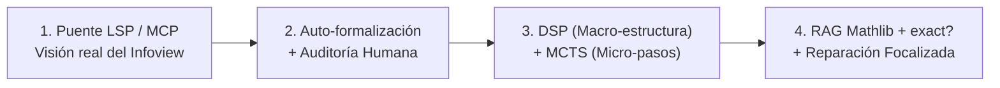

# Artículo 25: Estrategia de la Inteligencia Artificial para Formalizar y Demostrar Hipótesis en Lean 4 (Autoformalización, MCTS, *Draft-Sketch-Prove* y RAG)

> **Documentos y cuadernos relacionados en este repositorio:**
> * **Guía práctica paso a paso y reglas `AGENTS.md`:** [**Artículo 24 — Cómo se Construye una Demostración en Lean 4 Paso a Paso y Cómo se Instruye a una IA**](24_articulo_anatomia_demostracion_lean4_e_ia.md)
> * **Colección de 5 Cuadernos Interactivos (`.md` + `.ipynb`):** [**Índice de Cuadernos Prácticos**](cuadernos_demostracion_e_ia/00_indice_cuadernos_demostracion_e_ia.md)
> * **Módulo Lean 4 asociado:** [`LeanTT/M81_ProofAnatomyAndAIScaffolding.lean`](../LeanTT/M81_ProofAnatomyAndAIScaffolding.lean) y directorio de herramientas en [`docs/13_enlaces_webs_proyectos_y_videos.md`](13_enlaces_webs_proyectos_y_videos.md).

---

## Introducción: Las Dos Piezas Esenciales del Demostrador Automático Moderno

Instruir a una inteligencia artificial para demostrar una hipótesis en **Lean 4** requiere combinar dos piezas fundamentales:
1. **La formalización del enunciado (*Auto-formalization*):** traducir con fidelidad semántica la hipótesis matemática desde lenguaje natural o $\LaTeX$ a código Lean válido.
2. **Un bucle de interacción en tiempo real con el compilador (*Proof Search Loop*):** ningún modelo de lenguaje (LLM) es capaz de escribir de un solo tirón una demostración compleja sin verificar el estado exacto de los tipos y de las submetas en cada paso.

```mermaid
flowchart TD
    In["Hipótesis Matemática<br/>(Lenguaje Natural / LaTeX)"] --> S2["Etapa 2: Auto-formalización<br/>Traducción a firma `theorem ...` en Lean 4"]
    S2 --> Audit{"Revisión Humana /<br/>Auditoría de Trivialidad<br/>(p. ej. evitar x/0 = 0)"}
    Audit -->|Enunciado Fiel| S3{"Etapa 3: Estrategia de<br/>Búsqueda de Prueba"}
    S3 -->| Problemas tácticos / locales | MCTS["Estrategia A:<br/>Tactic-by-Tactic + MCTS<br/>(AlphaProof / DeepSeek-Prover)"]
    S3 -->| Teoremas largos / multi-lema | DSP["Estrategia B:<br/>Draft, Sketch & Prove (DSP)<br/>Esqueleto `have ...` jerárquico"]
    MCTS --> S1["Etapa 1: Puente IA ↔ Lean LSP<br/>(Pantograph / LeanDojo / MCP + lake env lean)"]
    DSP --> S1
    S1 -->| Nuevo Proof State (Γ ⊢ G) o Error | S4["Etapa 4: Optimización y Recuperación<br/>RAG Mathlib (LeanSearch/Moogle) + exact?/apply?/aesop"]
    S4 --> S1
    S1 -->| 0 metas pendientes + 0 sorry | Out["Demostración Verificada<br/>por el Kernel de Lean 4"]
```

El proceso completo de ingeniería de demostración asistida por IA se estructura en **cuatro etapas prácticas**, que desarrollamos y ejemplificamos a continuación.

---

## 1. Definir el Entorno de Ejecución (El Puente `IA ↔ Lean`)

Una IA no puede *"imaginar"* mentalmente cómo elabora y unifica tipos el compilador de Lean; necesita recibir la retroalimentación del **servidor de lenguaje (LSP)** o del entorno de ejecución de **Lean 4** en tiempo real. Para ello se conecta el modelo a una interfaz programática especializada:

* **`Pantograph`:** interfaz máquina-a-máquina para Lean 4 diseñada específicamente para búsqueda en árbol (permite ramificar estados de metavariables, retroceder *backtracking* instantáneo sin recompilar el archivo entero y manejar metas acopladas).
* **`LeanDojo`:** infraestructura de extracción de trazas tácticas, premisas de `Mathlib` e interacción programática con estados de prueba en Python.
* **Servidor MCP (*Model Context Protocol*) conectado a `lake env lean` / LSP (ej. `lean-lsp-mcp`):** expone al agente herramientas nativas para consultar el **Lean Infoview** en una posición `(línea, columna)`, probar tácticas candidatas y buscar declaraciones en el entorno cargado.

El flujo de comunicación sigue siempre un **ciclo cerrado estado-acción**:
1. **Acción:** La IA envía una táctica individual o un bloque estructurado de código Lean.
2. **Observación:** El entorno devuelve el nuevo **estado de la prueba (*Proof State / Infoview*)**, mostrando las hipótesis activas en el contexto local ($\Gamma$) y el objetivo pendiente tras el símbolo `⊢`, o bien el mensaje exacto de error de tipos del compilador.

---

## 2. Formalizar la Hipótesis (*Auto-formalization*)

Antes de intentar demostrar nada, es imprescindible traducir la conjetura desde lenguaje natural o $\LaTeX$ a un encabezado de teorema bien tipado en Lean 4.

### Prompt de Ejemplo para la Fase de Enunciado (*Auto-formalization*)

```text
Actúa como un experto en formalización matemática en Lean 4 utilizando la biblioteca Mathlib.
Traduce la siguiente hipótesis matemática a una firma de teorema válida en Lean 4, incluyendo todos los `import` necesarios y dejando la demostración pendiente con `sorry`.

Reglas estrictas:
- No inventes nombres de teoremas o estructuras que no existan en Mathlib.
- Asegúrate de que todos los tipos (ℕ, ℤ, ℝ) tengan coerciones explícitas si es necesario.
- Verifica que la hipótesis refleje fielmente el enunciado original sin debilitarlo ni hacerlo trivialmente falso.

Hipótesis: [Aquí va el enunciado en LaTeX]
```

> [!WARNING]
> **Nota crítica sobre funciones totales y casos degenerados ($x / 0 = 0$):**
> Un humano (o un auditor formal adversario) debe revisar **siempre** el encabezado formalizado antes de lanzar la búsqueda de prueba. En Lean 4 y `Mathlib`, las operaciones aritméticas se definen como **funciones totales** sobre todo el tipo: por convenio algebraico, la división por cero está definida como $x / 0 = 0$ (tanto en $\mathbb{N}, \mathbb{Z}, \mathbb{Q}$ como en $\mathbb{R}$) y la resta en $\mathbb{N}$ se satura en cero ($3 - 5 = 0$). Si la IA olvida incluir una hipótesis como `h : b ≠ 0` o formaliza mal una definición, podría "demostrar" una trivialidad falsa en matemáticas ordinarias o atascarse en un enunciado falso.

### Demostración Ejecutable en Lean 4 del Fenómeno $x / 0 = 0$ y $a - b = 0$ en `Nat`

Podemos comprobar directamente en el kernel de Lean 4 por qué este detalle semántico es tan importante al revisar el enunciado producido en la Etapa 2:

```lean
namespace DemoAutoformalizacion

-- En Lean 4, la división entre 0 y la resta truncada en `Nat` son funciones totales:
#eval (42 / 0 : Nat)   -- Devuelve 0 (¡NO lanza excepción de división por cero!)
#eval (3 - 10 : Nat)   -- Devuelve 0 (resta saturada en naturales)

-- PELIGRO DE AUTO-FORMALIZACIÓN DEFECTUOSA:
-- Si alguien traduce "si el cociente entero a / b vale 0 entonces a < b" olvidando pedir `0 < b`,
-- ¡el enunciado es FALSO en Lean 4 (contraejemplo: a = 5, b = 0, pues 5 / 0 = 0 pero ¬(5 < 0))!
theorem contraejemplo_sin_hipotesis_divisor :
    ∃ a b : Nat, a / b = 0 ∧ ¬ (a < b) :=
  ⟨5, 0, rfl, by decide⟩

-- FORMALIZACIÓN FIEL Y CORRECTA:
-- Exigiendo explícitamente `hb : 0 < b`, el algoritmo de división euclídea `b * (a / b) + a % b = a`
-- garantiza rigurosamente que `a / b = 0 → a < b`:
theorem cociente_cero_implica_menor_bien_formalizado {a b : Nat}
    (hb : 0 < b) (hQuot : a / b = 0) : a < b := by
  have hEuclid : b * (a / b) + a % b = a := Nat.div_add_mod a b
  rw [hQuot, Nat.mul_zero, Nat.zero_add] at hEuclid
  rw [← hEuclid]
  exact Nat.mod_lt a hb

end DemoAutoformalizacion
```

---

## 3. El Flujo de Demostración (Cómo Instruir el Razonamiento)

Una vez validada la firma del teorema, existen **dos grandes paradigmas complementarios** en la literatura y en la práctica industrial para instruir al modelo demostrador:

| Dimensión | Estrategia A: *Tactic-by-Tactic* + MCTS | Estrategia B: *Draft, Sketch, and Prove* (DSP) |
| :--- | :--- | :--- |
| **Granularidad de generación** | **1 sola táctica** por turno a partir del estado `Γ ⊢ G` actual | **Plan completo en 3 fases**: boceto humano $\to$ esqueleto `have` $\to$ cierre modular |
| **Algoritmo de exploración** | Búsqueda en árbol (*Best-First Search* o *Monte Carlo Tree Search* — MCTS) | Descomposición jerárquica *top-down* (*divide y vencerás*) |
| **Sistemas representativos** | **AlphaProof** (Google DeepMind), **DeepSeek-Prover**, **LeanDojo / ReProver** | **DSP** (Jiang et al.), **Aristotle**, **Herald**, **TauCeti** y agentes tipo código |
| **Fortaleza principal** | Excelente en sub-lemas técnicos densos donde hay que explorar ramificaciones tácticas | Mantiene la **visión global** en teoremas largos sin perder el hilo tras 30 pasos |

---

### Estrategia A: Búsqueda en Árbol Paso a Paso (*Tactic-by-Tactic* / MCTS)

Se instruye al modelo para que **no** escriba toda la demostración de golpe, sino que proponga **únicamente la siguiente táctica** observando el estado actual del Infoview. Al combinar el generador de tácticas con algoritmos de búsqueda en árbol como **MCTS (*Monte Carlo Tree Search*)**, el sistema puede explorar en paralelo varias ramas tácticas, evaluar cuáles simplifican realmente el objetivo y retroceder (*backtrack*) automáticamente cuando una rama llega a un callejón sin salida.

#### Prompt de Sistema para Búsqueda Paso a Paso (*Tactic-by-Tactic*)

```text
Eres un agente demostrador interactivo en Lean 4.
Recibirás el estado actual de la prueba (hipótesis y objetivo `⊢`).
Tu única tarea es devolver la siguiente táctica válida en Lean 4 que avance hacia la meta.

Restricciones:
- Responde ÚNICAMENTE con código Lean válido, sin explicaciones ni bloques markdown extra.
- Prioriza tácticas estructurales (`intro`, `cases`, `induction`, `have`, `apply`) antes de usar automatización (`simp`, `linarith`, `ring`, `aesop`).
- Si el objetivo es una desigualdad o igualdad algebraica pura, intenta cerrarla con `linarith`, `nlinarith`, `ring` o `positivity`.
```

---

### Estrategia B: Descomposición Jerárquica (*Draft, Sketch, and Prove* — DSP)

Para teoremas de varias páginas o con ideas matemáticas no obvias, pedir tácticas línea a línea a ciegas hace que el modelo pierda rápidamente el rumbo estratégico. En su lugar, el paradigma **DSP (*Draft, Sketch, and Prove*)** instruye al modelo en tres niveles de abstracción:
1. **Draft (Borrador informal):** redactar la idea matemática en lenguaje natural.
2. **Sketch (Esqueleto formal):** traducir los pasos clave del borrador a lemas intermedios `have h1 : ... := by sorry`, `have h2 : ... := by sorry` y verificar ya con Lean que **si** esos lemas intermedios son ciertos, el teorema principal queda demostrado!
3. **Prove (Refinamiento independiente):** resolver cada submeta `have` de manera aislada (incluso aplicando la Estrategia A dentro de cada hueco pequeño!).

#### Prompt de Estructura Jerárquica (*Draft, Sketch, and Prove*)

```text
Resuelve el siguiente teorema en Lean 4 siguiendo estrictamente estas 3 fases:

FASE 1 (Estrategia): Redacta en 4 pasos breves la idea matemática de la demostración.
FASE 2 (Esqueleto): Escribe el código en Lean 4 estructurando la prueba mediante bloques `have h1 : ... := by sorry`, `have h2 : ... := by sorry`, etc., y cierra el teorema principal combinando esos lemas.
FASE 3 (Refinamiento): Sustituye cada `sorry` uno por uno, verificando que el compilador acepte cada sub-lema de forma independiente.
```

### Ejemplo Ejecutable en Lean 4: Cómo Luce un Esqueleto DSP una vez Refinado (Fase 3 Completa)

Veamos la estructura final que produce la **Estrategia B (DSP)** al demostrar que para todo entero $n$, la expresión $n^3 - n$ es múltiplo de $3$ (o equivalentemente en restos módulo 3, `(n * n * n - n) % 3 = 0` sobre `Int`):

```lean
namespace DemoDSP

/-- Demostración estructurada mediante Draft-Sketch-Prove (Fase 3 completada con 0 sorry):
    Para todo entero `n`, `n³ - n` deja resto 0 al dividir por 3. -/
theorem cubo_menos_n_divisible_por_3 (n : Int) :
    ∃ k : Int, n * n * n - n = 3 * k := by
  -- [ESQUELETO DSP - Lema 1]: Descomposición euclídea `n = 3 * q + r` con `r ∈ {0, 1, 2}`:
  let q := n / 3
  let r := n % 3
  have hDivMod : n = 3 * q + r ∧ (r = 0 ∨ r = 1 ∨ r = 2) := by
    dsimp [q, r]
    exact ⟨by omega, by omega⟩

  -- [ESQUELETO DSP - Lema 2]: Factorización algebraica `n³ - n = (n - 1) * n * (n + 1)`
  -- (producto de tres enteros consecutivos!):
  have hConsecutivos : n * n * n - n = (n - 1) * n * (n + 1) := by
    calc
      n * n * n - n
        = (n * n - 1) * n         := by rw [Int.sub_mul, Int.one_mul, Int.mul_assoc]
      _ = ((n - 1) * (n + 1)) * n := by
            have hDiffSq : (n - 1) * (n + 1) = n * n - 1 := by
              simp only [Int.sub_mul, Int.mul_add, Int.one_mul, Int.mul_one]
              omega
            rw [hDiffSq]
      _ = (n - 1) * n * (n + 1)   := by
            rw [Int.mul_assoc (n - 1) (n + 1) n, Int.mul_comm (n + 1) n, ← Int.mul_assoc]

  -- [CIERRE DEL TEOREMA PRINCIPAL COMBINANDO H1 Y H2]:
  -- En tres enteros consecutivos `(n - 1), n, (n + 1)`, exactamente uno aporta el factor 3!
  rw [hConsecutivos]
  rcases hDivMod with ⟨hq, hr0 | hr1 | hr2⟩
  · -- Caso r = 0: `n = 3 * q`
    have hn : n = 3 * q := by omega
    refine ⟨(3 * q - 1) * q * (3 * q + 1), ?_⟩
    rw [hn, ← Int.mul_assoc (3 * q - 1) 3 q, Int.mul_comm (3 * q - 1) 3,
        Int.mul_assoc 3, Int.mul_assoc 3]
  · -- Caso r = 1: `n - 1 = 3 * q`
    have hn1 : n - 1 = 3 * q := by omega
    refine ⟨q * n * (n + 1), ?_⟩
    rw [hn1, Int.mul_assoc 3 q n, Int.mul_assoc 3 (q * n) (n + 1)]
  · -- Caso r = 2: `n + 1 = 3 * (q + 1)`
    have hn2 : n + 1 = 3 * (q + 1) := by omega
    refine ⟨(n - 1) * n * (q + 1), ?_⟩
    rw [hn2, ← Int.mul_assoc ((n - 1) * n) 3 (q + 1),
        Int.mul_comm ((n - 1) * n) 3, Int.mul_assoc 3]

#print axioms cubo_menos_n_divisible_por_3

end DemoDSP
```

---

## 4. Técnicas de Optimización y Recuperación de Errores

Para evitar que el agente demostrador caiga en bucles infinitos al chocar contra nombres inexistentes o discrepancias sutiles de tipos, en los sistemas de vanguardia se incorporan **tres mecanismos adicionales** en las instrucciones del agente:

### 4.1 Inyección de Contexto de Biblioteca (*RAG Semántico sobre Mathlib*)
Ningún LLM memoriza con exactitud los nombres en constante evolución de los **más de 150.000 teoremas y definiciones de `Mathlib4`**. Por ello se conecta una herramienta de recuperación semántica o sintáctica (**[LeanSearch](https://leansearch.net)**, **[Moogle](https://www.moogle.ai)** o **[Loogle](https://loogle.lean-lang.org)**) y se instruye explícitamente a la IA:

> *"Antes de adivinar o inventar el nombre de un lema sobre espacios métricos, topología o anillos en Mathlib, consulta primero la herramienta `search_mathlib` / `loogle` con el patrón de tipos o palabras clave en inglés, y utiliza únicamente identificadores verificados en los resultados."*

### 4.2 Tácticas Nativas de Descubrimiento Automático en Lean 4
Se instruye al modelo para apoyarse en las metaherramientas de búsqueda que el propio ecosistema de Lean 4 proporciona cuando un paso intermedio se resiste:
* **`exact?` y `apply?`:** piden directamente al elaborador de Lean 4 que indexe el entorno importado (`Init`, `Batteries`, `Mathlib`), encuentre qué lema unifica con el objetivo actual `⊢ G` y devuelva la sugerencia exacta `Try this: exact <NombreRealDelTeorema> ...`.
* **`aesop` (*Automated Extensible Search for Obvious Proofs*):** ejecuta una búsqueda *best-first* blanca y determinista sobre reglas de introducción/eliminación lógica y lemas marcados con `@[aesop]`.
* **`omega`, `decide`, `ring`, `linarith`, `positivity`:** procedimientos de decisión completos para dominios algebraicos y aritméticos específicos.

### 4.3 Bucle Quirúrgico de Autocorrección ante Errores de Compilación
Cuando Lean rechaza un paso con `type mismatch`, `unsolved goals` o `unknown identifier`, en lugar de regenerar toda la demostración desde cero, el orquestador le devuelve al modelo **únicamente la línea errónea, el estado del Infoview previo y el diagnóstico literal del compilador** con la instrucción focalizada:

```text
Analiza el desacuerdo exacto de tipos entre el tipo esperado (`expected type`) y el término
proporcionado (`has type`) en el mensaje del compilador Lean 4, y reescribe ÚNICAMENTE la táctica
o sub-expresión fallida manteniendo intactos los pasos anteriores ya verificados.
```

---

## Síntesis: Cuándo Combinar Cada Pieza



En la práctica más efectiva hoy en día, **ambas estrategias de la Etapa 3 se combinan de forma híbrida**:
1. Un modelo razonador de alto nivel aplica **DSP (Estrategia B)** para diseñar la arquitectura matemática global con bloques `have` bien tipados.
2. Un bucle rápido conectado al LSP/MCP aplica **búsqueda táctica paso a paso (Estrategia A)** asistida por **RAG (`LeanSearch` / `Loogle`)**, **`exact?` / `aesop`** y **autocorrección focalizada (Etapa 4)** para cerrar cada sub-objetivo hasta alcanzar `0 sorry` en el kernel de Lean 4.
