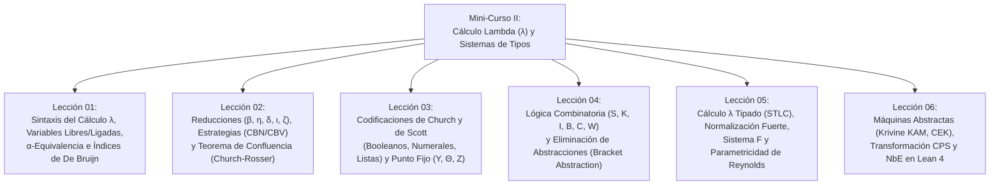

# Mini-Curso II: Cálculo Lambda ($\lambda$), Lógica Combinatoria, Sistemas de Tipos y Máquinas Abstractas en Lean 4

> **Referencias base ampliadas:** [Cálculo lambda — Wikipedia](https://es.wikipedia.org/wiki/C%C3%A1lculo_lambda) y [Cálculo lambda tipado — Wikipedia](https://es.wikipedia.org/wiki/C%C3%A1lculo_lambda_tipado).
>
> **Módulos Lean 4 ejecutables asociados:** [`M01`](../../LeanTT/M01_LambdaCalculus.lean), [`M10`](../../LeanTT/M10_MetatheorySTLC.lean), [`M11`](../../LeanTT/M11_OperationalSemantics.lean), [`M16`](../../LeanTT/M16_DidacticLambdaCubeAndPTS.lean), [`M26`](../../LeanTT/M26_SystemFAndParametricity.lean), [`M27`](../../LeanTT/M27_NormalizationByEvaluation.lean), [`M28`](../../LeanTT/M28_SubstructuralAndLinearTypes.lean) y [`M51`](../../LeanTT/M51_ContinuationPassingStyleCPS.lean).

---

## 🎯 Propósito de este Segundo Mini-Curso

Si el [**Mini-Curso I (`docs/curso_teoria_tipos_dependientes/`)**](../curso_teoria_tipos_dependientes/00_indice_minicurso_ttd.md) recorre el edificio de los tipos dependientes ($\Pi, \Sigma, \text{Id}, \text{HoTT}$), este **Mini-Curso II de 6 Lecciones** profundiza desde cero en el motor computacional que subyace tanto a Lean 4 como a todos los lenguajes funcionales modernos: el **Cálculo Lambda ($\lambda$) de Alonzo Church**.

Cada lección combina teoría formal rigurosa, diagramas visuales, código **Lean 4** 100% ejecutable y ejercicios resueltos.

---

## 🗺️ Estructura Visual del Mini-Curso de Cálculo Lambda

---

## 📚 Plan de Estudios de las 6 Lecciones

| Lección | Documento `.md` | Contenido Teórico y Práctico en Lean 4 |
| :---: | :--- | :--- |
| **01** | [**01_sintaxis_variables_y_debruijn.md**](01_sintaxis_variables_y_debruijn.md) | Orígenes (Church 1932), los 3 constructores del cálculo $\lambda$, alcance (*scope*), variables libres vs. ligadas, captura de variables, $\alpha$-conversión e **Índices vs. Niveles de De Bruijn** implementados en Lean 4. |
| **02** | [**02_reducciones_beta_eta_y_confluencia.md**](02_reducciones_beta_eta_y_confluencia.md) | Sustitución libre de captura $t[s/x]$, $\beta$-reducción, $\eta$-conversión, las reducciones extendidas del kernel de Lean ($\delta, \iota, \zeta$), orden normal vs. aplicativo (CBN, CBV, Call-by-Need) y el **Teorema del Diamante de Church-Rosser**. |
| **03** | [**03_codificaciones_church_scott_y_punto_fijo.md**](03_codificaciones_church_scott_y_punto_fijo.md) | Cómo programar sin tipos de datos primitivos: **Booleanos, Pares y Numerales de Church** (`succ`, `add`, `mul`, `exp`), **Codificación de Scott** (predecesor en $O(1)$) y los **Combinadores de Punto Fijo ($Y$ de Curry, $\Theta$ de Turing y $Z$)**. |
| **04** | [**04_logica_combinatoria_ski_y_abstraccion.md**](04_logica_combinatoria_ski_y_abstraccion.md) | El cálculo sin variables ligadas de Schönfinkel (1924) y Curry: combinadores $S, K, I, B, C, W$, el **algoritmo de *Bracket Abstraction*** $[x]^*\,t$ que compila cualquier término $\lambda$ a $S, K, I$ y su verificación formal en Lean 4. |
| **05** | [**05_calculo_lambda_tipado_stlc_y_sistema_f.md**](05_calculo_lambda_tipado_stlc_y_sistema_f.md) | Por qué el término $\Omega = (\lambda x.\, x\,x)(\lambda x.\, x\,x)$ queda prohibido al añadir tipos: **STLC ($\lambda^\to$)**, relaciones lógicas de Tait para **Normalización Fuerte**, **Sistema $F$ ($\lambda 2$)** y **Teoremas Gratis (*Parametricity*)**. |
| **06** | [**06_maquinas_abstractas_krivine_cek_y_nbe.md**](06_maquinas_abstractas_krivine_cek_y_nbe.md) | Cómo se ejecuta realmente el cálculo $\lambda$ en un ordenador: **Clausuras y Entornos**, la **Máquina Abstracta de Krivine (KAM)** para Call-by-Name, la **Máquina CEK** para Call-by-Value y **Normalización por Evaluación (NbE)** en Lean 4. |

---

👉 **Comenzar el curso:** [**Lección 01 — Sintaxis del Cálculo $\lambda$, Variables Libres/Ligadas, $\alpha$-Equivalencia e Índices de De Bruijn**](01_sintaxis_variables_y_debruijn.md)
