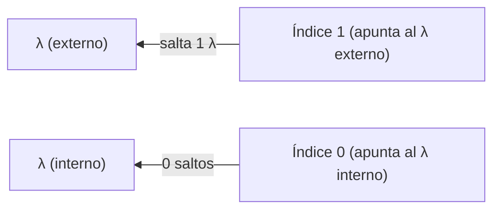

# Lección 01: Sintaxis del Cálculo $\lambda$, Variables Libres/Ligadas, $\alpha$-Equivalencia e Índices de De Bruijn

> **Navegación del Mini-Curso:** [⬅️ Índice del Mini-Curso $\lambda$](00_indice_minicurso_lambda.md) | [➡️ Lección 02: Reducciones $\beta, \eta$ y Confluencia](02_reducciones_beta_eta_y_confluencia.md)
>
> **Módulos ejecutables relacionados:** [`LeanTT/M01_LambdaCalculus.lean`](../../LeanTT/M01_LambdaCalculus.lean), [`LeanTT/M10_MetatheorySTLC.lean`](../../LeanTT/M10_MetatheorySTLC.lean) y [`LeanTT/M40_MiniDependentTypeChecker.lean`](../../LeanTT/M40_MiniDependentTypeChecker.lean).

---

## 1. El Nacimiento del Cálculo Lambda (Alonzo Church, 1932–1936)

Entre 1932 y 1936, en la Universidad de Princeton, el lógico **Alonzo Church** formuló el **Cálculo Lambda ($\lambda$-calculus)** para estudiar qué significa matemáticamente una *función como regla de cálculo* (en contraposición a una función como conjunto estático de pares ordenados en teoría de conjuntos).

En 1936, Church y su estudiante **Alan Turing** demostraron independientemente que la clase de funciones sobre números naturales definibles en el cálculo $\lambda$ no tipado coincide exactamente con la clase de funciones computables por una **Máquina de Turing** (**Tesis de Church-Turing**).

La belleza radical del cálculo $\lambda$ reside en que es un lenguaje de programación universal construido con **solo tres reglas gramaticales**:

$$t, u \;\;::=\;\; x \;\;\mid\;\; \lambda x.\, t \;\;\mid\;\; t\; u$$

| Construcción | Nombre Formal | Notación Matemática | Notación en Lean 4 | Significado |
| :---: | :--- | :--- | :--- | :--- |
| **1** | **Variable** | $x, y, z$ | `x` | Una referencia a un parámetro o valor del contexto. |
| **2** | **Abstracción $\lambda$** | $\lambda x.\, t$ | `fun x => t` (o `λ x => t`) | Creación de una función anónima con parámetro $x$ y cuerpo $t$. |
| **3** | **Aplicación** | $t\; u$ | `t u` | Invocación de la función $t$ pasándole el argumento $u$. |

### Convenciones de Paréntesis y Currificación
1. **La aplicación asocia por la izquierda:** $f\; x\; y\; z$ significa $((f\; x)\; y)\; z$.
2. **El cuerpo de una abstracción $\lambda$ se extiende todo lo posible hacia la derecha:** $\lambda x.\, f\; x\; y$ significa $\lambda x.\, ((f\; x)\; y)$.
3. **Funciones de múltiples argumentos (Currificación — Schönfinkel / Curry):** Una función de dos argumentos $\lambda (x, y).\, t$ se escribe como dos abstracciones anidadas $\lambda x.\, \lambda y.\, t$ (abreviado $\lambda x\, y.\, t$, y en Lean `fun x y => t`).

---

## 2. Variables Libres ($FV$), Variables Ligadas y el Problema de la Captura

En un término $\lambda$, una aparición de una variable $x$ está:
* **Ligada (*bound*):** si se encuentra bajo el alcance (*scope*) de un ligador $\lambda x$ que la engloba.
* **Libre (*free*):** si no está ligada por ningún $\lambda x$ dentro del término.

El conjunto de **variables libres** $FV(t)$ se define por recursión estructural:
* $FV(x) = \{x\}$
* $FV(\lambda x.\, t) = FV(t) \setminus \{x\}$
* $FV(t\; u) = FV(t) \cup FV(u)$

Un término sin variables libres ($FV(t) = \emptyset$, como $\lambda x.\, \lambda y.\, x$) se denomina un **término cerrado** o **combinador**.

### 2.1 $\alpha$-Equivalencia: Los Nombres de las Variables Ligadas son Irrelevantes
La función identidad escrita como $\lambda x.\, x$ y la escrita como $\lambda y.\, y$ son exactamente la misma función. Renombrar consistentemente una variable ligada por un nombre fresco que no capture ninguna variable libre se denomina **$\alpha$-conversión** ($\equiv_\alpha$):
$$\lambda x.\, \lambda y.\, x \;\equiv_\alpha\; \lambda a.\, \lambda b.\, a$$

### 2.2 El Peligro Mortal: La Captura Accidental de Variables
Supongamos que tenemos la función $f \equiv \lambda x.\, (\lambda y.\, x + y)$, que dado $x$ devuelve la función "sumar $x$".
¿Qué ocurre si sustituimos ingenuamente $x$ por la variable $y$ sin renombrar primero el ligador interno $\lambda y$?
$$(\lambda y.\, x + y)[y/x]_{\text{ingenuo}} \;\leadsto\; \lambda y.\, y + y \quad\text{¡ERROR DE CAPTURA!}$$
La variable libre $y$ que queríamos inyectar ha sido **capturada** por el ligador interno $\lambda y$, transformando la función "sumar $y$" en la función "duplicar el argumento".

---

## 3. La Solución Canónica en los Kernels Modernos: Índices de De Bruijn (1972)

Para eliminar de raíz la captura de variables y hacer que dos términos $\alpha$-equivalentes tengan **exactamente el mismo árbol sintáctico en memoria**, N. G. de Bruijn propuso reemplazar los nombres de las variables ligadas por números naturales (`0, 1, 2, ...`):
* El índice **`0`** apunta al $\lambda$ **inmediatamente más cercano** que lo engloba.
* El índice **`1`** apunta al **segundo $\lambda$** contando de adentro hacia afuera.
* En general, el índice **`k`** atraviesa $k$ ligadores $\lambda$ internos hasta llegar a su ligador.



| Término con Nombres | Término con Índices de De Bruijn | Explicación |
| :--- | :--- | :--- |
| $\lambda x.\, x$ | $\lambda.\, 0$ | `0` apunta al único $\lambda$. |
| $\lambda x.\, \lambda y.\, x$ (Combinador $K$) | $\lambda.\, \lambda.\, 1$ | `1` salta el $\lambda y$ interno y apunta al $\lambda x$ externo. |
| $\lambda x.\, \lambda y.\, x\; y$ | $\lambda.\, \lambda.\, 1\; 0$ | `1` es $x$ (externo), `0` es $y$ (interno). |
| $\lambda f.\, (\lambda x.\, f\; (x\; x))\; (\lambda x.\, f\; (x\; x))$ | $\lambda.\, (\lambda.\, 1\; (0\; 0))\; (\lambda.\, 1\; (0\; 0))$ | El combinador $Y$ de Curry sin un solo nombre de variable. |

---

## 4. Implementación Ejecutable y Verificada en Lean 4

En Lean 4 podemos implementar en unas pocas líneas tanto el AST con índices de De Bruijn como el comprobador exacto de si un término es **cerrado** (todas sus variables tienen índice menor que la profundidad actual de ligadores `depth`):

```lean
namespace CursoLambda.Leccion01

/-- Sintaxis del Cálculo Lambda no tipado con Índices de De Bruijn -/
inductive LTerm where
  | var : Nat → LTerm           -- Índice de De Bruijn `#i`
  | lam : LTerm → LTerm         -- Abstracción `λ. body`
  | app : LTerm → LTerm → LTerm -- Aplicación `f a`
  deriving Repr, DecidableEq

/-- Comprueba si todas las variables de `t` están ligadas bajo una profundidad `depth` de lambdas: -/
@[simp]
def isClosedAt (depth : Nat) : LTerm → Bool
  | .var i   => i < depth
  | .lam b   => isClosedAt (depth + 1) b
  | .app f a => isClosedAt depth f && isClosedAt depth a

/-- Un término es un Combinador (término cerrado, `FV(t) = ∅`) si `isClosedAt 0 t = true` -/
@[simp]
def isCombinator (t : LTerm) : Bool :=
  isClosedAt 0 t

-- Los tres combinadores clásicos I, K, S en notación de De Bruijn:
def combI : LTerm := .lam (.var 0)
def combK : LTerm := .lam (.lam (.var 1))
def combS : LTerm :=
  .lam (.lam (.lam (.app (.app (.var 2) (.var 0)) (.app (.var 1) (.var 0)))))

/-- TEOREMA: El kernel de Lean 4 verifica por cómputo (`decide`) que I, K y S son términos cerrados,
    mientras que `λ. #1` tiene una variable libre y NO es un combinador: -/
theorem combinadores_IKS_cerrados :
    isCombinator combI = true ∧
    isCombinator combK = true ∧
    isCombinator combS = true ∧
    isCombinator (.lam (.var 1)) = false := by
  decide

end CursoLambda.Leccion01
```

---

## 5. Ejercicios Prácticos de la Lección 01

### Ejercicio 1.1: Traducir a Índices de De Bruijn
Traduce a notación `LTerm` con índices de De Bruijn el combinador de composición $B :\equiv \lambda f.\, \lambda g.\, \lambda x.\, f\; (g\; x)$ y el combinador de intercambio $C :\equiv \lambda f.\, \lambda x.\, \lambda y.\, f\; y\; x$, y comprueba con `isCombinator` que ambos son cerrados.

<details>
<summary>💡 <b>Ver Solución Comentada en Lean 4</b></summary>

```lean
open CursoLambda.Leccion01

-- En `λf. λg. λx. f (g x)`: `x` es `#0`, `g` es `#1`, `f` es `#2`
def combB : LTerm :=
  .lam (.lam (.lam (.app (.var 2) (.app (.var 1) (.var 0)))))

-- En `λf. λx. λy. (f y) x`: `y` es `#0`, `x` es `#1`, `f` es `#2`
def combC : LTerm :=
  .lam (.lam (.lam (.app (.app (.var 2) (.var 0)) (.var 1))))

example : isCombinator combB = true ∧ isCombinator combC = true := by decide
```
</details>

---

👉 **Siguiente lección:** [**Lección 02 — Reglas de Reducción ($\beta, \eta, \delta, \iota, \zeta$), Estrategias de Evaluación y el Teorema de Church-Rosser**](02_reducciones_beta_eta_y_confluencia.md)
