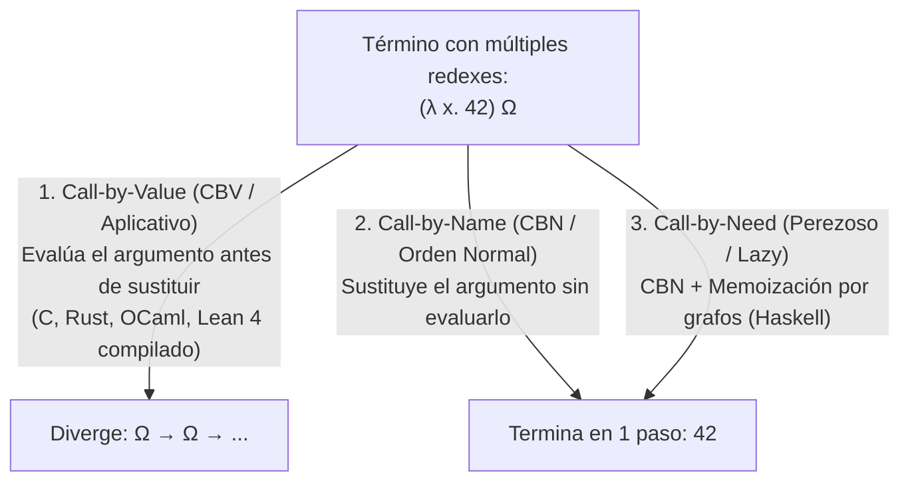
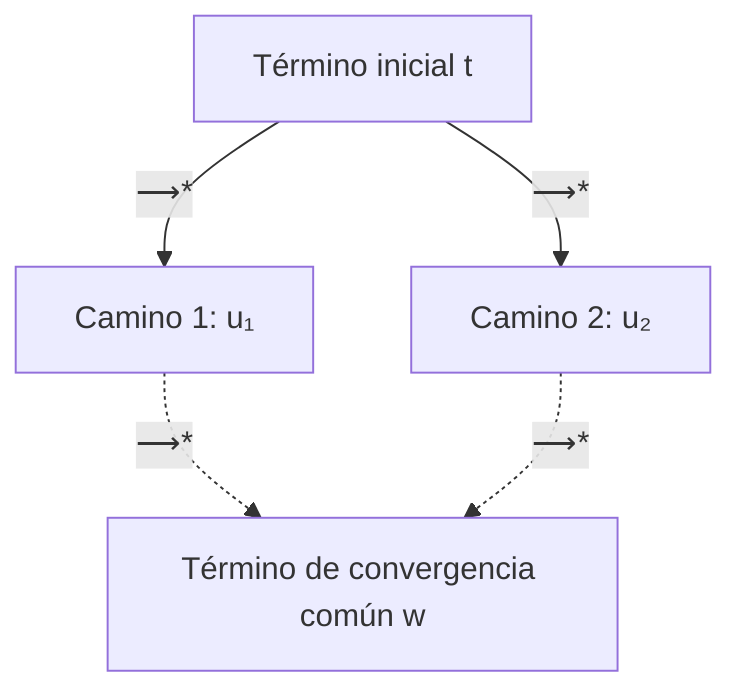

# Lección 02: Reglas de Reducción ($\beta, \eta, \delta, \iota, \zeta$), Estrategias de Evaluación y el Teorema de Church-Rosser

> **Navegación del Mini-Curso:** [⬅️ Lección 01: Sintaxis y De Bruijn](01_sintaxis_variables_y_debruijn.md) | [🏠 Índice](00_indice_minicurso_lambda.md) | [➡️ Lección 03: Codificaciones de Church/Scott y Punto Fijo](03_codificaciones_church_scott_y_punto_fijo.md)
>
> **Módulos ejecutables relacionados:** [`LeanTT/M01_LambdaCalculus.lean`](../../LeanTT/M01_LambdaCalculus.lean) y [`LeanTT/M11_OperationalSemantics.lean`](../../LeanTT/M11_OperationalSemantics.lean).

---

## 1. El Motor del Cálculo: La $\beta$-Reducción y la $\eta$-Conversión

Si la Lección 01 definió la *estática* (los árboles sintácticos), las reglas de reducción definen la *dinámica* (cómo se calcula un resultado).

### 1.1 La Regla $\beta$ (Aplicación de Funciones)
Una subexpresión de la forma $(\lambda x.\, t)\; u$ —una abstracción $\lambda$ aplicada inmediatamente a un argumento $u$— se denomina un **$\beta$-redex** (*reducible expression*).
La **$\beta$-reducción** contrae el redex sustituyendo todas las ocurrencias libres de $x$ en el cuerpo $t$ por el argumento $u$ (evitando captura de variables):

$$(\lambda x.\, t)\; u \;\longrightarrow_\beta\; t[u / x]$$

Con índices de De Bruijn (como está programado en [`M40`](../../LeanTT/M40_MiniDependentTypeChecker.lean) y [`M60`](../../LeanTT/M60_UniversePolymorphicKernelAndInductives.lean)), la sustitución $(\lambda.\, t)\; u \longrightarrow_\beta t[0 := u]$ sigue dos reglas aritméticas exactas llamadas **`shift` ($\uparrow$)** y **`subst`**:
1. Cuando el argumento $u$ entra bajo un $\lambda$ interno dentro de $t$, todos los índices libres de $u$ se incrementan en $+1$ (`shift 0 1 u`) para que sigan apuntando a los mismos ligadores externos.
2. Al desaparecer el $\lambda$ externo que ha sido consumido por la aplicación, todas las variables libres de $t$ que apuntaban más afuera (`i > target`) decrementan su índice en $-1$.

### 1.2 La Regla $\eta$ (Extensionalidad Puntual de Funciones)
Si $x \notin FV(f)$, envolver una función $f$ en una abstracción $\lambda x.\, f\; x$ que simplemente reenvía su argumento a $f$ no cambia su comportamiento:

$$\lambda x.\, f\; x \;\longrightarrow_\eta\; f \qquad (\text{siempre que } x \notin FV(f))$$

### 1.3 Las 6 Reducciones del Kernel de Lean 4 ($\beta, \eta, \delta, \iota, \zeta$ y Proyecciones)
En un asistente de pruebas basado en el Cálculo de Construcciones Inductivas (como Lean 4), la igualdad definicional $\Gamma \vdash a \equiv b$ une la $\beta$- y $\eta$-reducción con cuatro reducciones adicionales que puedes experimentar en [`LeanTT/M01_LambdaCalculus.lean`](../../LeanTT/M01_LambdaCalculus.lean):

| Símbolo | Nombre de la Reducción | Regla de Evaluación | Ejemplo en Lean 4 (`rfl`) |
| :---: | :--- | :--- | :--- |
| **$\beta$** | Beta-reducción | $(\lambda x.\, t)\; u \longrightarrow t[u/x]$ | `(fun x => x + 1) 5 = 6` |
| **$\eta$** | Eta-conversión | $(\lambda x.\, f\; x) \equiv f$ | `(fun x => Nat.succ x) = Nat.succ` |
| **$\delta$** | Delta-reducción | Desplegado de una definición constante `def c := body` | Si `def doble x := x + x`, `doble 3 = 6` |
| **$\iota$** | Iota-reducción | Aplicación de un eliminador recursivo (`rec` / `match`) a un constructor inductivo | `Nat.rec base step (Nat.succ n) = step n (Nat.rec base step n)` |
| **$\zeta$** | Zeta-reducción | Expansión de una ligadura local `let x := v; t` $\longrightarrow t[v/x]$ | `(let x := 10; x * 2) = 20` |
| **$\pi$** | Reducción de proyección | `(⟨a, b⟩).1` $\longrightarrow a$ | `(10, 20).1 = 10` |

---

## 2. Estrategias de Evaluación: ¿Qué Redex Reducimos Primero?

Un mismo término puede contener varios $\beta$-redexes a la vez. Considera el término:
$$(\lambda x.\, 42)\; \Omega \qquad \text{donde } \Omega :\equiv (\lambda z.\, z\; z)\; (\lambda z.\, z\; z)$$
Observa que $\Omega \longrightarrow_\beta \Omega \longrightarrow_\beta \Omega \dots$ es un bucle infinito sin forma normal.
* Si evaluamos primero el **argumento** $\Omega$ antes de entrar en la función, ¡entramos en un bucle infinito!
* Si sustituimos primero el argumento **sin evaluarlo** en el cuerpo de $\lambda x.\, 42$ (que no usa $x$), ¡obtenemos $42$ en un solo paso!

Esto distingue las grandes estrategias de evaluación de los lenguajes de programación:



---

## 3. El Teorema de Confluencia (Church-Rosser, 1936) y Teorema de Estandarización

¿Podría ocurrir que elegir dos caminos distintos de $\beta$-reducción desde un mismo término $t$ nos lleve a dos resultados finales (formas normales) **diferentes** e incompatibles?

El **Teorema de Church-Rosser (1936)** garantiza que **NO**: la relación de reducción en múltiples pasos $\longrightarrow_\beta^*$ posee la **Propiedad del Diamante (Confluencia)**:

> **Teorema de Church-Rosser:** Si un término $t$ se reduce por dos caminos cualesquiera $t \longrightarrow_\beta^* u_1$ y $t \longrightarrow_\beta^* u_2$, entonces siempre existe un término común $w$ al que ambos pueden seguir reduciéndose:
> $$u_1 \longrightarrow_\beta^* w \qquad\text{y}\qquad u_2 \longrightarrow_\beta^* w$$



**Corolarios fundamentales del Teorema de Church-Rosser:**
1. **Unicidad de la Forma Normal:** Todo término $t$ tiene **a lo sumo una** forma normal $\beta$ (salvo $\alpha$-equivalencia). El orden en que el kernel reduzca una expresión jamás puede alterar el resultado final.
2. **Teorema de Estandarización (Curry & Feys, 1958):** Si un término $t$ posee forma normal, la estrategia de **Orden Normal (*Leftmost-Outermost*, reducir siempre el redex situado más a la izquierda y más afuera)** **encuentra garantizadamente** dicha forma normal.

---

## 4. Formalización de la Propiedad del Diamante y Confluencia en Lean 4

Veamos en Lean 4 cómo se definen formalmente la propiedad del diamante de una relación abstracta de reducción `R : α → α → Prop`, su clausura reflexiva-transitiva `MultiStep R` y el teorema de que si `R` es determinista (como nuestras estrategias `Step` del [`Módulo 11`](../../LeanTT/M11_OperationalSemantics.lean)), la propiedad del diamante en un paso se cumple trivialmente:

```lean
namespace CursoLambda.Leccion02

/-- Propiedad del Diamante para una relación `R : α → α → Prop` -/
def DiamondProperty {α : Type} (R : α → α → Prop) : Prop :=
  ∀ t u1 u2 : α, R t u1 → R t u2 → ∃ w : α, R u1 w ∧ R u2 w

/-- Una relación de reducción es determinista si cada término da a lo sumo un paso `R t u` -/
def Deterministic {α : Type} (R : α → α → Prop) : Prop :=
  ∀ t u1 u2 : α, R t u1 → R t u2 → u1 = u2

/-- Un término `nf` está en Forma Normal respecto a `R` si no puede dar ningún paso `R nf t'` -/
def IsNormalForm {α : Type} (R : α → α → Prop) (nf : α) : Prop :=
  ∀ t' : α, ¬ R nf t'

/-- TEOREMA: Si una relación confluente `Confluent` relaciona `t` con dos formas normales `nf1` y `nf2`,
    y las formas normales solo se reducen en 0 pasos a sí mismas, entonces `nf1 = nf2` (Unicidad)! -/
theorem normal_form_unique_of_confluent {α : Type} (RStar : α → α → Prop)
    (hDiamond : DiamondProperty RStar)
    (hNfSelf  : ∀ nf w : α, IsNormalForm RStar nf → RStar nf w → nf = w)
    {t nf1 nf2 : α}
    (hRed1 : RStar t nf1) (hRed2 : RStar t nf2)
    (hNf1  : IsNormalForm RStar nf1) (hNf2 : IsNormalForm RStar nf2) :
    nf1 = nf2 := by
  rcases hDiamond t nf1 nf2 hRed1 hRed2 with ⟨w, hw1, hw2⟩
  have h1 : nf1 = w := hNfSelf nf1 w hNf1 hw1
  have h2 : nf2 = w := hNfSelf nf2 w hNf2 hw2
  rw [h1, h2]

end CursoLambda.Leccion02
```

---

## 5. Ejercicio Práctico de la Lección 02

### Ejercicio 2.1: Comprobar las 6 Reducciones del Kernel en Lean 4
Escribe un teorema en Lean 4 que combine en una sola expresión una $\zeta$-reducción (`let`), una $\beta$-reducción (`fun`), una $\iota$-reducción (`match` sobre `Bool`) y una proyección (`.1`), y demuéstralo exclusivamente con `rfl`.

<details>
<summary>💡 <b>Ver Solución Comentada en Lean 4</b></summary>

```lean
theorem seis_reducciones_en_una :
    (let f := fun (p : Nat × Bool) =>
      match p.2 with
      | true  => p.1 + 10
      | false => 0
     f (32, true)) = 42 :=
  rfl
```
</details>

---

👉 **Siguiente lección:** [**Lección 03 — Codificaciones de Church y de Scott (Booleanos, Numerales, Listas) y Combinadores de Punto Fijo ($Y, \Theta, Z$)**](03_codificaciones_church_scott_y_punto_fijo.md)
