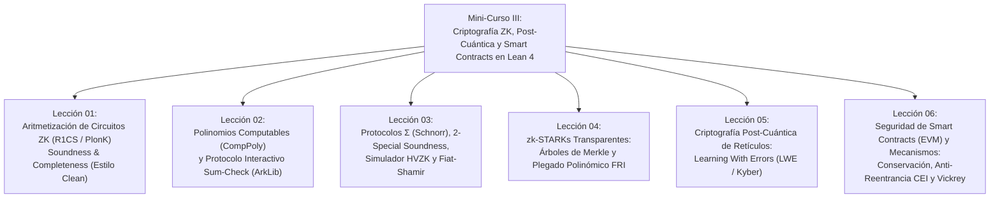

# Mini-Curso III: Verificación Formal de Criptografía ZK (SNARKs/STARKs), Post-Cuántica (LWE) y Smart Contracts en Lean 4

> **Proyectos del ecosistema relacionados:** **[ArkLib](https://github.com/Verified-zkEVM/ArkLib)**, **[VCV-io](https://github.com/Verified-zkEVM/VCV-io)**, **[CompPoly](https://github.com/Verified-zkEVM/CompPoly)**, **[Clean](https://github.com/Verified-zkEVM/clean)** y **[Verified-zkEVM](https://github.com/Verified-zkEVM)**.
>
> **Módulos Lean 4 ejecutables asociados:** [`M21`](../../LeanTT/M21_NumberTheoryAndCryptography.lean), [`M30`](../../LeanTT/M30_SmartContractsAndEVMState.lean), [`M31`](../../LeanTT/M31_SumCheckProtocolAndOracles.lean), [`M32`](../../LeanTT/M32_ComputablePolynomialsAndFields.lean), [`M42`](../../LeanTT/M42_FiatShamirAndSigmaProtocols.lean), [`M44`](../../LeanTT/M44_MerkleTreesAndCryptographicCommitments.lean), [`M49`](../../LeanTT/M49_ProbabilityDistributionsAndMarkovChains.lean), [`M55`](../../LeanTT/M55_STARKsAndFRILowDegreeFolding.lean), [`M56`](../../LeanTT/M56_GameTheoryNashEquilibriumAndVCG.lean), [`M58`](../../LeanTT/M58_SmartContractReentrancyAndCEI.lean), [`M62`](../../LeanTT/M62_PostQuantumLatticeCryptoLWE.lean) y los talleres [`E03`](../../LeanTT/Exercises/E03_WorkoutVerificationAndCryptography.lean), [`E04`](../../LeanTT/Exercises/E04_WorkoutCompilersSTARKsAndGames.lean) y [`E05`](../../LeanTT/Exercises/E05_WorkoutQTTPostQuantumAndHardware.lean).

---

## 🎯 Propósito de este Tercer Mini-Curso

Uno de los ámbitos donde **Lean 4** está teniendo mayor impacto industrial es la **verificación formal de sistemas criptográficos de Conocimiento Cero (*Zero-Knowledge Proofs*: SNARKs y STARKs), Criptografía Post-Cuántica (LWE / Kyber) y Contratos Inteligentes (EVM)**:
* Un solo error en una ecuación polinómica de un circuito R1CS/PlonK (**sub-restricción** o *under-constrained circuit*) permite a un atacante fabricar pruebas falsas de transacciones inexistentes.
* Un solo olvido del patrón *Checks-Effects-Interactions* en un contrato inteligente permite drenar sus reservas mediante un ataque de reentrancia.

Este **Mini-Curso III de 6 Lecciones** enseña paso a paso cómo modelar y demostrar en **Lean 4** las propiedades matemáticas de seguridad (**Completitud**, **Solidez / *Soundness***, **Simulación Zero-Knowledge HVZK**, **Plegado FRI**, **Cancelación de Ruido LWE** e **Invariantes de Solvencia EVM**).

---

## 🗺️ Mapa Conceptual del Mini-Curso de Criptografía y Smart Contracts

---

## 📚 Plan de Estudios de las 6 Lecciones

| Lección | Documento `.md` | Módulos `.lean` | Qué Aprenderás y Demostrarás en Lean 4 |
| :---: | :--- | :---: | :--- |
| **01** | [**01_aritmetizacion_circuitos_r1cs_y_plonk.md**](01_aritmetizacion_circuitos_r1cs_y_plonk.md) | `M21`, `E03`, `S03` | Qué es aritmetizar un programa en ecuaciones polinómicas sobre un cuerpo; circuitos *under-constrained* vs. *over-constrained*, y verificación formal de puertas booleanas (`NOT`, `AND`, `OR`, `XOR`), multiplexores y comprobadores de rango. |
| **02** | [**02_polinomios_computables_y_sumcheck.md**](02_polinomios_computables_y_sumcheck.md) | `M31`, `M32`, `E03` | Representación ejecutable de polinomios mediante el Esquema de Horner (`CompPoly`), homomorfismo lineal de evaluación y demostración de **Completitud Perfecta** del protocolo **Sum-Check** de Lund-Fortnow-Karloff-Nisan (`ArkLib`). |
| **03** | [**03_protocolos_sigma_schnorr_y_fiat_shamir.md**](03_protocolos_sigma_schnorr_y_fiat_shamir.md) | `M42`, `M49`, `E03` | La trilogía de seguridad de toda prueba ZK: **Completitud**, **Solidez Especial (*2-Special Soundness*: extractor algebraico del testigo secreto)** y **Honest-Verifier Zero-Knowledge (Simulador HVZK)**, más la heurística de Fiat-Shamir. |
| **04** | [**04_starks_transparentes_merkle_y_fri.md**](04_starks_transparentes_merkle_y_fri.md) | `M44`, `M55`, `E04` | Cómo funcionan los **zk-STARKs** sin ceremonia de configuración confiable (*Trusted Setup*): compromisos vectoriales con **Árboles de Merkle indexados por altura** y **Plegado Polinómico de Bajo Grado FRI** ($P_{\text{even}}, P_{\text{odd}}$). |
| **05** | [**05_criptografia_postcuantica_reticulos_lwe.md**](05_criptografia_postcuantica_reticulos_lwe.md) | `M62`, `E05` | Por qué el algoritmo cuántico de Shor rompe RSA/ECDSA y cómo los retículos con ruido (**Learning With Errors — LWE**, base de **ML-KEM / Kyber**) resisten ataques cuánticos: demostración de desencriptado exacto con ruido $|e| < q/4$ y homomorfía aditiva. |
| **06** | [**06_verificacion_smart_contracts_evm_y_cei.md**](06_verificacion_smart_contracts_evm_y_cei.md) | `M30`, `M56`, `M58` | Verificación formal de contratos inteligentes y mecanismos on-chain: **conservación bilateral de tokens**, aislamiento de terceros, prevención formal de ataques de **reentrancia** con el patrón **CEI + `ReentrancyGuard`** y veracidad de la **Subasta de Vickrey**. |

---

👉 **Comenzar el curso:** [**Lección 01 — Aritmetización de Programas y Puertas de Circuitos ZK (R1CS y PlonKish) en Lean 4**](01_aritmetizacion_circuitos_r1cs_y_plonk.md)
