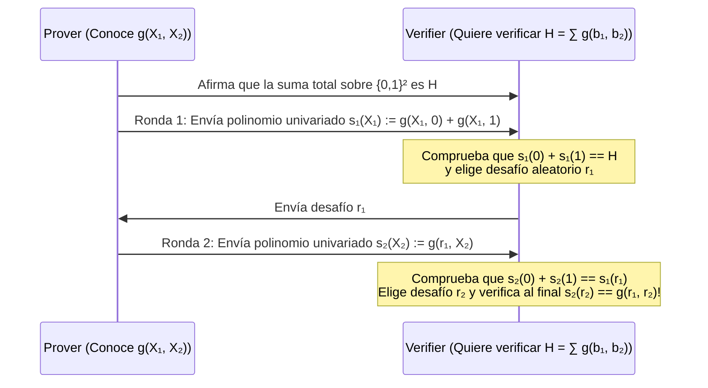

# Lección 02: Polinomios Computables (Esquema de Horner, `CompPoly`) y el Protocolo Interactivo Sum-Check (`ArkLib`)

> **Navegación del Mini-Curso:** [⬅️ Lección 01: Aritmetización R1CS/PlonK](01_aritmetizacion_circuitos_r1cs_y_plonk.md) | [🏠 Índice](00_indice_minicurso_zk_y_cripto.md) | [➡️ Lección 03: Protocolos $\Sigma$ (Schnorr) y HVZK](03_protocolos_sigma_schnorr_y_fiat_shamir.md)
>
> **Módulos ejecutables relacionados:** [`LeanTT/M31_SumCheckProtocolAndOracles.lean`](../../LeanTT/M31_SumCheckProtocolAndOracles.lean) y [`LeanTT/M32_ComputablePolynomialsAndFields.lean`](../../LeanTT/M32_ComputablePolynomialsAndFields.lean).

---

## 1. ¿Por Qué los Polinomios son el Alma de las Pruebas Interactivas (SNARKs y STARKs)?

En criptografía de conocimiento cero, un Prover quiere convencer a un Verificador de que millones de restricciones aritméticas $C_1 = 0, C_2 = 0, \dots, C_N = 0$ se cumplen simultáneamente, pero el Verificador solo quiere hacer **una o muy pocas comprobaciones**.

La magia que permite comprimir $N$ ecuaciones en una sola comprobación aleatoria es el **Lema de Schwartz-Zippel**:
> **Lema de Schwartz-Zippel:** Si dos polinomios distintos $P(X) \neq Q(X)$ tienen grado a lo sumo $d$ sobre un cuerpo finito grande $\mathbb{F}_p$ (por ejemplo, $p \approx 2^{256}$), entonces pueden coincidir en **a lo sumo $d$ puntos**.
> Por tanto, si el Verificador elige un punto aleatorio $r \xleftarrow{\$} \mathbb{F}_p$ y comprueba que $P(r) = Q(r)$, la probabilidad de que $P \neq Q$ y el Prover haya tenido suerte es $\le \frac{d}{|\mathbb{F}_p|} \approx 2^{-230}$ (despreciable).

---

## 2. Polinomios Computables en Lean 4 (Estilo `CompPoly`) y el Esquema de Horner

En matemáticas puras (`Mathlib`), los polinomios suelen definirse como funciones con soporte finito (`Finsupp`), que son cómodas para el álgebra abstracta pero **no son directamente ejecutables** (`noncomputable`).
Por eso el proyecto **[CompPoly](https://github.com/Verified-zkEVM/CompPoly)** de `Verified-zkEVM` formaliza polinomios **100% ejecutables** como listas o arrays de coeficientes $[c_0, c_1, \dots, c_d]$ evaluados mediante el **Esquema de Horner**:

$$P(x) \;=\; c_0 + x \cdot \big(c_1 + x \cdot (c_2 + \dots + x \cdot c_d)\big)$$

Mientras que evaluar cada monomio $c_k x^k$ por separado requiere $O(d^2)$ multiplicaciones, el Esquema de Horner evalúa un polinomio de grado $d$ en **exactamente $d$ multiplicaciones y $d$ sumas ($O(d)$)** y su definición recursiva por listas en Lean 4 ocupa dos líneas:

```lean
/-- Evaluación en O(d) de un polinomio `[c₀, c₁, ..., c_d]` por el Esquema de Horner: -/
@[simp]
def evalHorner : List Int → Int → Int
  | [],      _ => 0
  | c :: cs, x => c + x * evalHorner cs x
```

En el módulo [`LeanTT/M32_ComputablePolynomialsAndFields.lean`](../../LeanTT/M32_ComputablePolynomialsAndFields.lean) demostramos formalmente por inducción estructural que `evalHorner` es un **homomorfismo lineal**:
1. `evalHorner (addPoly p q) x = evalHorner p x + evalHorner q x`
2. `evalHorner (scalePoly k p) x = k * evalHorner p x`

---

## 3. El Protocolo Interactivo *Sum-Check* (Lund-Fortnow-Karloff-Nisan, 1992 — `ArkLib`)

El protocolo **Sum-Check** es la piedra angular de los SNARKs modernos de tiempo lineal (como Spartan, HyperPlonk, Jolt y Lasso) y el protocolo central formalizado en **[ArkLib](https://github.com/Verified-zkEVM/ArkLib)**.

### 3.1 El Problema que Resuelve Sum-Check
Dado un polinomio multivariado $g(X_1, X_2, \dots, X_v)$ de $v$ variables, el Prover afirma que la suma de $g$ sobre los $2^v$ vértices del hipercubo booleano $\{0, 1\}^v$ es igual a un valor $H$:

$$H \;=\; \sum_{b_1 \in \{0, 1\}} \sum_{b_2 \in \{0, 1\}} \dots \sum_{b_v \in \{0, 1\}} g(b_1, b_2, \dots, b_v)$$

Si el Verificador calculara esta suma por sí mismo necesitaría $2^v$ pasos (exponencial). Con el protocolo **Sum-Check**, el Verificador reduce comprobar las $2^v$ sumas a **evaluar $g$ en un único punto aleatorio $(r_1, \dots, r_v)$ en solo $v$ rondas ($O(v)$)**:



---

## 4. Demostración Formal de Completitud Perfecta de *Sum-Check* en Lean 4

En [`LeanTT/M31_SumCheckProtocolAndOracles.lean`](../../LeanTT/M31_SumCheckProtocolAndOracles.lean) formalizamos el protocolo Sum-Check bivariado y demostramos que todo Prover honesto supera todas las ecuaciones de verificación para cualesquiera desafíos $(r_1, r_2)$ del Verificador:

```lean
namespace CursoZK.Leccion02

/-- Un polinomio bivariado `g : Int → Int → Int` -/
abbrev Poly2 := Int → Int → Int

/-- Suma verdadera sobre los 4 vértices del hipercubo booleano `{0, 1}²` -/
@[simp]
def hypercubeSum2 (g : Poly2) : Int :=
  (g 0 0 + g 0 1) + (g 1 0 + g 1 1)

/-- Polinomio univariado de la Ronda 1 del Prover honesto: `s₁(x₁) = g(x₁, 0) + g(x₁, 1)` -/
@[simp]
def honestRound1 (g : Poly2) (x1 : Int) : Int :=
  g x1 0 + g x1 1

/-- Polinomio univariado de la Ronda 2 del Prover honesto tras recibir el desafío `r1`: `s₂(x₂) = g(r₁, x₂)` -/
@[simp]
def honestRound2 (g : Poly2) (r1 x2 : Int) : Int :=
  g r1 x2

/-- TEOREMA (Completitud Perfecta del Protocolo Sum-Check):
    Para todo polinomio bivariado `g` y cualesquiera desafíos aleatorios `r1, r2 : Int` del Verificador,
    los polinomios enviados por el Prover honesto satisfacen las 3 comprobaciones del protocolo:
    1. `s₁(0) + s₁(1) = H`
    2. `s₂(0) + s₂(1) = s₁(r₁)`
    3. `s₂(r₂) = g(r₁, r₂)` -/
theorem sumCheck_perfect_completeness (g : Poly2) (r1 r2 : Int) :
    (honestRound1 g 0 + honestRound1 g 1 = hypercubeSum2 g) ∧
    (honestRound2 g r1 0 + honestRound2 g r1 1 = honestRound1 g r1) ∧
    (honestRound2 g r1 r2 = g r1 r2) :=
  ⟨rfl, rfl, rfl⟩

end CursoZK.Leccion02
```

---

## 5. Ejercicio Práctico de la Lección 02

### Ejercicio 2.1: Evaluar un Polinomio en $x = 0$ Devuelve el Término Independiente $c_0$
Demuestra en Lean 4 que para cualquier coeficiente inicial $c_0 : \text{Int}$ y cualquier cola de coeficientes $cs : \text{List Int}$, evaluar por Horner en $x = 0$ devuelve exactamente $c_0$.

<details>
<summary>💡 <b>Ver Solución Comentada en Lean 4</b></summary>

```lean
@[simp]
def evalHorner : List Int → Int → Int
  | [],      _ => 0
  | c :: cs, x => c + x * evalHorner cs x

theorem evalHorner_at_zero (c0 : Int) (cs : List Int) :
    evalHorner (c0 :: cs) 0 = c0 := by
  dsimp [evalHorner]
  omega
```
</details>

---

👉 **Siguiente lección:** [**Lección 03 — Protocolos $\Sigma$ (Schnorr), *2-Special Soundness*, Simulador HVZK y Transformación de Fiat-Shamir**](03_protocolos_sigma_schnorr_y_fiat_shamir.md)
