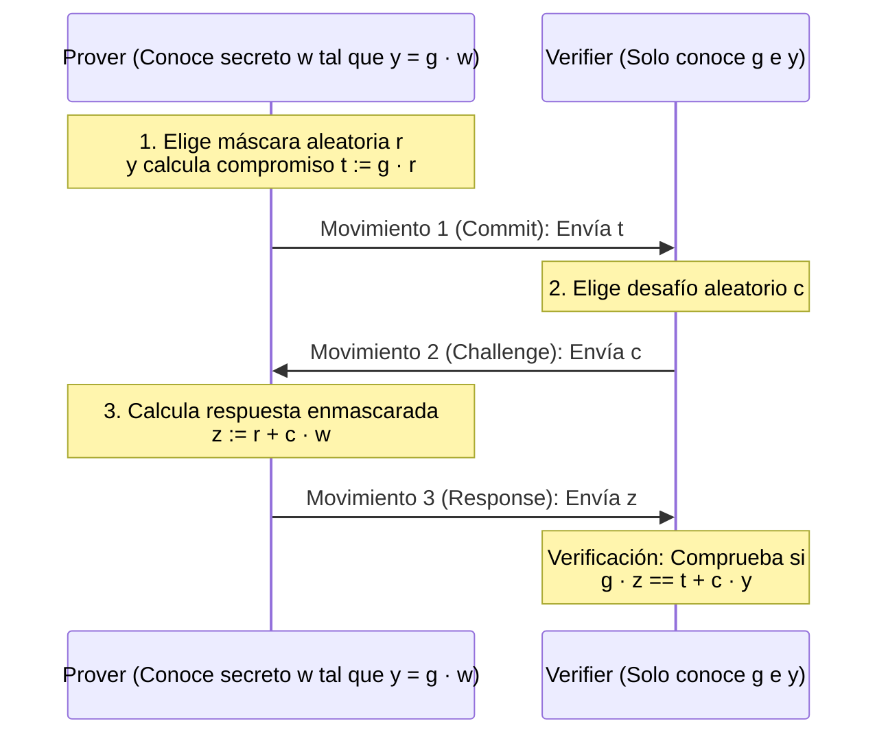

# Lección 03: Protocolos $\Sigma$ (Schnorr), *2-Special Soundness*, Simulador HVZK y Transformación de Fiat-Shamir

> **Navegación del Mini-Curso:** [⬅️ Lección 02: Polinomios Computables y Sum-Check](02_polinomios_computables_y_sumcheck.md) | [🏠 Índice](00_indice_minicurso_zk_y_cripto.md) | [➡️ Lección 04: zk-STARKs, Merkle y FRI](04_starks_transparentes_merkle_y_fri.md)
>
> **Módulos ejecutables relacionados:** [`LeanTT/M42_FiatShamirAndSigmaProtocols.lean`](../../LeanTT/M42_FiatShamirAndSigmaProtocols.lean), [`LeanTT/M49_ProbabilityDistributionsAndMarkovChains.lean`](../../LeanTT/M49_ProbabilityDistributionsAndMarkovChains.lean) y [`LeanTT/Exercises/E03_WorkoutVerificationAndCryptography.lean`](../../LeanTT/Exercises/E03_WorkoutVerificationAndCryptography.lean).

---

## 1. ¿Qué es un Protocolo $\Sigma$? (La Estructura de 3 Movimientos)

Un **Protocolo $\Sigma$** (como el protocolo de identificación y firma de **Claus-Peter Schnorr, 1989**) es el arquetipo de toda **Prueba Interactiva de Conocimiento Cero**.
El Prover quiere demostrar al Verificador que conoce un **testigo secreto** $w$ (la clave privada) tal que la clave pública es $y = g \cdot w$, **sin revelar ni un solo bit de información sobre $w$**.

El protocolo se desarrolla en tres pasos (que dibujan la letra griega $\Sigma$):



---

## 2. Las Tres Propiedades Matemáticas que Definen una Prueba de Conocimiento Cero

En el módulo [`LeanTT/M42_FiatShamirAndSigmaProtocols.lean`](../../LeanTT/M42_FiatShamirAndSigmaProtocols.lean) demostramos formalmente las tres propiedades que todo protocolo $\Sigma$ debe satisfacer:

### 2.1 Propiedad 1: Completitud (*Completeness*)
Si el Prover conoce realmente el secreto $w$ ($y = g \cdot w$) y sigue el protocolo con cualquier máscara $r$, el Verificador **siempre acepta** la transcripción $(t, c, z)$:
$$g \cdot z \;=\; g \cdot (r + c \cdot w) \;=\; g \cdot r + c \cdot (g \cdot w) \;=\; t + c \cdot y$$

### 2.2 Propiedad 2: Solidez Especial (*2-Special Soundness* / Extractor de Conocimiento)
¿Cómo sabemos que un Prover que responde correctamente *realmente conoce* el secreto $w$?
Porque si un Prover es capaz de responder válidamente a **dos desafíos distintos** $c_1 \neq c_2$ para el **mismo compromiso inicial $t$** —produciendo dos transcripciones válidas $(t, c_1, z_1)$ y $(t, c_2, z_2)$—, entonces podemos **extraer algebraicamente su clave secreta $w$** restando ambas ecuaciones de verificación:
$$g \cdot (z_1 - z_2) \;=\; (t + c_1 \cdot y) - (t + c_2 \cdot y) \;=\; (c_1 - c_2) \cdot y$$
*(Este principio explica además por qué en las firmas de Schnorr y ECDSA reutilizar la misma máscara aleatoria $r$ en dos firmas distintas revela instantáneamente la clave privada).*

### 2.3 Propiedad 3: Conocimiento Cero ante Verificador Honesto (*Honest-Verifier Zero-Knowledge*, HVZK)
¿Por qué la transcripción $(t, c, z)$ no revela absolutamente nada sobre el secreto $w$?
Porque existe un algoritmo llamado **Simulador (`simulateTranscript`)** que, **sin conocer el secreto $w$** (conociendo únicamente los parámetros públicos $g, y$), puede fabricar una transcripción $(t_{\text{sim}}, c, z)$ **indistinguible y 100% válida** simplemente ejecutando el protocolo *hacia atrás*:
1. Elige primero el desafío $c$ y la respuesta $z$.
2. Define el compromiso despejando $t_{\text{sim}} := g \cdot z - c \cdot y$.
¡Como una transcripción válida puede generarse sin que nadie conozca $w$, la transcripción por sí sola no puede contener información sobre $w$!

---

## 3. Las 3 Demostraciones Formales en Lean 4

```lean
namespace CursoZK.Leccion03

/-- Transcripción pública de un Protocolo Σ: `(commit t, challenge c, response z)` -/
structure Transcript where
  commit    : Int
  challenge : Int
  response  : Int
  deriving Repr, DecidableEq

/-- Ecuación de verificación del protocolo de Schnorr aditivo: `g · z = t + c · y` -/
@[simp]
def verifySigma (g y : Int) (tr : Transcript) : Prop :=
  g * tr.response = tr.commit + tr.challenge * y

/-- 1. Generador de transcripción del Prover honesto (conoce el secreto `w`) -/
@[simp]
def honestProver (g w r c : Int) : Transcript :=
  { commit    := g * r
  , challenge := c
  , response  := r + c * w }

/-- 2. Simulador HVZK (¡NO recibe ni conoce el secreto `w`!) -/
@[simp]
def simulateHVZK (g y c z : Int) : Transcript :=
  { commit    := g * z - c * y
  , challenge := c
  , response  := z }

/-- TEOREMA 1 (Completitud): Si `y = g * w`, el Prover honesto siempre pasa `verifySigma`. -/
theorem sigma_completeness (g w y r c : Int) (hKey : y = g * w) :
    verifySigma g y (honestProver g w r c) := by
  dsimp [verifySigma, honestProver]
  rw [hKey, Int.mul_add, Int.mul_left_comm g c w]

/-- TEOREMA 2 (2-Special Soundness / Ecuación de Extracción del Secreto):
    Dadas dos transcripciones válidas con el mismo compromiso `t1 = t2`,
    `g * (z1 - z2) = (c1 - c2) * y`! -/
theorem sigma_two_special_soundness (g y : Int) (tr1 tr2 : Transcript)
    (hSameCommit : tr1.commit = tr2.commit)
    (hV1 : verifySigma g y tr1) (hV2 : verifySigma g y tr2) :
    g * (tr1.response - tr2.response) = (tr1.challenge - tr2.challenge) * y := by
  dsimp [verifySigma] at hV1 hV2
  rw [Int.mul_sub, Int.sub_mul]
  omega

/-- TEOREMA 3 (Zero-Knowledge HVZK): La transcripción fabricada por el Simulador sin conocer `w`
    satisface la ecuación `verifySigma` para cualesquiera `(c, z)`! -/
theorem sigma_hvzk_simulator_valid (g y c z : Int) :
    verifySigma g y (simulateHVZK g y c z) := by
  dsimp [verifySigma, simulateHVZK]
  omega

end CursoZK.Leccion03
```

---

## 4. La Transformación de Fiat-Shamir (1986): De Interactivo a No-Interactivo (NIZK)

En una blockchain o en una firma digital, el Verificador no está conectado en vivo para enviar el desafío $c$.
La **Transformación de Fiat-Shamir** convierte cualquier protocolo $\Sigma$ de moneda pública en una **prueba no interactiva** reemplazando el desafío del Verificador por el resultado de aplicar una función hash criptográfica (modelada como un Oráculo Aleatorio $H$) al compromiso $t$ y a la clave pública $y$:
$$c \;:=\; H(g,\; y,\; t)$$
¿Por qué sigue siendo seguro? Porque el Prover no puede usar el Simulador HVZK: en el Simulador había que elegir $c$ *antes* de calcular $t_{\text{sim}} = g\cdot z - c\cdot y$, pero con Fiat-Shamir cualquier cambio en $t$ altera impredeciblemente el hash $c = H(g, y, t)$!

---

## 5. Ejercicio Práctico de la Lección 03

### Ejercicio 3.1: Extracción Exacta de la Clave Privada cuando $c_1 - c_2 = 1$
Usando `sigma_two_special_soundness`, demuestra en Lean 4 que si un Prover responde a dos desafíos consecutivos $c_1 = c_2 + 1$ bajo el mismo compromiso `tr1.commit = tr2.commit`, entonces $g \cdot (z_1 - z_2) = y$, por lo que la diferencia de respuestas $z_1 - z_2$ es directamente una clave privada válida para $y$.

<details>
<summary>💡 <b>Ver Solución Comentada en Lean 4</b></summary>

```lean
open CursoZK.Leccion03

theorem extract_witness_unit_challenge_diff (g y : Int) (tr1 tr2 : Transcript)
    (hSameCommit : tr1.commit = tr2.commit)
    (hUnitDiff   : tr1.challenge - tr2.challenge = 1)
    (hV1 : verifySigma g y tr1) (hV2 : verifySigma g y tr2) :
    g * (tr1.response - tr2.response) = y := by
  have h := sigma_two_special_soundness g y tr1 tr2 hSameCommit hV1 hV2
  rw [hUnitDiff, Int.one_mul] at h
  exact h
```
</details>

---

👉 **Siguiente lección:** [**Lección 04 — Pruebas Transparentes zk-STARKs: Árboles de Merkle Dependientes y Plegado Polinómico FRI**](04_starks_transparentes_merkle_y_fri.md)
