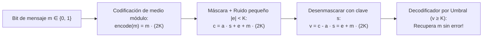

# Lección 05: Criptografía Post-Cuántica Basada en Retículos — *Learning With Errors* (LWE de Regev / Kyber)

> **Navegación del Mini-Curso:** [⬅️ Lección 04: zk-STARKs, Merkle y FRI](04_starks_transparentes_merkle_y_fri.md) | [🏠 Índice](00_indice_minicurso_zk_y_cripto.md) | [➡️ Lección 06: Smart Contracts EVM, CEI y Vickrey](06_verificacion_smart_contracts_evm_y_cei.md)
>
> **Módulos ejecutables relacionados:** [`LeanTT/M62_PostQuantumLatticeCryptoLWE.lean`](../../LeanTT/M62_PostQuantumLatticeCryptoLWE.lean) y [`LeanTT/Exercises/E05_WorkoutQTTPostQuantumAndHardware.lean`](../../LeanTT/Exercises/E05_WorkoutQTTPostQuantumAndHardware.lean).

---

## 1. ¿Por Qué Hace Falta la Criptografía Post-Cuántica?

Toda la criptografía asimétrica desplegada desde los años 1970 (RSA, Diffie-Hellman, curvas elípticas ECDSA/Ed25519 y emparejamientos BLS) descansa sobre problemas de grupos abelianos (factorización de enteros o logaritmo discreto) que el **Algoritmo Cuántico de Peter Shor (1994)** resuelve en **tiempo polinómico** mediante la Transformada Cuántica de Fourier.

Para proteger las comunicaciones y las cadenas de bloques frente a computadores cuánticos, el **NIST** estandarizó en 2024 la familia de criptografía basada en **Retículos Euclídeos (*Lattice-Based Cryptography*)**:
* **ML-KEM (CRYSTALS-Kyber)** para encapsulación de claves y cifrado.
* **ML-DSA (CRYSTALS-Dilithium)** para firmas digitales.

Ambos estándares se fundamentan en el problema **Learning With Errors (LWE)** introducido por **Oded Regev en 2005**.

---

## 2. Anatomía Matemática del Esquema LWE: Añadir Ruido para Ocultar la Clave

¿Por qué es difícil LWE?
* Si alguien te da un sistema de ecuaciones lineales **exactas** sin ruido:
  $$\begin{aligned} a_1 \cdot s &= b_1 \\ a_2 \cdot s &= b_2 \end{aligned}$$
  puedes despejar la clave secreta $s$ en milisegundos mediante **eliminación gaussiana** (o el algoritmo de Euclides).
* Pero si a cada ecuación se le suma un **pequeño error o ruido aleatorio** $e_i \in (-B, B)$:
  $$b_i \;=\; a_i \cdot s + e_i$$
  la eliminación gaussiana **amplifica exponencialmente el ruido** al combinar filas, destruyendo toda la información. Encontrar $s$ equivale a encontrar el punto del retículo más cercano a un vector ruidoso (**Closest Vector Problem — CVP**), un problema NP-duro para el que no existe ningún algoritmo cuántico eficiente conocido.



---

## 3. El Presupuesto de Ruido (*Noise Budget*) y la Condición $|e| < q/4$

En nuestro módulo [`LeanTT/M62_PostQuantumLatticeCryptoLWE.lean`](../../LeanTT/M62_PostQuantumLatticeCryptoLWE.lean), parametrizamos el esquema por el cuarto de módulo $K > 0$ (de modo que la mitad del módulo es $2K$ y el módulo completo es $q = 4K$):
* Cuando ciframos **`m = false` ($0$)**, la señal desenmascarada es $v = e + 0 = e$.
  Como $-K < e < K$, se cumple garantizadamente que **$v < K$**, por lo que el decodificador por umbral `decide (K ≤ v)` devuelve **`false`**.
* Cuando ciframos **`m = true` ($1$)**, la señal desenmascarada es $v = e + 2K$.
  Como $-K < e$, tenemos $v = 2K + e > 2K - K = K$, es decir, **$K < v$** (y en particular **`K ≤ v`**), por lo que el decodificador devuelve **`true`**.

¡La condición **$-K < e < K$** es la frontera geométrica exacta que impide un fallo de desencriptado (*decryption failure*)!

---

## 4. Cifrado Homomórfico Aditivo y Crecimiento del Ruido en Lean 4

Los esquemas basados en LWE (como TFHE, BGV, BFV y CKKS) permiten además realizar **Cifrado Totalmente Homomórfico (FHE)**: calcular sobre datos cifrados sin descifrarlos primero.

Al sumar dos textos cifrados $c_1 = a_1 s + e_1 + \text{msg}_1$ y $c_2 = a_2 s + e_2 + \text{msg}_2$, sus ruidos se suman ($e_1 + e_2$). Demostremos en Lean 4 que si cada texto cifrado tiene un ruido acotado por la mitad del presupuesto ($|e_1| < K/2$ y $|e_2| < K/2$), su combinación homomórfica sigue dentro del presupuesto de ruido total $(-K, K)$:

```lean
import LeanTT.M62_PostQuantumLatticeCryptoLWE

namespace CursoZK.Leccion05

open LeanTT.M62

/-- TEOREMA (Conservación del Presupuesto de Ruido en Suma Homomórfica LWE):
    Si dos muestras LWE tienen ruidos individuales `e1, e2` acotados por un semi-presupuesto `B`
    (`-B < e1 < B` y `-B < e2 < B`) tal que `2 * B ≤ K`, entonces el ruido acumulado `e1 + e2`
    tras una suma homomórfica sigue estrictamente dentro de la zona segura de desencriptado `(-K, K)`! -/
theorem lwe_homomorphic_noise_budget (K B e1 e2 : Int)
    (hBudget : 2 * B ≤ K)
    (h1Low : -B < e1) (h1High : e1 < B)
    (h2Low : -B < e2) (h2High : e2 < B) :
    -K < e1 + e2 ∧ e1 + e2 < K := by
  omega

end CursoZK.Leccion05
```

---

## 5. Ejercicio Práctico de la Lección 05

### Ejercicio 5.1: ¿Qué Ocurre cuando el Ruido Supera el Umbral $K$ (*Decryption Failure*)?
Demuestra en Lean 4 que si el ruido $e$ se sale de la cota $|e| < K$ y alcanza $e = K$, entonces cifrar el bit `m = false` ($0$) produce un **error de desencriptado**: `lweDecrypt K s a (lweEncrypt K s a K false) = true` (se decodifica erróneamente como `true`).

<details>
<summary>💡 <b>Ver Solución Comentada en Lean 4</b></summary>

```lean
import LeanTT.M62_PostQuantumLatticeCryptoLWE

open LeanTT.M62

/-- Cuando el ruido `e = K` invade el radio de decisión `K`, el bit `false` se corrompe a `true`: -/
theorem lwe_decryption_failure_when_noise_reaches_K (K s a : Int) :
    lweDecrypt K s a (lweEncrypt K s a K false) = true := by
  unfold lweDecrypt
  rw [lweUnmask_lweEncrypt]
  simp only [lweDecode, encodeBitLWE, Bool.false_eq_true, ↓reduceIte, Int.add_zero,
    decide_eq_true_eq]
  omega
```
</details>

---

👉 **Siguiente lección:** [**Lección 06 — Verificación Formal de Smart Contracts (EVM) y Mecanismos Económicos: Conservación, Patrón CEI y Subasta de Vickrey**](06_verificacion_smart_contracts_evm_y_cei.md)
