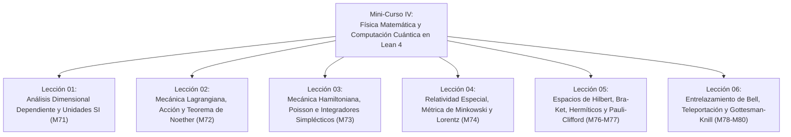

# Mini-Curso IV: Física Matemática, Mecánica Clásica, Relatividad Especial y Computación Cuántica en Lean 4

> **Proyectos del ecosistema relacionados:** **[PhysLean (HepLean)](https://github.com/HEPLean/PhysLean)**, **[SciLean](https://github.com/lecopivo/SciLean)** y compiladores cuánticos verificados (**VOQC / SQIR**).
>
> **Módulos Lean 4 ejecutables asociados:** [`M66`](../../LeanTT/M66_ReversibleAndQuantumGateLogic.lean), [`M71`](../../LeanTT/M71_DimensionalAnalysisAndSIUnits.lean), [`M72`](../../LeanTT/M72_LagrangianMechanicsAndEulerLagrange.lean), [`M73`](../../LeanTT/M73_HamiltonianMechanicsAndPoissonBrackets.lean), [`M74`](../../LeanTT/M74_SpecialRelativityAndMinkowskiMetric.lean), [`M75`](../../LeanTT/M75_StatisticalMechanicsAndEntropy.lean), [`M76`](../../LeanTT/M76_QuantumHilbertSpacesAndBraKet.lean), [`M77`](../../LeanTT/M77_PauliCliffordAlgebraAndUnitarity.lean), [`M78`](../../LeanTT/M78_QuantumEntanglementAndBellStates.lean), [`M79`](../../LeanTT/M79_NoCloningTeleportationAndDeutschJozsa.lean), [**`M80` (Proyecto Cumbre V)**](../../LeanTT/M80_VerifiedQuantumCircuitCompilerAndStabilizers.lean) y el [**Taller 06 (`E06` / `S06`)**](../../LeanTT/Exercises/E06_WorkoutPhysicsAndQuantumMechanics.lean).

---

## 🎯 Propósito de este Cuarto Mini-Curso

En 1900 **David Hilbert** propuso como **Sexto Problema** axiomatizar las leyes fundamentales de la Física con el mismo rigor deductivo que la geometría o la aritmética. Hoy, gracias a la **Teoría de Tipos Dependientes en Lean 4**, podemos ir aún más lejos:
* **Convertir el análisis dimensional en tipos estáticos** que impiden compilar ecuaciones físicamente mal formadas.
* **Demostrar en el kernel los grandes teoremas estructurales de la física teórica:** el Principio de Mínima Acción de Hamilton, el **Teorema de Emmy Noether**, la **Identidad de Jacobi** y el **Teorema de Liouville** simpléctico, la **Invariancia del Cono de Luz de Minkowski** y el **Balance Detallado de Boltzmann**.
* **Verificar algoritmos y protocolos cuánticos sin errores de coma flotante:** estados entrelazados de **Bell**, **Teorema de No-Clonación**, **Teleportación Cuántica**, **Algoritmo de Deutsch** y el **Teorema de Gottesman-Knill**.

---

## 🗺️ Mapa Conceptual del Mini-Curso IV

---

## 📚 Plan de Estudios de las 6 Lecciones

| Lección | Documento `.md` | Módulos `.lean` | Qué Aprenderás y Demostrarás en Lean 4 |
| :---: | :--- | :---: | :--- |
| **01** | [**01_analisis_dimensional_y_unidades_dependientes.md**](01_analisis_dimensional_y_unidades_dependientes.md) | `M71`, `E06` | El grupo abeliano $\mathbb{Z}^7$ del Sistema Internacional como índice de `Quantity d`, prevención estática de fallos tipo *Mars Climate Orbiter* y teorema trabajo-energía. |
| **02** | [**02_mecanica_lagrangiana_accion_y_noether.md**](02_mecanica_lagrangiana_accion_y_noether.md) | `M38`, `M72`, `E06` | Cálculo variacional discreto, equivalencia $\delta S = 0 \iff \text{Euler-Lagrange}$, **Teorema de Noether** (simetría de traslación $\implies$ conservación del momento) y oscilador armónico. |
| **03** | [**03_mecanica_hamiltoniana_poisson_y_simpleticos.md**](03_mecanica_hamiltoniana_poisson_y_simpleticos.md) | `M73`, `M75`, `S06` | Espacio de fases $(q, p)$, 2-forma simpléctica $\omega$, **Identidad de Jacobi** en $\mathfrak{sp}(2)$, **Teorema de Liouville Discreto** para integradores simplécticos y equilibrio térmico de Boltzmann. |
| **04** | [**04_relatividad_especial_minkowski_y_lorentz.md**](04_relatividad_especial_minkowski_y_lorentz.md) | `M74`, `E06` | Cuadrivectores en $\mathbb{R}^{1,3}$, causalidad, *boosts* hiperbólicos exactos, **invariancia del cono de luz**, relación $E^2 - p^2 = m_0^2$ y barrera sublumínica $|u \oplus_c v| < c$. |
| **05** | [**05_espacios_hilbert_braket_y_algebra_pauli.md**](05_espacios_hilbert_braket_y_algebra_pauli.md) | `M76`, `M77`, `S06` | Amplitudes complejas exactas en $\mathbb{Z}[i]$, regla de Born, realidad de valores esperados hermíticos ($A^\dagger = A$), álgebra de espín de Pauli y cambio de base de Clifford ($H X H = Z$). |
| **06** | [**06_entrelazamiento_bell_teleportacion_y_compilador_cuantico.md**](06_entrelazamiento_bell_teleportacion_y_compilador_cuantico.md) | `M78`, `M79`, `M80` | Prueba formal de **Entrelazamiento de Bell**, **Teorema de No-Clonación**, **Teleportación Cuántica** en 3 qubits, algoritmo de **Deutsch** y **Proyecto Cumbre V** (optimizador de circuitos y **Gottesman-Knill**). |

---

👉 **Comenzar el curso:** [**Lección 01 — Análisis Dimensional Dependiente y Seguridad Estática del Sistema Internacional (SI) en Lean 4**](01_analisis_dimensional_y_unidades_dependientes.md)
