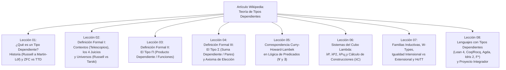

# Mini-Curso Completo de Teoría de Tipos Dependientes (Edición Ampliada de Wikipedia)

> **Referencia base ampliada:** [Teoría de Tipos Dependientes — Wikipedia en español](https://es.wikipedia.org/wiki/Teor%C3%ADa_de_Tipos_Dependientes)
>
> **Módulos Lean 4 ejecutables asociados:** [`M01`](../../LeanTT/M01_LambdaCalculus.lean), [`M02`](../../LeanTT/M02_DependentTypes.lean), [`M03`](../../LeanTT/M03_UniversesAndProp.lean), [`M04`](../../LeanTT/M04_CurryHoward.lean), [`M05`](../../LeanTT/M05_InductiveFamilies.lean), [`M06`](../../LeanTT/M06_EqualityAndTransport.lean), [`M13`](../../LeanTT/M13_FoundationsOfDependentTypeTheory.lean), [`M15`](../../LeanTT/M15_DidacticDependentTypesFromZero.lean), [`M16`](../../LeanTT/M16_DidacticLambdaCubeAndPTS.lean), [`M23`](../../LeanTT/M23_HoTTAndHomotopyPaths.lean), [`M40`](../../LeanTT/M40_MiniDependentTypeChecker.lean) y [`M50`](../../LeanTT/M50_BidirectionalElaboratorAndUnification.lean).

---

## 🎯 Propósito de este Mini-Curso

El artículo enciclopédico de Wikipedia sobre la **[Teoría de Tipos Dependientes](https://es.wikipedia.org/wiki/Teor%C3%ADa_de_Tipos_Dependientes)** condensa en unas pocas secciones un siglo de lógica matemática y ciencias de la computación: desde la historia de Per Martin-Löf y la jerarquía de universos al estilo de Russell o Tarski, pasando por los tipos $\Pi$ (funciones dependientes) y $\Sigma$ (pares dependientes), los sistemas del **Cubo Lambda ($\lambda P, \lambda P2, \lambda P\underline{\omega}, \lambda C$)** y los lenguajes modernos (Agda, Coq/Rocq, Idris, F\*, Epigram, Lean).

Este **Mini-Curso de 8 Lecciones Progresivas** toma exactamente el esqueleto temático de dicho artículo de Wikipedia y **amplía cada uno de sus apartados en profundidad**, añadiendo:
1. **Intuición pedagógica desde cero** con analogías cotidianas y diagramas visuales.
2. **Reglas de inferencia completas** en notación de Gentzen ($\text{Formación}, \text{Introducción}, \text{Eliminación}, \beta, \eta$).
3. **Demostraciones y programas ejecutables en Lean 4** para cada concepto teórico.
4. **Ejercicios propuestos y resueltos** al final de cada lección para afianzar el aprendizaje.

---

## 🗺️ Mapa de Correspondencia: Wikipedia $\longrightarrow$ Mini-Curso en `docs/curso_teoria_tipos_dependientes/`

---

## 📚 Plan de Estudios de las 8 Lecciones

| Lección | Documento `.md` | Apartado de Wikipedia que Amplía | Conceptos Clave y Código Lean 4 |
| :---: | :--- | :--- | :--- |
| **01** | [**01_introduccion_e_historia_ttd.md**](01_introduccion_e_historia_ttd.md) | Introducción e **Historia** | Qué significa que un tipo dependa de un valor (`Vec α n`, `Matrix m n`); Paradoja de Russell (1901), BHK, `Automath` (1967), Martin-Löf (1971–1984), Paradoja de Girard y diferencia entre ZFC ($\in$) y TTD ($:$). |
| **02** | [**02_juicios_contextos_y_universos.md**](02_juicios_contextos_y_universos.md) | **Definición formal** (Universos y Familias) | Telescopios $\Gamma$, los 4 juicios de Martin-Löf, **Universos al estilo de Russell vs. Tarski** ($\mathcal{U}_i$ vs $\text{El}$), `Sort u`, `Prop`, función `imax`, familias $B : A \to \mathcal{U}_i$ y las 5 reglas canónicas. |
| **03** | [**03_tipos_pi_funciones_dependientes.md**](03_tipos_pi_funciones_dependientes.md) | **Producto dependiente ($\Pi$-Type)** | Reglas formales de $\prod_{x:A} B(x)$, intuición geométrica de fibraciones y secciones, reducción al tipo función $A \to B$, polimorfismo, `replicate` y `printf` dependientemente tipado. |
| **04** | [**04_tipos_sigma_pares_dependientes.md**](04_tipos_sigma_pares_dependientes.md) | **Suma dependiente ($\Sigma$-Type)** | Reglas formales de $\sum_{x:A} B(x)$, pares dependientes $\langle a, b \rangle$, proyecciones $\pi_1, \pi_2$, reducción a $A \times B$, `Sigma` vs `Subtype` vs `Exists`, y demostración del **Axioma de Elección Constructivo**. |
| **05** | [**05_curry_howard_y_logica_predicados.md**](05_curry_howard_y_logica_predicados.md) | **Correspondencia de Curry-Howard** | Cómo $\Pi$ modela $\forall$ y $\Sigma$ modela $\exists$; cuantificación acotada, negación constructiva, leyes de De Morgan cuantificadas, adjunción $\Sigma_f \dashv f^* \dashv \Pi_f$ y lógica intuicionista vs clásica. |
| **06** | [**06_cubo_lambda_y_sistemas_tipos_puros.md**](06_cubo_lambda_y_sistemas_tipos_puros.md) | **Sistemas del cubo lambda** | Los 3 ejes de Barendregt y análisis detallado de los **4 sistemas con tipos dependientes**: $\lambda P$ (LF), $\lambda P2$, $\lambda P\underline{\omega}$ y $\lambda C$ (Cálculo de Construcciones), formulados como Sistemas de Tipos Puros (PTS). |
| **07** | [**07_igualdad_intensional_extensional_y_hott.md**](07_igualdad_intensional_extensional_y_hott.md) | **Igualdad, $W$-Types y Teoría Homotópica (HoTT)** | Árboles bien fundados ($W$-types), tipo identidad $\text{Id}_A(a,b)$, eliminador $J$, transporte, **TTD Intensional vs Extensional** (regla de reflexión), UIP/Axioma $K$ y el **Axioma de Univalencia** en HoTT. |
| **08** | [**08_lenguajes_comparativa_y_aplicaciones.md**](08_lenguajes_comparativa_y_aplicaciones.md) | **Lenguajes con tipos dependientes** | Comparativa arquitectónica profunda entre **Lean 4, Coq/Rocq, Agda, Idris 2 (QTT), F\*, Twelf y Epigram**, criterios de diseño (borrado de tipos, Perceus, tácticas) y **Taller Práctico Integrador**. |

---

## 🚀 ¿Cómo Seguir Este Mini-Curso?

1. **Lectura secuencial (`01` $\to$ `08`):** Cada lección comienza con un resumen ejecutivo de 2 minutos, desarrolla la teoría paso a paso y termina con un bloque de **código Lean 4 listo para copiar y ejecutar** y **ejercicios con solución desplegable**.
2. **Práctica en vivo con los Módulos del Repositorio:** Al inicio de cada lección encontrarás enlaces directos a los archivos `.lean` de la carpeta [`LeanTT/`](../../LeanTT/) donde todos los teoremas están verificados por el kernel de Lean 4 sin un solo `sorry`.

👉 **Comenzar el curso:** [**Lección 01 — ¿Qué es un Tipo Dependiente? Orígenes Históricos y Comparativa con ZFC**](01_introduccion_e_historia_ttd.md)
