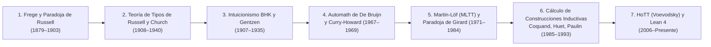

# Lección 01: ¿Qué es un Tipo Dependiente? Orígenes Históricos y Comparativa con ZFC

> **Navegación del Mini-Curso:** [⬅️ Índice del Mini-Curso](00_indice_minicurso_ttd.md) | [➡️ Lección 02: Juicios, Contextos y Universos](02_juicios_contextos_y_universos.md)
>
> **Apartados de Wikipedia ampliados:** Introducción general y sección *«Historia»* de [Teoría de Tipos Dependientes](https://es.wikipedia.org/wiki/Teor%C3%ADa_de_Tipos_Dependientes).
>
> **Módulos ejecutables relacionados:** [`LeanTT/M15_DidacticDependentTypesFromZero.lean`](../../LeanTT/M15_DidacticDependentTypesFromZero.lean) y [`LeanTT/M13_FoundationsOfDependentTypeTheory.lean`](../../LeanTT/M13_FoundationsOfDependentTypeTheory.lean).

---

## 1. Idea Intuitiva: ¿Qué Significa que un Tipo «Dependa de un Valor»?

En las ciencias de la computación y en la lógica matemática, un **tipo dependiente** es un tipo cuya definición o estructura **depende de un valor (término) concreto** de otro tipo.

### 1.1 El Límite de los Sistemas de Tipos Convencionales
En la mayoría de los lenguajes de programación estáticamente tipados (como C, Java, Rust, TypeScript o Haskell estándar), el mundo de los **tipos** y el mundo de los **valores** viven en compartimentos estancos:
* Puedes tener un tipo parametrizado por **otro tipo** (polimorfismo o *generics*): `List<T>`, `Option<Nat>`, `Map<String, Int>`.
* Pero **no** puedes tener un tipo parametrizado por un **valor arbitrario calculado en el lenguaje**, como un número natural $n$, una cadena de formato `"Edad: %d"` o el estado actual de un protocolo.

Por ejemplo, para el sistema de tipos de Java o Haskell estándar:
* La lista vacía `[]` tiene tipo `List Int`.
* La lista `[42]` tiene tipo `List Int`.
* La lista `[1, 2, 3, 4, 5]` tiene tipo `List Int`.

Como el tipo `List Int` ha **olvidado** cuántos elementos contiene la lista, el compilador es incapaz de distinguir una lista vacía de una no vacía. Si escribes `head []`, el programa compila sin quejarse y **explota en tiempo de ejecución**.

### 1.2 El Salto a los Tipos Dependientes
En una **Teoría de Tipos Dependientes** (como la implementada en **Lean 4**, Agda, Coq/Rocq o Idris), los tipos son ciudadanos de primera clase que pueden recibir **valores ordinarios como argumentos**:

| Ejemplo Clásico | Tipo Dependiente | ¿De qué valor depende? | ¿Qué errores imposibilita en tiempo de compilación? |
| :--- | :--- | :--- | :--- |
| **Vectores de longitud fija** | `Vec α n` | Del número natural `n : Nat` | Extraer la cabeza de un vector vacío (`head : Vec α (n + 1) → α`) o sumar vectores de distinta longitud. |
| **Matrices dimensionadas** | `Matrix ℝ m n` | De las dimensiones `m, n : Nat` | Multiplicar una matriz $m \times n$ por una $p \times q$ cuando $n \neq p$: `mul : Matrix ℝ m n → Matrix ℝ n k → Matrix ℝ m k`. |
| **Ordinales acotados** | `Fin n` | Del límite superior `n : Nat` | Accesos fuera de rango (*buffer overflow*): un habitante de `Fin n` es un par $\langle i, h \rangle$ con $i < n$ garantizado. |
| **Formateo seguro (`printf`)** | `PrintfType fmt` | De la cadena literal `fmt : String` | Pasar un `String` donde el formato `"%d"` esperaba un `Nat`, o pasar menos argumentos de los indicados. |
| **Proposiciones matemáticas** | `EsPar n`, `a = b` | De los valores `n`, `a`, `b` | Afirmar que un teorema es cierto sin adjuntar un término (prueba) que habite dicho tipo. |

Veamos cómo luce esto directamente en **Lean 4**:

```lean
/-- Una función que calcula un TIPO distinto según el valor booleano `esTresDimensiones`: -/
def EspacioCoordenadas (esTresDimensiones : Bool) : Type :=
  if esTresDimensiones then
    Float × Float × Float
  else
    Float × Float

/-- El tipo de retorno de `origen` cambia dinámicamente según el valor booleano de entrada: -/
def origen (b : Bool) : EspacioCoordenadas b :=
  match b with
  | true  => (0.0, 0.0, 0.0) -- Tiene tipo `EspacioCoordenadas true`  ≡ `Float × Float × Float`
  | false => (0.0, 0.0)      -- Tiene tipo `EspacioCoordenadas false` ≡ `Float × Float`
```

---

## 2. Historia Ampliada de la Teoría de Tipos Dependientes (1879–Presente)

El artículo de Wikipedia resume la historia en torno a **Bertrand Russell**, **Alonzo Church** y **Per Martin-Löf**. Para comprender verdaderamente *por qué* las reglas de la teoría de tipos dependientes son como son, recorramos las **siete etapas históricas** que la forjaron.



### 2.1 De Frege a la Paradoja de Russell (1879–1908)
* **Gottlob Frege** intentó fundamentar la aritmética en la lógica mediante su *Ley Básica V*, que permitía formar la extensión $\{x \mid P(x)\}$ de cualquier predicado sin distinguir entre el nivel de los objetos y el nivel de los predicados.
* En **1901**, **Bertrand Russell** descubrió que al tomar $P(x) :\equiv x \notin x$, el conjunto $R = \{x \mid x \notin x\}$ verifica $R \in R \iff R \notin R$.
* Para restaurar la consistencia sin abandonar el logicismo, Russell introdujo en **1903** (y desarrolló junto a Whitehead en *Principia Mathematica*, 1910–1913) la **Teoría de Tipos**: cada entidad matemática pertenece a un estrato jerárquico, de modo que aplicar una función o predicado a sí mismo ($f(f)$ o $x \in x$) es **gramaticalmente inválido (mal tipado)**.
* En **1926**, **Frank P. Ramsey** simplificó la compleja jerarquía ramificada de Russell proponiendo la **Teoría Simple de Tipos**, y en **1940** **Alonzo Church** la fusionó con su cálculo $\lambda$ (1932), dando lugar al **Cálculo Lambda Simplemente Tipado ($\lambda^\to$)**.

### 2.2 La Semántica Constructiva BHK y la Deducción Natural de Gentzen (1930–1935)
Mientras la escuela clásica interpretaba una proposición por su valor de verdad platónico ($\text{Verdadero}/\text{Falso}$), **Brouwer, Heyting y Kolmogorov (interpretación BHK)** propusieron que el significado de una proposición matemática es el **tipo de sus construcciones (demostraciones)**:
* Demostrar $\forall x \in A,\, B(x)$ consiste en dar una **función efectiva** que transforme cada elemento $a \in A$ en una demostración de $B(a)$.
* Demostrar $\exists x \in A,\, B(x)$ consiste en dar un **par** $\langle a, p \rangle$ formado por un elemento concreto $a \in A$ y una demostración $p$ de la propiedad $B(a)$ para ese elemento específico.

En **1934**, **Gerhard Gentzen** descubrió en su **Deducción Natural** que toda conectiva lógica se rige por un par simétrico de reglas: **Introducción** (constructores) y **Eliminación** (destructores/eliminadores), cuya composición se simplifica mediante la **eliminación de cortes (normalización)**.

### 2.3 El Eslabón Perdido: `Automath` de N. G. de Bruijn (1967) y William Howard (1969)
* Mientras **Haskell Curry (1934, 1958)** había notado la identidad entre la lógica implicacional ($A \to B$) y los tipos simples de funciones, faltaba dar el salto a la **lógica de predicados con cuantificadores ($\forall, \exists$)**.
* En **1967**, el matemático neerlandés **Nicolaas Govert de Bruijn** creó en Eindhoven el proyecto **Automath**, el primer lenguaje formal de la historia diseñado para verificar libros enteros de matemáticas por ordenador. En Automath, las variables de un contexto formaban un *telescopio* y una proposición dependiente de un número real $x$ se modelaba literalmente como una familia de tipos indexada por $x$.
* En **1969**, **William Alvin Howard** redactó su famoso artículo *"The formulae-as-types notion of construction"*, haciendo explícito que la interpretación BHK de los cuantificadores $\forall x : A, B(x)$ y $\exists x : A, B(x)$ equivale exactamente a introducir dos constructores de **tipos dependientes**: el producto dependiente ($\Pi$) y la suma dependiente ($\Sigma$).

### 2.4 Per Martin-Löf, la Paradoja de Girard y la Madurez de MLTT (1971–1984)
El lógico sueco **Per Martin-Löf** formuló a partir de **1971** su **Teoría Intuicionista de Tipos (MLTT)** como fundamento constructivo completo de las matemáticas:
1. **El tropiezo de 1971 (`Type : Type`) y la Paradoja de Girard (1972):** En la primera versión inédita de 1971, Martin-Löf incluyó un único universo universal $\mathcal{V}$ que se pertenecía a sí mismo ($\mathcal{V} : \mathcal{V}$). **Jean-Yves Girard** demostró en 1972 que esto permitía reproducir la paradoja de Burali-Forti de los ordinales dentro de la teoría de tipos (**Paradoja de Girard**, posteriormente simplificada por **Antonius Hurkens** en 1995), haciendo que todo tipo fuera habitado (inconsistencia lógica).
2. **La solución predicativa (1973–1975):** Martin-Löf reemplazó $\mathcal{V} : \mathcal{V}$ por una **jerarquía infinita numerable de universos predicativos**:
   $$\mathcal{U}_0 : \mathcal{U}_1 : \mathcal{U}_2 : \mathcal{U}_3 : \dots$$
   e introdujo el **Tipo Identidad Intensional** $\text{Id}_A(a, b)$ junto con el principio de inducción sobre la igualdad ($J$).
3. **La versión extensional (1979/1984):** En su monografía de Bibliopolis (*Intuitionistic Type Theory*, 1984), exploró la variante extensional (adoptada por el asistente **NuPRL**), donde toda igualdad demostrada colapsa en igualdad definicional.

### 2.5 Del Cálculo de Construcciones (1985) a HoTT y Lean 4 (2006–Presente)
* **Coquand y Huet (1985–1988):** Crearon el **Cálculo de Construcciones ($\lambda C$)**, uniendo los tipos dependientes con el polimorfismo impredicativo de Girard.
* **Paulin-Mohring y Coquand (1989–1993):** Añadieron tipos inductivos generales y la jerarquía de universos, creando el **Cálculo de Construcciones Inductivas (CIC)**.
* **Voevodsky, Awodey y Warren (2006–2013):** Descubrieron que en la teoría intensional de Martin-Löf un tipo se comporta como un **espacio topológico ($\infty$-grupoide)** y una prueba de igualdad $p : a =_A b$ como un **camino continuo**, fundando la **Teoría Homotópica de Tipos (HoTT)**.
* **Leonardo de Moura y Sebastian Ullrich (2013–2021+):** Crearon **Lean 3** y **Lean 4**, combinando un kernel minimalista basado en CIC + cocientes computacionales con un compilador funcional de alto rendimiento y metaprogramación reflexiva.

---

## 3. Teoría de Tipos Dependientes vs. Teoría de Conjuntos (ZFC)

El artículo de Wikipedia destaca que la Teoría de Tipos Dependientes actúa como una **alternativa moderna a la teoría de conjuntos** para fundamentar las matemáticas. ¿En qué se diferencian exactamente?

| Aspecto | Teoría Axiomática de Conjuntos (ZFC) | Teoría de Tipos Dependientes (MLTT / Lean 4) |
| :--- | :--- | :--- |
| **Relación fundamental** | **Pertenencia ($a \in A$):** Es una proposición lógica que relaciona dos conjuntos cualesquiera. Tiene sentido gramatical preguntarse si $\emptyset \in \pi$ o si $2 \in 3$. | **Tipado ($a : A$):** Es un **juicio constitutivo**. Todo término nace con su tipo intrínseco; no existe un término "desnudo" fuera de su tipo. |
| **Arquitectura lógica** | **Bicameral:** La Lógica de Primer Orden (conectivas $\land, \lor, \to, \forall, \exists$) se construye *antes* y *por separado* de los axiomas de conjuntos. | **Unificada (Curry-Howard):** No hay una capa lógica separada; las conectivas y cuantificadores *son* constructores de tipos ($\times, +, \to, \Pi, \Sigma$). |
| **Basura ontológica** | En la codificación de Von Neumann ($0=\emptyset, 1=\{0\}, 2=\{0,1\}$), el teorema "$1 \in 2$" o "$\emptyset \subseteq \mathbb{R}$" es verdadero por accidente de representación. | **Abstracción estructural fuerte:** `Nat`, `Real` y `Bool` son tipos disjuntos. No existen relaciones parásitas entre sus codificaciones internas. |
| **Noción de cálculo** | **Estática:** Una función es un conjunto de pares ordenados $(x, y)$. No existe reducción ni evaluación en los axiomas de ZFC. | **Dinámica y computacional:** Las funciones son algoritmos ($\lambda$-términos) y el kernel incluye reglas de cómputo ($\beta, \delta, \iota, \zeta$). |
| **Verificación mecánica** | Saber si $a \in A$ requiere demostrar un teorema arbitrario (**indecidible**). | Saber si $\Gamma \vdash a : A$ es un chequeo sintáctico **algorítmicamente decidible** (en TTD intensional). |

---

## 4. Ejercicios Prácticos de la Lección 01 (en Lean 4)

Puedes probar estos ejercicios en cualquier archivo de tu entorno Lean 4 o en el [Lean 4 Web Playground](https://live.lean-lang.org/):

### Ejercicio 1.1: Tu primera familia de tipos dependientes
Define una función `TipoSegunNumero : Nat → Type` que devuelva:
* `Unit` cuando el número sea `0`.
* `Bool` cuando el número sea `1`.
* `Nat × Nat` para cualquier otro número $n \ge 2$.
A continuación, define una función dependiente `habitantePorDefecto (n : Nat) : TipoSegunNumero n`.

<details>
<summary>💡 <b>Ver Solución Comentada en Lean 4</b></summary>

```lean
/-- Familia de tipos indexada por `Nat`: el tipo devuelto depende del valor de `n` -/
def TipoSegunNumero : Nat → Type
  | 0 => Unit
  | 1 => Bool
  | _ => Nat × Nat

/-- Función dependiente (Π-type): el tipo de retorno cambia en cada rama del `match`! -/
def habitantePorDefecto : (n : Nat) → TipoSegunNumero n
  | 0     => ()       -- Tipo esperado: `TipoSegunNumero 0` ≡ `Unit`
  | 1     => true     -- Tipo esperado: `TipoSegunNumero 1` ≡ `Bool`
  | k + 2 => (k, k)   -- Tipo esperado: `TipoSegunNumero (k + 2)` ≡ `Nat × Nat`

#eval habitantePorDefecto 0 -- ()
#eval habitantePorDefecto 1 -- true
#eval habitantePorDefecto 5 -- (3, 3)
```
</details>

### Ejercicio 1.2: Por qué `a : A` impide paradojas de autorreferencia
Intenta explicar (y comprobar en Lean 4) por qué no se puede aplicar una función $f : A \to B$ a sí misma escribiendo `f f`.

<details>
<summary>💡 <b>Ver Solución Comentada</b></summary>

Para que la aplicación `f a` esté bien tipada cuando `f : A → B`, el argumento `a` debe tener exactamente tipo `A`. Si intentamos pasar `f` como argumento de `f`, necesitaríamos que el tipo de `f` (que es `A → B`) coincidiera con el dominio `A`, es decir, $A \equiv (A \to B)$, lo cual es imposible para expresiones de tipos finitas. Así, la estratificación por tipos bloquea de raíz la autorreferencia no tipada $(\lambda x.\, x\; x)$ que originó las paradojas de Russell y Curry.
</details>

---

👉 **Siguiente lección:** [**Lección 02 — Definición Formal I: Contextos (Telescopios), los 4 Juicios y Universos (Russell vs. Tarski)**](02_juicios_contextos_y_universos.md)
