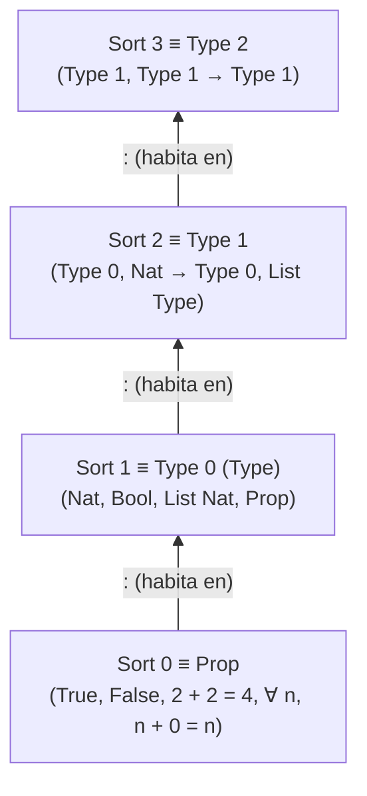
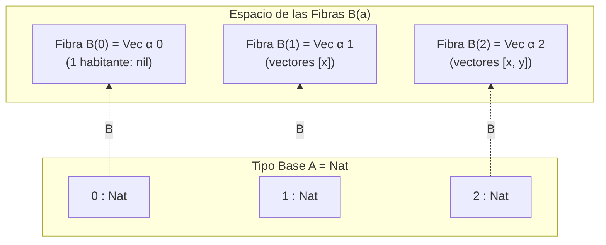

# Lección 02: Definición Formal I — Contextos (Telescopios), los 4 Juicios y Universos (Russell vs. Tarski)

> **Navegación del Mini-Curso:** [⬅️ Lección 01: Introducción e Historia](01_introduccion_e_historia_ttd.md) | [🏠 Índice](00_indice_minicurso_ttd.md) | [➡️ Lección 03: El Tipo Π (Funciones Dependientes)](03_tipos_pi_funciones_dependientes.md)
>
> **Apartado de Wikipedia ampliado:** Inicio de *«Definición formal»* (Universos $\mathcal{U}_i$ al estilo de Russell/Tarski y familias de tipos $B : A \to \mathcal{U}_i$) en [Teoría de Tipos Dependientes](https://es.wikipedia.org/wiki/Teor%C3%ADa_de_Tipos_Dependientes).
>
> **Módulos ejecutables relacionados:** [`LeanTT/M03_UniversesAndProp.lean`](../../LeanTT/M03_UniversesAndProp.lean), [`LeanTT/M13_FoundationsOfDependentTypeTheory.lean`](../../LeanTT/M13_FoundationsOfDependentTypeTheory.lean) y [`LeanTT/M40_MiniDependentTypeChecker.lean`](../../LeanTT/M40_MiniDependentTypeChecker.lean).

---

## 1. ¿Por Qué los Contextos son «Telescopios» en Teoría de Tipos Dependientes?

En un sistema de tipos simples (como el cálculo $\lambda^\to$), un **contexto de tipado** $\Gamma = \{x_1 : A_1,\; x_2 : A_2,\; \dots,\; x_n : A_n\}$ es un conjunto (o lista) sin orden relevante porque los tipos $A_1, \dots, A_n$ no pueden mencionar a las variables $x_i$.

En **Teoría de Tipos Dependientes**, el orden es **vital**: el tipo $A_k$ de la variable $x_k$ puede depender de los valores de las variables anteriores $x_1, \dots, x_{k-1}$:

$$\Gamma \;=\; \big( x_1 : A_1,\;\; x_2 : A_2(x_1),\;\; x_3 : A_3(x_1, x_2),\;\; \dots,\;\; x_n : A_n(x_1, \dots, x_{n-1}) \big)$$

N. G. de Bruijn bautizó a estas listas ordenadas de declaraciones dependientes como **telescopios** (*telescopes*), porque cada nuevo segmento $x_k : A_k(x_1, \dots, x_{k-1})$ se despliega apoyándose en los anteriores.

### 1.1 Reglas de Buena Formación de Contextos ($\vdash \Gamma\text{ ctx}$)
Un contexto se construye inductivamente a partir del contexto vacío $()$ mediante dos reglas:

$$
\frac{}{\vdash ()\text{ ctx}} \;(\text{Ctx-Vacío})
\qquad\qquad
\frac{\vdash \Gamma\text{ ctx} \qquad \Gamma \vdash A : \mathcal{U}_i}{\vdash (\Gamma,\; x : A)\text{ ctx}} \;(\text{Ctx-Ext})
$$

Ejemplo de telescopio válido en Lean 4:
```lean
-- Observa cómo cada parámetro a la derecha usa las variables declaradas a su izquierda:
variable (α : Type) (n : Nat) (v : Vector α n) (i : Fin n)
```
Aquí:
1. `α : Type` está bien formado en el contexto vacío.
2. `n : Nat` está bien formado en `(α : Type)`.
3. `v : Vector α n` usa tanto `α` como `n`.
4. `i : Fin n` usa `n`.

---

## 2. Los Cuatro Juicios Formales de Per Martin-Löf

Para definir rigurosamente una teoría de tipos dependientes sin caer en circularidades, Martin-Löf distinguió entre una **proposición interna** (un tipo dentro del lenguaje, como `a = b`) y un **juicio metateórico** (una afirmación que el verificador o kernel comprueba sobre la sintaxis).

Toda la teoría descansa sobre **cuatro formas de juicio** bajo un contexto válido $\Gamma$:

| # | Notación Clásica (Martin-Löf) | Notación de Universo (Lean 4) | Lectura y Significado Metateórico |
| :---: | :--- | :--- | :--- |
| **1** | $\Gamma \vdash A\text{ type}$ | $\Gamma \vdash A : \texttt{Sort } u$ | **$A$ es un tipo bien formado** en el contexto $\Gamma$. |
| **2** | $\Gamma \vdash a : A$ | $\Gamma \vdash a : A$ | **$a$ es un término bien tipado** de tipo $A$ en el contexto $\Gamma$. |
| **3** | $\Gamma \vdash A \equiv B\text{ type}$ | $\Gamma \vdash A \equiv B : \texttt{Sort } u$ | **Igualdad definicional (o judiciaria) de tipos:** $A$ y $B$ se reducen por cómputo al mismo tipo. |
| **4** | $\Gamma \vdash a \equiv b : A$ | $\Gamma \vdash a \equiv b : A$ | **Igualdad definicional de términos:** $a$ y $b$ se reducen por cómputo ($\beta, \delta, \iota, \zeta, \eta$) al mismo valor en $A$. |

### La Regla de Conversión de Tipos (*Type Conversion Rule*)
¿Por qué la igualdad definicional de tipos ($\Gamma \vdash A \equiv B$) es el motor de los tipos dependientes? Porque conecta el cómputo de valores con el chequeo de tipos mediante la **Regla de Conversión**:

$$
\frac{\Gamma \vdash a : A \qquad \Gamma \vdash A \equiv B : \mathcal{U}_i}{\Gamma \vdash a : B} \;(\text{Conv})
$$

Gracias a esta regla, si tienes un vector `v : Vec α (2 + 2)` y una función espera un `Vec α 4`, el kernel de Lean evalúa $2 + 2 \equiv 4$, deduce que `Vec α (2 + 2) ≡ Vec α 4` y acepta `v` automáticamente sin necesidad de ninguna conversión manual.

---

## 3. Universos de Tipos ($\mathcal{U}_i$): Formulación al Estilo de Russell vs. al Estilo de Tarski

El artículo de Wikipedia comienza su sección *«Definición formal»* diciendo:
> *"Formalmente, asumiendo una jerarquía de universos de tipos al estilo de Russell $\mathcal{U}_i$, dado un tipo $A : \mathcal{U}_i$, se puede definir una familia de tipos $B : A \to \mathcal{U}_i$ que asigna a cada término $a : A$ un tipo $B(a) : \mathcal{U}_i$."*

Detengámonos a explicar qué es un **universo de tipos**, por qué hace falta una **jerarquía** $\mathcal{U}_0 : \mathcal{U}_1 : \mathcal{U}_2 : \dots$ y cuál es la diferencia exacta entre un **universo al estilo de Russell** y un **universo al estilo de Tarski**.

### 3.1 ¿Qué es un Universo de Tipos y por qué necesitamos una Jerarquía?
Para poder hablar de *"familias de tipos indexadas por valores"* como funciones ordinarias $B : A \to \mathcal{U}$ (o para cuantificar polimórficamente sobre todos los tipos $\forall (\alpha : \mathcal{U}),\, \alpha \to \alpha$), necesitamos un **tipo cuyos habitantes sean ellos mismos tipos**. Ese "tipo de tipos" se llama un **universo** $\mathcal{U}$.

Sin embargo, como demostró Jean-Yves Girard en 1972 (**Paradoja de Girard**), si permitimos que un único universo $\mathcal{U}$ sea habitante de sí mismo ($\mathcal{U} : \mathcal{U}$), el sistema se vuelve **lógicamente inconsistente** (podemos construir un término cerrado de cualquier tipo, incluido el tipo vacío `False`).

Para evitar la paradoja manteniendo la capacidad de tratar a los tipos como ciudadanos de primera clase, estratificamos los universos en una **jerarquía infinita numerable**:

$$\mathcal{U}_0 : \mathcal{U}_1 : \mathcal{U}_2 : \mathcal{U}_3 : \dots \qquad (\text{en general, } \mathcal{U}_i : \mathcal{U}_{i+1})$$

En **Lean 4**, esta jerarquía se denomina `Sort u` (donde `u` es un nivel de universo natural):
* `Sort 0` es **`Prop`** (el universo de las proposiciones lógicas).
* `Sort 1` es **`Type 0`** (abreviado simplemente **`Type`**: contiene a `Nat`, `Bool`, `String`, `List Nat`, etc.).
* `Sort 2` es **`Type 1`** (contiene a `Type 0` y a constructores como `Type 0 → Type 0`).
* En general, `Sort (u + 1)` es **`Type u`**, y se verifica que `Type u : Type (u + 1)`.



### 3.2 Universos al Estilo de Russell vs. Universos al Estilo de Tarski
En la literatura de teoría de tipos (y tal como menciona explícitamente Wikipedia), existen dos maneras formales de presentar los universos $\mathcal{U}_i$:

| Característica | Universos al Estilo de **Russell** | Universos al Estilo de **Tarski** |
| :--- | :--- | :--- |
| **Idea central** | Los elementos $A : \mathcal{U}_i$ **son directamente tipos**. No se distingue sintácticamente entre un término de tipo $\mathcal{U}_i$ y un tipo. | Los elementos $c : \mathcal{U}_i$ son **códigos (nombres)** de tipos. Para convertir un código $c$ en un tipo real se aplica un operador de **decodificación explícito** $\text{El}_i(c)\text{ type}$. |
| **Regla formal** | $\dfrac{\Gamma \vdash A : \mathcal{U}_i}{\Gamma \vdash A\text{ type}}$ (implícita) | $\dfrac{\Gamma \vdash c : \mathcal{U}_i}{\Gamma \vdash \text{El}_i(c)\text{ type}}$ (con constructor $\hat{\Pi}, \hat{\Sigma}, \widehat{\text{Nat}} : \mathcal{U}_i$) |
| **Ejemplo de familia** | $B : A \to \mathcal{U}_i$, y para cada $a:A$, $B(a)$ ya es un tipo ($x : B(a)$). | $B : A \to \mathcal{U}_i$, y para cada $a:A$, el tipo es $\text{El}_i(B(a))$ ($x : \text{El}_i(B(a))$). |
| **Ventajas** | **Notación limpia, ergonómica y concisa.** Es la usada en la práctica por **Lean 4, Coq/Rocq, Agda e Idris**, y por la presentación de Wikipedia. | **Precisión metateórica absoluta:** evita toda ambigüedad cuando se formaliza la semántica categórica o cuando hay coerciones entre niveles $\mathcal{U}_i \to \mathcal{U}_{i+1}$. |

Podemos modelar ambos estilos en **Lean 4** en apenas unas líneas para ver su equivalencia:

```lean
-- 1. ESTILO DE RUSSELL (nativo en Lean 4):
-- `Type` es un universo de Russell: una función `Bool → Type` devuelve tipos directamente.
def FamiliaRussell (b : Bool) : Type :=
  if b then Nat else Bool

def ejemploRussell : FamiliaRussell true := 42

-- 2. ESTILO DE TARSKI (codificado explícitamente):
-- Definimos un universo de códigos `CodigoU` y su función decodificadora `El : CodigoU → Type`.
inductive CodigoU where
  | nat  : CodigoU
  | bool : CodigoU
  | prod : CodigoU → CodigoU → CodigoU

@[simp]
def El : CodigoU → Type
  | .nat        => Nat
  | .bool       => Bool
  | .prod c1 c2 => El c1 × El c2

def familiaTarski (b : Bool) : CodigoU :=
  if b then .nat else .bool

-- Para habitar el tipo asociado a `familiaTarski true`, aplicamos el decodificador `El`:
def ejemploTarski : El (familiaTarski true) := 42
```

---

## 4. Familias de Tipos Dependientes ($B : A \to \mathcal{U}_i$)

Siguiendo la definición formal de Wikipedia:
> Dado un tipo base $A : \mathcal{U}_i$, una **familia de tipos dependientes** sobre $A$ es una función
> $$B : A \to \mathcal{U}_j$$
> que asigna a cada término (valor) $a : A$ un tipo $B(a) : \mathcal{U}_j$.

### 4.1 Interpretación Geométrica: Espacio Base y Fibras
En topología y geometría algebraica (y en HoTT), una familia de tipos $B : A \to \mathcal{U}$ se visualiza como un **haz de fibras (fibración)** sobre el **espacio base** $A$:
* Cada punto $a : A$ del espacio base tiene encima una **fibra** vertical, que es el tipo $B(a)$.
* Si $a_1 \neq a_2$, las fibras $B(a_1)$ y $B(a_2)$ son tipos completamente distintos (por ejemplo, $B(0) \equiv \texttt{Unit}$, $B(1) \equiv \texttt{Nat}$, $B(2) \equiv \texttt{Nat} \times \texttt{Nat}$).



---

## 5. La Plantilla Universal: Las 5 Reglas Canónicas de Todo Constructor de Tipos

En las siguientes lecciones estudiaremos los grandes constructores de la Teoría de Tipos Dependientes ($\Pi$, $\Sigma$, $+$, $\mathbf{0}$, $\mathbf{1}$, $W$, $\text{Id}$). Todos ellos se definen siguiendo exactamente el **mismo esquema de 5 reglas** ideado por Gentzen y Martin-Löf:

1. **Regla de Formación (*Formation*):** Indica bajo qué premisas podemos construir el nuevo tipo y en qué universo $\mathcal{U}$ habita.
2. **Reglas de Introducción (*Introduction* / Constructores):** Indican cómo construir los habitantes canónicos del tipo.
3. **Reglas de Eliminación (*Elimination* / Eliminadores o Inducción):** Indican cómo consumir un habitante arbitrario del tipo para demostrar una propiedad o producir un valor en un motivo dependiente $C$.
4. **Reglas de Computación ($\beta$-reducción):** Indican cómo se evalúa un eliminador cuando se aplica directamente a un constructor canónico *(armonía local: eliminar lo recién introducido recupera los datos originales)*.
5. **Reglas de Unicidad ($\eta$-expansión/reducción):** Indican que todo habitante queda unívocamente determinado por el resultado de aplicarle sus eliminadores *(completitud local)*.

---

## 6. Ejercicios Prácticos de la Lección 02 (en Lean 4)

### Ejercicio 2.1: Polimorfismo de Universos en Lean 4
Comprueba con `#check` en qué universo vive el tipo de las funciones polimórficas `(α : Type u) → α → α`. ¿Por qué no puede vivir en el mismo universo `Type u`?

<details>
<summary>💡 <b>Ver Solución Comentada en Lean 4</b></summary>

```lean
universe u

-- Como cuantificamos sobre `α : Type u` (donde `Type u : Type (u + 1)`),
-- el tipo completo sube al universo `Type (u + 1)` (predicatividad):
#check (α : Type u) → α → α
-- Resultado: `(α : Type u) → α → α : Type (u + 1)`
```
Si `(α : Type u) → α → α` viviera dentro de `Type u`, podríamos instanciar la variable `α` consigo misma (impredicatividad en `Type`), lo que combinado con eliminación dependiente permite reconstruir la Paradoja de Girard. En Lean 4, **solo `Prop` (`Sort 0`) es impredicativo**.
</details>

### Ejercicio 2.2: Ampliar el Universo al Estilo de Tarski
Añade al tipo `CodigoU` de la Sección 3.2 un constructor `funType : CodigoU → CodigoU → CodigoU` que represente el código del tipo función, extiende el decodificador `El` y construye un habitante de `El (.funType .nat .bool)`.

<details>
<summary>💡 <b>Ver Solución Comentada en Lean 4</b></summary>

```lean
inductive CodigoU2 where
  | nat     : CodigoU2
  | bool    : CodigoU2
  | funType : CodigoU2 → CodigoU2 → CodigoU2

@[simp]
def El2 : CodigoU2 → Type
  | .nat           => Nat
  | .bool          => Bool
  | .funType c1 c2 => El2 c1 → El2 c2

-- `El2 (.funType .nat .bool)` se reduce definicionalmente a `Nat → Bool`!
def esCeroTarski : El2 (.funType .nat .bool) :=
  fun n => n == 0

#eval esCeroTarski 0 -- true
#eval esCeroTarski 7 -- false
```
</details>

---

👉 **Siguiente lección:** [**Lección 03 — Definición Formal II: El Tipo Producto Dependiente ($\Pi$-Type) y las Funciones Dependientes**](03_tipos_pi_funciones_dependientes.md)
