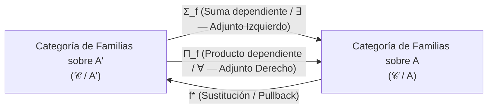

# Lección 05: La Correspondencia de Curry-Howard-Lambek en Lógica de Predicados ($\forall$ y $\exists$)

> **Navegación del Mini-Curso:** [⬅️ Lección 04: El Tipo Σ (Pares Dependientes)](04_tipos_sigma_pares_dependientes.md) | [🏠 Índice](00_indice_minicurso_ttd.md) | [➡️ Lección 06: Sistemas del Cubo Lambda](06_cubo_lambda_y_sistemas_tipos_puros.md)
>
> **Apartado de Wikipedia ampliado:** El papel de la **correspondencia de Curry-Howard** en la lógica de predicados ($\Pi \leftrightarrow \forall$ y $\Sigma \leftrightarrow \exists$) mencionado en *«Definición formal»* de [Teoría de Tipos Dependientes](https://es.wikipedia.org/wiki/Teor%C3%ADa_de_Tipos_Dependientes).
>
> **Módulos ejecutables relacionados:** [`LeanTT/M04_CurryHoward.lean`](../../LeanTT/M04_CurryHoward.lean), [`LeanTT/M14_DidacticStepByStepProofs.lean`](../../LeanTT/M14_DidacticStepByStepProofs.lean) y [`LeanTT/M22_CategoryTheoryAndFunctors.lean`](../../LeanTT/M22_CategoryTheoryAndFunctors.lean).

---

## 1. De la Lógica Proposicional a la Lógica de Predicados gracias a los Tipos Dependientes

El artículo de Wikipedia destaca un hecho profundo:
> *"Bajo la correspondencia de Curry-Howard, el tipo producto dependiente $\prod_{x:A} B(x)$ corresponde al **cuantificador universal** ($\forall x \in A, B(x)$) de la lógica de predicados, mientras que el tipo suma dependiente $\sum_{x:A} B(x)$ corresponde al **cuantificador existencial** ($\exists x \in A, B(x)$)."*

¿Por qué la correspondencia de Curry-Howard de los años 1934–1958 (basada en tipos simples) estaba limitada a la lógica proposicional ($P \to Q$, $P \land Q$, $P \lor Q$), y por qué los **tipos dependientes** de Howard (1969) y Martin-Löf (1971) permitieron capturar la **Lógica de Predicados de Primer Orden y de Orden Superior**?

### 1.1 Un Predicado es una Familia de Tipos Dependientes
En lógica de predicados, una propiedad como $P(x) :\equiv \text{«}x \text{ es un número primo»}$ no es una proposición fija: depende de qué número natural $x : \mathbb{N}$ sustituyamos.
Bajo Curry-Howard, si las proposiciones son tipos:
* Una **proposición fija** $P$ es un **tipo** ($P : \texttt{Prop}$ o $P : \mathcal{U}$).
* Un **predicado unario** $P(x)$ sobre un dominio $A$ es una **familia de tipos dependientes** $P : A \to \texttt{Prop}$ (o $P : A \to \mathcal{U}$).
* Una **relación binaria** $R(x, y)$ entre $A$ y $B$ es una **familia de tipos doblemente indexada** $R : A \to B \to \texttt{Prop}$.

### 1.2 Por Qué $\Pi$ es $\forall$ y $\Sigma$ es $\exists$
* **¿Qué es una demostración constructiva de $\forall (x : A),\, P(x)$?**
  Es un procedimiento universal que, para cualquier elemento concreto $a : A$ que nos entreguen, fabrica una demostración del tipo $P(a)$. Pero una función que toma $a : A$ y devuelve un habitante de $P(a)$ es, por definición, un habitante del **tipo producto dependiente**:
  $$\prod_{x : A} P(x) \qquad \big(\text{escrito en Lean 4 como } \texttt{∀ (x : A), P x} \text{ o } \texttt{(x : A) → P x}\big)$$
* **¿Qué es una demostración constructiva de $\exists (x : A),\, P(x)$?**
  Es un paquete $\langle a, h \rangle$ formado por dos piezas: un **testigo concreto** $a : A$ y una **demostración** $h : P(a)$ de que ese testigo específico cumple la propiedad $P$. Pero un par donde el tipo del segundo componente depende del valor del primero es, por definición, un habitante del **tipo suma dependiente**:
  $$\sum_{x : A} P(x) \qquad \big(\text{escrito en Lean 4 como } \texttt{∃ x : A, P x} \text{ en } \texttt{Prop}\text{, o } \texttt{(x : A) × P x} \text{ en } \texttt{Type}\big)$$

---

## 2. Tabla Maestra de la Trinidad de Curry-Howard-Lambek Dependiente

La correspondencia une tres mundos isomorfos: **Lógica**, **Teoría de Tipos Dependientes (Programación)** y **Teoría de Categorías (Categorías Localmente Cartesianas Cerradas — LCCC)**.

| Lógica de Predicados | Teoría de Tipos Dependientes (Lean 4) | Término Constructor (Prueba / Intro) | Término Eliminador (Uso / Elim) | Teoría de Categorías (LCCC / Fibraciones) |
| :--- | :--- | :--- | :--- | :--- |
| **Proposición** $P$ | Tipo $P : \texttt{Prop}$ (o $\mathcal{U}$) | Habitante $p : P$ | Función desde $P$ | Objeto $P$ |
| **Predicado** $P(x)$ sobre $A$ | Familia dependiente $P : A \to \texttt{Prop}$ | — | — | Morfismo / Fibración $p : E \to A$ |
| **Verdad** ($\top$) | Tipo unitario `True` / `Unit` ($\mathbf{1}$) | `True.intro` / `()` | — | Objeto terminal $1$ |
| **Falsedad** ($\bot$) | Tipo vacío `False` / `Empty` ($\mathbf{0}$) | *(Sin constructores)* | `False.elim` / `nomatch` | Objeto inicial $0$ |
| **Conjunción** ($P \land Q$) | Producto `P ∧ Q` / `P × Q` | `⟨hp, hq⟩` | `h.left`, `h.right` | Producto categórico $P \times Q$ |
| **Disyunción** ($P \lor Q$) | Coproducto `P ∨ Q` / `P ⊕ Q` | `Or.inl hp`, `Or.inr hq` | `Or.elim` / `match` | Coproducto $P + Q$ |
| **Implicación** ($P \to Q$) | Tipo función `P → Q` | `fun hp => ...` | Aplicación `f hp` | Exponencial $Q^P$ |
| **Negación** ($\neg P$) | Función al vacío `P → False` | `fun hp => ...` | Aplicación `hnp hp` | Exponencial $0^P$ |
| **Para todo** ($\forall x : A, P(x)$) | **Producto dependiente** $\prod_{x:A} P(x)$ | `fun (x : A) => ...` | Aplicación `h a : P a` | **Adjunto derecho al pullback ($\Pi_f$)** |
| **Existe** ($\exists x : A, P(x)$) | **Suma dependiente** $\sum_{x:A} P(x)$ | `⟨a, ha⟩` (`Exists.intro`) | `let ⟨x, hx⟩ := h` (`Exists.elim`) | **Adjunto izquierdo al pullback ($\Sigma_f$)** |
| **Igualdad** ($a =_A b$) | **Tipo identidad** $\text{Id}_A(a, b)$ (`a = b`) | `rfl` ($\text{refl}_a$) | Eliminador $J$ (`Eq.rec` / `rw`) | Objeto de caminos / Diagonal $\Delta_A$ |

---

## 3. La Perspectiva Categórica (Lambek-Lawvere): La Triple Adjunción $\Sigma_f \dashv f^* \dashv \Pi_f$

En los años 1969–1970, **F. William Lawvere** descubrió la lectura geométrica y categórica de los cuantificadores $\exists$ y $\forall$ (y por tanto de los tipos $\Sigma$ y $\Pi$):
* Una familia de tipos $B$ sobre $A$ se modela en una categoría $\mathcal{C}$ como un morfismo (fibración) $p : E \to A$ (un objeto de la categoría *slice* $\mathcal{C}/A$).
* Sustituir una variable a lo largo de una función $f : A' \to A$ corresponde al funtor de **cambio de base (pullback)** $f^* : \mathcal{C}/A \to \mathcal{C}/A'$.
* **Teorema de Lawvere:**
  1. La **suma dependiente ($\Sigma_f$ / $\exists_f$)** es el **adjunto izquierdo** del cambio de base $f^*$.
  2. El **producto dependiente ($\Pi_f$ / $\forall_f$)** es el **adjunto derecho** del cambio de base $f^*$:
     $$\Sigma_f \;\dashv\; f^* \;\dashv\; \Pi_f$$



---

## 4. Demostraciones de Lógica de Predicados en Lean 4: Términos $\lambda$ Puros vs. Tácticas

En Lean 4 podemos escribir cualquier demostración de lógica de predicados de dos formas que producen **exactamente el mismo término en el kernel**:
1. **En modo término ($\lambda$-cálculo dependiente puro):** construyendo explícitamente funciones `fun x => ...` y pares `⟨a, h⟩`.
2. **En modo tácticas (`by ...`):** usando `intro`, `exact`, `apply`, `exists`, `rcases`.

Veamos tres teoremas clásicos de lógica de predicados demostrados de ambas maneras:

```lean
variable {A : Type} {P Q : A → Prop} {R : A → A → Prop}

-- 1. Distribución de ∀ sobre ∧:
--    (∀ x, P x ∧ Q x) → (∀ x, P x) ∧ (∀ x, Q x)
theorem forall_and_term : (∀ x, P x ∧ Q x) → (∀ x, P x) ∧ (∀ x, Q x) :=
  fun h => ⟨fun x => (h x).left, fun x => (h x).right⟩

-- 2. Intercambio de cuantificadores (∃ y, ∀ x, R x y) → (∀ x, ∃ y, R x y):
--    ¡Observa que es una función que desempaqueta el par dependiente ⟨y, hy⟩ y lo reempaqueta!
theorem exists_forall_imp_forall_exists_term :
    (∃ y, ∀ x, R x y) → (∀ x, ∃ y, R x y) :=
  fun ⟨y, hy⟩ x => ⟨y, hy x⟩

-- El mismo teorema en modo tácticas:
theorem exists_forall_imp_forall_exists_tactic :
    (∃ y, ∀ x, R x y) → (∀ x, ∃ y, R x y) := by
  intro h x
  rcases h with ⟨y, hy⟩
  exact ⟨y, hy x⟩

-- 3. Ley de De Morgan Cuantificada (100% constructiva en ambos sentidos):
--    (¬ ∃ x, P x) ↔ (∀ x, ¬ P x)
--    ¡Por Curry-Howard, es simplemente el currying dependiente de la Lección 04!
theorem not_exists_iff_forall_not : (¬ ∃ x, P x) ↔ (∀ x, ¬ P x) :=
  ⟨ fun hne x hpx => hne ⟨x, hpx⟩
  , fun hfn ⟨x, hpx⟩ => hfn x hpx ⟩
```

---

## 5. Lógica Intuicionista (Constructiva) vs. Lógica Clásica en Lean 4

¿Por qué la implicación recíproca $(\forall x, \exists y, R(x, y)) \to (\exists y, \forall x, R(x, y))$ **no** es válida, y por qué la segunda ley de De Morgan cuantificada $(\neg \forall x, P(x)) \to (\exists x, \neg P(x))$ **no es demostrable constructivamente**?

* Si sabemos que "no todos los números naturales cumplen $P(x)$" ($\neg \forall x, P(x)$, es decir, $(\forall x, P(x)) \to \texttt{False}$), tenemos una función que convierte una prueba universal en una contradicción.
* Pero para construir un habitante de $\exists x, \neg P(x)$ (un par $\langle a, h \rangle$), necesitamos **exhibir un contraejemplo concreto $a : \mathbb{N}$**. Una función $(\forall x, P(x)) \to \texttt{False}$ es una caja negra que no nos dice cuál es el número $a$ donde falla $P$.
* En matemáticas clásicas (disponibles en Lean 4 importando el axioma de elección de Hilbert `Classical.choice` y el tercio excluso `Classical.em`), sí podemos demostrar $(\neg \forall x, P(x)) \to (\exists x, \neg P(x))$, marcando aquellas definiciones que extraigan datos de una prueba clásica como `noncomputable`.

---

## 6. Ejercicios Prácticos de la Lección 05 (en Lean 4)

### Ejercicio 5.1: Cuantificación Universal sobre Implicación
Demuestra en Lean 4 mediante un **término $\lambda$ puro** (sin usar `by`) el esquema axiomático de los cuantificadores de Frege-Hilbert:
$$(\forall x : A,\, P(x) \to Q(x)) \to (\forall x : A,\, P(x)) \to (\forall x : A,\, Q(x))$$
¿Con qué combinador de la Lección 03 coincide exactamente este término $\lambda$?

<details>
<summary>💡 <b>Ver Solución Comentada en Lean 4</b></summary>

```lean
theorem frege_quantifier {A : Type} {P Q : A → Prop} :
    (∀ x, P x → Q x) → (∀ x, P x) → (∀ x, Q x) :=
  fun f g x => f x (g x)
```
¡Es exactamente el **combinador $S$ dependiente** (`fun f g x => f x (g x)`) de la Lección 03!
</details>

### Ejercicio 5.2: Salida de Factor Independiente de un Existencial
Demuestra constructivamente en Lean 4 que si $Q : \texttt{Prop}$ no depende de $x$, entonces:
$$(\exists x : A,\, P(x) \land Q) \leftrightarrow (\exists x : A,\, P(x)) \land Q$$

<details>
<summary>💡 <b>Ver Solución Comentada en Lean 4</b></summary>

```lean
theorem exists_and_right_ttd {A : Type} {P : A → Prop} {Q : Prop} :
    (∃ x, P x ∧ Q) ↔ (∃ x, P x) ∧ Q :=
  ⟨ fun ⟨x, ⟨hpx, hq⟩⟩ => ⟨⟨x, hpx⟩, hq⟩
  , fun ⟨⟨x, hpx⟩, hq⟩ => ⟨x, ⟨hpx, hq⟩⟩ ⟩
```
</details>

---

👉 **Siguiente lección:** [**Lección 06 — Sistemas del Cubo Lambda ($\lambda$-Cube) de Barendregt y Sistemas de Tipos Puros (PTS)**](06_cubo_lambda_y_sistemas_tipos_puros.md)
