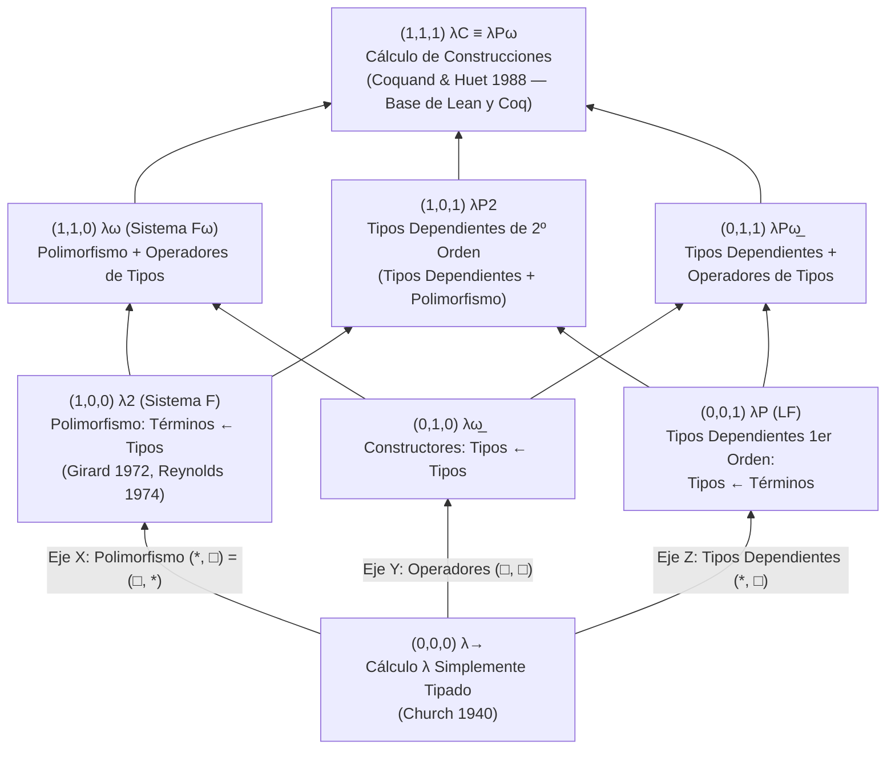

# Lección 06: Sistemas del Cubo Lambda ($\lambda$-Cube) de Barendregt y Sistemas de Tipos Puros (PTS)

> **Navegación del Mini-Curso:** [⬅️ Lección 05: Curry-Howard en Lógica de Predicados](05_curry_howard_y_logica_predicados.md) | [🏠 Índice](00_indice_minicurso_ttd.md) | [➡️ Lección 07: Igualdad Intensional, Extensional y HoTT](07_igualdad_intensional_extensional_y_hott.md)
>
> **Apartado de Wikipedia ampliado:** Sección completa *«Sistemas del cubo lambda»* (Teoría de tipos dependientes de primer orden $\lambda P$, de segundo orden $\lambda P2$, con operadores de tipos $\lambda P\underline{\omega}$ y Cálculo de Construcciones $\lambda C$) en [Teoría de Tipos Dependientes](https://es.wikipedia.org/wiki/Teor%C3%ADa_de_Tipos_Dependientes).
>
> **Módulos ejecutables relacionados:** [`LeanTT/M16_DidacticLambdaCubeAndPTS.lean`](../../LeanTT/M16_DidacticLambdaCubeAndPTS.lean), [`LeanTT/M01_LambdaCalculus.lean`](../../LeanTT/M01_LambdaCalculus.lean) y [`LeanTT/M26_SystemFAndParametricity.lean`](../../LeanTT/M26_SystemFAndParametricity.lean).

---

## 1. ¿Qué es el Cubo Lambda ($\lambda$-Cube) de Henk Barendregt (1991)?

En 1991, el lógico neerlandés **Henk Barendregt** observó que todos los grandes sistemas de cálculo lambda tipado que habían surgido entre 1940 y 1988 podían organizarse geométricamente como los **8 vértices de un cubo tridimensional**, partiendo del **Cálculo Lambda Simplemente Tipado ($\lambda^\to$)** en el origen $(0,0,0)$ y añadiendo tres ejes ortogonales de dependencia:

1. **Eje X — Términos que dependen de Tipos (Polimorfismo / $\lambda 2$):** Permite escribir funciones polimórficas $\Lambda \alpha : *.\, t(x)$ como en el **Sistema F** de Girard-Reynolds.
2. **Eje Y — Tipos que dependen de Tipos (Operadores de Tipos / $\lambda\underline{\omega}$):** Permite funciones a nivel de tipos $\lambda \alpha : *.\, \text{List }\alpha$ (constructores de tipos de orden superior).
3. **Eje Z — Tipos que dependen de Términos (Tipos Dependientes / $\lambda P$):** Permite familias de tipos indexadas por valores ordinarios $\lambda n : \text{Nat}.\, \text{Vec }\alpha\; n$.



Los **cuatro vértices superiores** del cubo (aquellos que tienen la coordenada $Z = 1$) son precisamente los **cuatro sistemas con tipos dependientes** descritos en el artículo de Wikipedia: **$\lambda P$**, **$\lambda P2$**, **$\lambda P\underline{\omega}$** y **$\lambda C$ ($\lambda P\omega$)**.

---

## 2. El Mecanismo Unificador: Sistemas de Tipos Puros (PTS) y las Reglas $(s_1, s_2)$

¿Cómo logró Barendregt describir los 8 sistemas con un único conjunto de reglas? Mediante el formalismo de los **Sistemas de Tipos Puros (*Pure Type Systems*, PTS)** de Berardi y Terlouw:

* En el Cubo de Barendregt existen únicamente **dos universos (*sorts*)**:
  * $*$ (leído *«estrella»*, corresponde a `Type 0` en Lean): el universo de los **tipos propiamente dichos**, cuyos habitantes son los **términos (valores)** como `5 : Nat`.
  * $\square$ (leído *«caja»*, corresponde a `Type 1` en Lean): el super-universo de las **clases (*kinds*)**, cuyos habitantes son los **tipos** (`Nat : *`) y las familias de tipos (`Vec : * → Nat → * : □`), con el axioma $* : \square$.
* Toda flecha o producto dependiente $\prod_{x : A} B(x)$ se forma mediante una única regla parametrizada por un par de universos $(s_1, s_2) \in \{*, \square\} \times \{*, \square\}$:

$$
\frac{\Gamma \vdash A : s_1 \qquad \Gamma,\; x : A \vdash B(x) : s_2}{\Gamma \vdash \left(\prod_{x : A} B(x)\right) : s_2} \;\text{Regla }(s_1, s_2)
$$

Cada una de las **4 combinaciones posibles de $(s_1, s_2)$** activa exactamente una dimensión del cubo:

| Regla $(s_1, s_2)$ | Dominio $x : A$ ($A : s_1$) | Codominio $B(x)$ ($B(x) : s_2$) | ¿Qué permite construir? | Ejemplo en Lean 4 |
| :---: | :--- | :--- | :--- | :--- |
| **$(*, *)$** | $x$ es un **término** ($A : *$) | $B$ es un **tipo** ($B : *$) | **Funciones ordinarias y dependientes entre valores** (presente en los 8 sistemas; cuando $x$ aparece libre en $B(x)$ requiere haber formado la familia $B$ con $(*, \square)$). | `fun (x : Nat) => x + 1` |
| **$(\square, *)$** | $x$ es un **tipo** ($A : \square$) | $B(x)$ es un **tipo** ($B(x) : *$) | **Polimorfismo (Eje X / $\lambda 2$):** Términos que dependen de tipos. | `fun (α : Type) (x : α) => x` |
| **$(\square, \square)$** | $x$ es un **tipo** ($A : \square$) | $B(x)$ es un **kind/familia** ($B(x) : \square$) | **Operadores de Tipos (Eje Y / $\lambda\underline{\omega}$):** Tipos que dependen de tipos. | `fun (α : Type) => α × α` |
| **$(*, \square)$** | $x$ es un **término** ($A : *$) | $B(x)$ es un **kind/familia** ($B(x) : \square$) | **Familias de Tipos Dependientes (Eje Z / $\lambda P$):** Tipos que dependen de términos ($B : A \to *$). | `fun (n : Nat) => Vec Bool n` |

---

## 3. Análisis Detallado de las 4 Teorías de Tipos Dependientes del Cubo Lambda

Examinemos ahora uno por uno los cuatro sistemas de la cara superior del cubo que protagonizan la sección *«Sistemas del cubo lambda»* de Wikipedia, con su implementación directa en **Lean 4**.

### 3.1 Teoría de Tipos Dependientes de Primer Orden: $\lambda P$ (o Marco Lógico **LF**)
* **Reglas activas:** $(*, *)$ y $(*, \square)$.
* **¿Qué permite?** Permite definir familias de tipos indexadas por valores ($B : A \to *$, gracias a la regla $(*, \square)$) y funciones dependientes sobre valores ($\prod_{x:A} B(x) : *$, gracias a $(*, *)$).
* **¿Qué NO permite?** No tiene polimorfismo sobre tipos $(\square, *)$ ni constructores de tipos de orden superior $(\square, \square)$.
* **Importancia histórica y práctica:** Bajo Curry-Howard, $\lambda P$ corresponde exactamente a la **Lógica de Predicados Intuicionista de Primer Orden** (de ahí la $P$ de *Predicados*). Fue bautizado como **Edinburgh Logical Framework (LF)** por Harper, Honsell y Plotkin (1993) y es el núcleo del asistente **Twelf**, utilizado para especificar sintaxis y reglas de inferencia de otros sistemas lógicos (representación *Higher-Order Abstract Syntax*, HOAS).

```lean
-- Ejemplo en la esquina λP (0,0,1):
-- Una familia de tipos `VecBool : Nat → Type` (Regla (*, □))
-- y una función dependiente `(n : Nat) → VecBool n` (Regla (*, *)), sin polimorfismo de tipos:
def VecBool : Nat → Type
  | 0     => Unit
  | n + 1 => Bool × VecBool n

def todoTrue : (n : Nat) → VecBool n
  | 0     => ()
  | k + 1 => (true, todoTrue k)
```

### 3.2 Teoría de Tipos Dependientes de Segundo Orden: $\lambda P2$
* **Reglas activas:** $(*, *)$, $(*, \square)$ y $(\square, *)$.
* **¿Qué permite?** Combina los tipos dependientes de primer orden ($\lambda P$) con el **polimorfismo paramétrico de Sistema F ($\lambda 2$)**. Ahora podemos escribir funciones polimórficas cuyos tipos también dependen de valores, y en lógica podemos cuantificar tanto sobre individuos ($\forall x : A$) como sobre **tipos o predicados de primer orden** (**Lógica de Predicados de Segundo Orden**).
* **¿Qué NO permite?** Aún no permite abstraer constructores de tipos arbitrarios de orden superior $(\square, \square)$ (por ejemplo, parametrizar una definición sobre cualquier funtor $F : * \to *$).

```lean
-- Ejemplo en la esquina λP2 (1,0,1):
-- Cuantificamos polimórficamente sobre el tipo `α : Type` (Regla (□, *))
-- Y dependientemente sobre el valor `n : Nat` (Reglas (*, □) y (*, *)):
def VecPoli (α : Type) : Nat → Type
  | 0     => Unit
  | n + 1 => α × VecPoli α n

def replicarPoli (α : Type) (n : Nat) (x : α) : VecPoli α n :=
  match n with
  | 0     => ()
  | k + 1 => (x, replicarPoli α k x)
```

### 3.3 Teoría de Tipos Dependientes con Operadores de Tipos: $\lambda P\underline{\omega}$
* **Reglas activas:** $(*, *)$, $(*, \square)$ y $(\square, \square)$.
* **¿Qué permite?** Permite que las familias de tipos reciban tanto **valores** ($n : \text{Nat}$, regla $(*, \square)$) como **tipos u otros constructores de tipos** ($F : * \to *$, regla $(\square, \square)$) para producir nuevos tipos.
* **¿Qué NO permite?** Como carece de $(\square, *)$, los **términos (programas)** no pueden cuantificar polimórficamente sobre tipos dentro del universo $*$.

```lean
-- Ejemplo en la esquina λPω̲ (0,1,1):
-- Un operador a nivel de tipos que recibe un constructor `F : Type → Type` (Regla (□, □))
-- y un valor natural `n : Nat` (Regla (*, □)) para iterar `F` exactamente `n` veces:
def IterarConstructor (F : Type → Type) : Nat → Type → Type
  | 0,     α => α
  | n + 1, α => F (IterarConstructor F n α)

-- `IterarConstructor Option 2 Nat` se reduce a `Option (Option Nat)`:
example : IterarConstructor Option 2 Nat = Option (Option Nat) := rfl
```

### 3.4 El Vértice Supremo: El Cálculo de Construcciones ($\lambda C \equiv \lambda P\omega$)
* **Reglas activas:** **Las 4 reglas:** $(*, *)$, $(\square, *)$, $(\square, \square)$ y $(*, \square)$.
* **¿Qué permite?** Introducido por **Thierry Coquand y Gérard Huet (1985–1988)**, unifica los tres ejes del cubo de Barendregt sin restricciones:
  1. Los términos pueden depender de términos $(*, *)$.
  2. Los términos pueden depender de tipos y constructores de tipos $(\square, *)$.
  3. Los tipos pueden depender de tipos y constructores de tipos $(\square, \square)$.
  4. Los tipos pueden depender de términos $(*, \square)$.
* **Importancia:** Corresponde a la **Lógica Intuicionista de Orden Superior (HOL) Dependiente**. Al enriquecer $\lambda C$ con tipos inductivos y una jerarquía infinita de universos $\texttt{Sort } u$ obtenemos el **Cálculo de Construcciones Inductivas (CIC)**, que es el sistema exacto sobre el que funcionan **Lean 4** y **Coq/Rocq**.

```lean
-- Ejemplo en el vértice supremo λC (1,1,1):
-- Una función que cuantifica simultáneamente sobre un operador de tipos `F : Type → Type` ((□, □)),
-- un tipo `α : Type` ((□, *)), un valor natural `n : Nat` ((*, □)) y un término `x` ((*, *)):
def IterarConstructorC (F : Type → Type) : Nat → Type → Type
  | 0,     α => α
  | n + 1, α => F (IterarConstructorC F n α)

def envolverNVeces
    (F : Type → Type) (pureF : {β : Type} → β → F β)
    (α : Type) (n : Nat) (x : α) : IterarConstructorC F n α :=
  match n with
  | 0     => x
  | k + 1 => pureF (envolverNVeces F pureF α k x)

#eval envolverNVeces Option some Nat 3 42 -- some (some (some 42))
```

---

## 4. Tabla Resumen de los 8 Sistemas del Cubo de Barendregt

| Sistema | Coordenadas $(X, Y, Z)$ | Reglas PTS Activas | Nombre Clásico y Autores |
| :--- | :---: | :--- | :--- |
| **$\lambda^\to$** | $(0, 0, 0)$ | $(*, *)$ | Cálculo $\lambda$ Simplemente Tipado (Church, 1940) |
| **$\lambda 2$** | $(1, 0, 0)$ | $(*, *), (\square, *)$ | Sistema F / Cálculo $\lambda$ Polimórfico (Girard 1972, Reynolds 1974) |
| **$\lambda\underline{\omega}$** | $(0, 1, 0)$ | $(*, *), (\square, \square)$ | Cálculo $\lambda$ con Constructores de Tipos |
| **$\lambda\omega$** | $(1, 1, 0)$ | $(*, *), (\square, *), (\square, \square)$ | Sistema $F_\omega$ (Girard 1972 — Base de GHC Haskell Core) |
| **$\lambda P$** | $(0, 0, 1)$ | $(*, *), (*, \square)$ | **TTD de 1.er Orden / Marco Lógico LF** (Harper-Honsell-Plotkin — Base de Twelf) |
| **$\lambda P2$** | $(1, 0, 1)$ | $(*, *), (\square, *), (*, \square)$ | **TTD de 2.º Orden** (Tipos Dependientes + Polimorfismo) |
| **$\lambda P\underline{\omega}$** | $(0, 1, 1)$ | $(*, *), (\square, \square), (*, \square)$ | **TTD con Operadores de Tipos** |
| **$\lambda C$ ($\lambda P\omega$)** | $(1, 1, 1)$ | $(*, *), (\square, *), (\square, \square), (*, \square)$ | **Cálculo de Construcciones** (Coquand & Huet 1988 — Base de Lean 4 y Coq) |

---

## 5. Ejercicios Prácticos de la Lección 06 (en Lean 4)

### Ejercicio 6.1: Clasificar Expresiones en el Cubo de Barendregt
Para cada una de las siguientes firmas en Lean 4, indica cuál es el **sistema mínimo** del Cubo de Barendregt en el que puede formarse y qué reglas $(s_1, s_2)$ utiliza:
1. `Nat → Bool → Nat`
2. `(α : Type) → (α → α) → α → α`
3. `Nat → Type`
4. `(F : Type → Type) → (n : Nat) → Type`

<details>
<summary>💡 <b>Ver Solución Comentada</b></summary>

1. `Nat → Bool → Nat`: Solo usa $(*, *)$. Vive en el origen **$\lambda^\to$** $(0,0,0)$.
2. `(α : Type) → (α → α) → α → α`: Cuantifica un término sobre un tipo $(\square, *)$ y luego usa $(*, *)$. Vive en **$\lambda 2$ (Sistema F)** $(1,0,0)$.
3. `Nat → Type`: Un tipo que depende de un valor natural $(*, \square)$. Vive en **$\lambda P$ (LF)** $(0,0,1)$.
4. `(F : Type → Type) → (n : Nat) → Type`: Construye una familia de tipos que recibe un operador de tipos $(\square, \square)$ y un valor $(*, \square)$. Vive en **$\lambda P\underline{\omega}$** $(0,1,1)$.
</details>

### Ejercicio 6.2: La Igualdad de Leibniz en $\lambda P2$ / $\lambda C$
En los sistemas del cubo que incluyen $(\square, *)$ y $(*, \square)$ (como $\lambda P2$ y $\lambda C$), podemos definir la igualdad entre dos términos $x, y : A$ sin necesidad de tipos inductivos mediante la **Igualdad de Leibniz** (dos objetos son iguales si y solo si comparten todos sus predicados $P : A \to \texttt{Prop}$). Defínela en Lean 4 y demuestra que es reflexiva, simétrica y transitiva.

<details>
<summary>💡 <b>Ver Solución Comentada en Lean 4</b></summary>

```lean
/-- Igualdad impredicativa de Leibniz en el Cálculo de Construcciones (λC): -/
def LeibnizEq {A : Type u} (x y : A) : Prop :=
  ∀ (P : A → Prop), P x → P y

theorem leibniz_refl {A : Type u} (x : A) : LeibnizEq x x :=
  fun _ px => px

theorem leibniz_symm {A : Type u} {x y : A} (h : LeibnizEq x y) : LeibnizEq y x :=
  h (fun z => LeibnizEq z x) (leibniz_refl x)

theorem leibniz_trans {A : Type u} {x y z : A}
    (hxy : LeibnizEq x y) (hyz : LeibnizEq y z) : LeibnizEq x z :=
  fun P px => hyz P (hxy P px)
```
</details>

---

👉 **Siguiente lección:** [**Lección 07 — Familias Inductivas, $W$-Types, Igualdad Intensional vs. Extensional y Teoría Homotópica de Tipos (HoTT)**](07_igualdad_intensional_extensional_y_hott.md)
