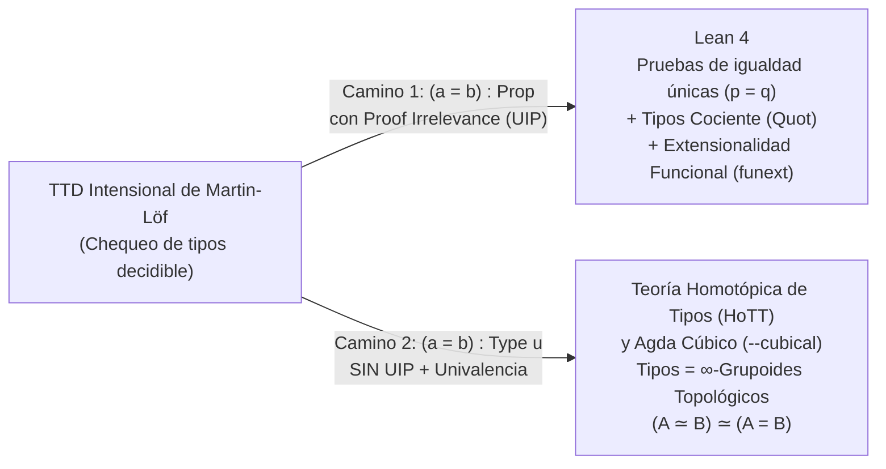

# Lección 07: Familias Inductivas, $W$-Types, Igualdad Intensional vs. Extensional y Teoría Homotópica de Tipos (HoTT)

> **Navegación del Mini-Curso:** [⬅️ Lección 06: Sistemas del Cubo Lambda](06_cubo_lambda_y_sistemas_tipos_puros.md) | [🏠 Índice](00_indice_minicurso_ttd.md) | [➡️ Lección 08: Lenguajes con Tipos Dependientes y Proyecto](08_lenguajes_comparativa_y_aplicaciones.md)
>
> **Apartados de Wikipedia ampliados:** El tipo identidad $\text{Id}_A(a, b)$, tipos inductivos ($W$-types), la distinción entre **teoría de tipos intensional y extensional** y la conexión con la **[Teoría Homotópica de Tipos (HoTT)](https://es.wikipedia.org/wiki/Teor%C3%ADa_homot%C3%B3pica_de_tipos)** en [Teoría de Tipos Dependientes](https://es.wikipedia.org/wiki/Teor%C3%ADa_de_Tipos_Dependientes).
>
> **Módulos ejecutables relacionados:** [`LeanTT/M05_InductiveFamilies.lean`](../../LeanTT/M05_InductiveFamilies.lean), [`LeanTT/M06_EqualityAndTransport.lean`](../../LeanTT/M06_EqualityAndTransport.lean), [`LeanTT/M13_FoundationsOfDependentTypeTheory.lean`](../../LeanTT/M13_FoundationsOfDependentTypeTheory.lean) y [`LeanTT/M23_HoTTAndHomotopyPaths.lean`](../../LeanTT/M23_HoTTAndHomotopyPaths.lean).

---

## 1. Familias Inductivas Indexadas y Tipos de Árboles Bien Fundados ($W$-Types)

Además de los tipos $\Pi$ y $\Sigma$, una teoría de tipos dependientes completa necesita poder definir tipos de datos recursivos y predicados inductivos:

### 1.1 Parámetros vs. Índices en una Familia Inductiva
En el Cálculo de Construcciones Inductivas (CIC) de Lean 4, una declaración `inductive` distingue cuidadosamente entre **parámetros** (a la izquierda de `:`) e **índices** (a la derecha de `:`):

```lean
inductive Vec (α : Type u) : Nat → Type u where
  | nil  : Vec α 0
  | cons : α → {n : Nat} → Vec α n → Vec α (n + 1)
```
* **`(α : Type u)` es un Parámetro:** Permanece fijo y uniforme en todos los constructores (`Vec α 0`, `Vec α (n + 1)`).
* **`Nat` (en `: Nat → Type u`) es un Índice:** Varía de un constructor a otro (`nil` aterriza exclusivamente en la fibra `0`, mientras que `cons` aterriza en la fibra `n + 1`).
* **¿Por qué esta variación del índice es tan poderosa?** Cuando hacemos `match` sobre un término `v : Vec α (k + 1)`, el unificador del kernel de Lean descubre que el índice `k + 1` **no puede unificar con `0`**, por lo que **descarta automáticamente el constructor `nil` por ser imposible** y nos permite escribir `head` de forma 100% total sin manejar el caso vacío.

### 1.2 Los Tipos $W$ de Martin-Löf: Todos los Tipos Inductivos en Uno Solo
En su formulación minimalista de MLTT (1979), Martin-Löf demostró que no hace falta un esquema infinito de declaraciones para los tipos inductivos ordinarios: todos ellos (naturales, listas, árboles de sintaxis, ordinales constructivos de Brouwer) son instancias de un único constructor dependiente llamado el **Tipo de Árboles Bien Fundados ($\mathsf{W}_{x:A} B(x)$)**:

```lean
/-- `A` es el tipo de formas de constructores (etiquetas de nodo) y
    `B a` es la aridad (tipo de índices de los hijos) del constructor `a`: -/
inductive W (A : Type u) (B : A → Type v) : Type (max u v) where
  | sup (a : A) (hijos : B a → W A B) : W A B
```

---

## 2. Las Dos Igualdades: Igualdad Definicional ($a \equiv b$) vs. Igualdad Proposicional ($\text{Id}_A(a, b)$)

Para entender la diferencia entre las distintas escuelas de la Teoría de Tipos Dependientes, debemos distinguir las **dos nociones de igualdad** que coexisten en el sistema:

| Característica | 1. Igualdad Definicional (o Judiciaria) | 2. Igualdad Proposicional (Tipo Identidad) |
| :--- | :--- | :--- |
| **Notación** | $\Gamma \vdash a \equiv b : A$ | $\text{Id}_A(a, b)$ o $a =_A b$ (un **tipo** dentro del lenguaje) |
| **¿Qué es?** | Un **juicio metateórico automático** del kernel: $a$ y $b$ se reducen al mismo término normal por cómputo ($\beta, \delta, \iota, \zeta, \eta$). | Una **familia de tipos dependientes** cuyos habitantes $p : a =_A b$ son demostraciones (o caminos) que certifican que $a$ y $b$ son iguales. |
| **Ejemplo con `Nat`** | `(2 + 3 : Nat) ≡ 5` y `0 + n ≡ n` (porque `+` se define por recursión en el segundo o primer argumento según la librería). | `n + m = m + n` para variables libres $n, m$: **no** son definicionalmente iguales; requiere una demostración por inducción ($p : n + m = m + n$). |
| **¿Quién la comprueba?** | El **algoritmo de conversión del kernel** automáticamente. | El **usuario (o una táctica)** construyendo un término de tipo `a = b`. |

---

## 3. El Eliminador $J$ de Martin-Löf y el Transporte entre Fibras (`Eq.rec`)

En Lean 4, el tipo identidad `Eq` se define como una familia inductiva con un parámetro `(a : α)` y un índice `: α → Prop`:

```lean
namespace DemoIdentidad
inductive Eq {α : Sort u} (a : α) : α → Prop where
  | refl : Eq a a
end DemoIdentidad
```
*(En el preludio de Lean 4, el constructor `Eq.refl a` se abrevia `rfl : a = a`).*

### 3.1 El Transporte (`Eq.rec` / `subst`): Cómo Mover un Dato de $P(a)$ a $P(b)$
Si tenemos una familia de tipos $P : A \to \texttt{Sort } v$, una prueba de igualdad $h : a =_A b$ y un habitante $x : P(a)$, la regla de eliminación de la igualdad nos permite **transportar** $x$ a lo largo de la igualdad $h$ para obtener un habitante de la fibra $P(b)$:

```lean
def transportar {A : Sort u} {P : A → Sort v} {a b : A} (h : a = b) (x : P a) : P b :=
  h ▸ x -- El macro `h ▸ x` aplica internamente el eliminador `Eq.rec` (la regla J)
```
Por ejemplo, si tienes un vector `v : Vec α (n + m)` y necesitas un `Vec α (m + n)`, basta transportar `v` a lo largo del teorema `Nat.add_comm n m : n + m = m + n`:
```lean
def conmutarLongitudVec {Vec : Type u → Nat → Type u} {α : Type u} {n m : Nat}
    (v : Vec α (n + m)) : Vec α (m + n) :=
  Nat.add_comm n m ▸ v
```

---

## 4. Teoría de Tipos Intensional vs. Extensional

Esta distinción es uno de los pilares de la teoría de tipos moderna:

### 4.1 Teoría de Tipos Extensional (Martin-Löf 1979, NuPRL)
Añade al sistema la **Regla de Reflexión de la Igualdad (*Equality Reflection Rule*)**:
$$
\frac{\Gamma \vdash p : (a =_A b)}{\Gamma \vdash a \equiv b : A} \;(\text{Reflexión Extensional})
$$
* **¿Qué significa?** Que tan pronto como existe una prueba proposicional $p : a =_A b$ en el contexto, el kernel trata a $a$ y $b$ como **definicionalmente idénticos** ($a \equiv b$). Por tanto, nunca hace falta escribir transportes `h ▸ v` (`Vec α (n + m)` y `Vec α (m + n)` pasan a ser el mismo tipo automáticamente si `h : n + m = m + n` está en el contexto).
* **El precio fatal:** Para decidir si un término está bien tipado ($\Gamma \vdash t : T$), el kernel tendría que decidir si dos tipos $A$ y $B$ son iguales, lo que por la regla de reflexión equivale a decidir si existe una demostración matemática arbitraria $p : a = b$. **El chequeo de tipos (`type checking`) se vuelve algorítmicamente indecidible**, y se pierde la propiedad de normalización fuerte.

### 4.2 Teoría de Tipos Intensional (Martin-Löf 1973/1975, Lean 4, Coq/Rocq, Agda, Idris 2)
**No** incluye la regla de reflexión: mantiene estrictamente separadas la igualdad definicional $a \equiv b$ (decidible por evaluación) y la igualdad proposicional $p : a =_A b$ (que requiere transporte explícito `Eq.rec`, automatizado en la práctica por tácticas como `rw` y `simp`).
* **Gran ventaja:** El **chequeo de tipos del kernel es 100% decidible, rápido y pequeño**, cumpliendo el Criterio de De Bruijn.

---

## 5. De la Unicidad de Pruebas de Identidad (UIP) a la Teoría Homotópica de Tipos (HoTT)

En una teoría de tipos **intensional**, surge una pregunta fascinante que estuvo abierta durante veinte años:
> Dados dos puntos $a, b : A$ y **dos pruebas de igualdad** $p, q : a =_A b$, ¿se puede demostrar usando solo el eliminador $J$ que $p =_{(a =_A b)} q$ (es decir, que existe a lo sumo una prueba de igualdad entre dos objetos)?

En **1994**, **Martin Hofmann y Thomas Streicher** construyeron el **modelo de grupoides** y demostraron que **NO**: el principio de **Unicidad de Pruebas de Identidad (UIP)** (también equivalente al **Axioma $K$ de Streicher**) **no es demostrable** en MLTT intensional pura.

Esto abrió dos caminos divergentes y extraordinariamente fructíferos:



### 5.1 El Camino de Lean 4: Igualdad en `Prop` con Irrelevancia de Prueba + Cocientes
En **Lean 4**, la igualdad `a = b` vive en el universo `Prop`, donde rige la **irrelevancia de prueba definicional**: cualesquiera dos pruebas $p, q : a = b$ son definicionalmente iguales ($p \equiv q$). Además, Lean 4 incluye tipos cociente primitivos (`Quot`) que permiten demostrar la **extensionalidad funcional (`funext`)**:
$$\big(\forall x : A,\, f(x) = g(x)\big) \;\to\; f = g$$

### 5.2 El Camino de la Teoría Homotópica de Tipos (HoTT — Voevodsky, Awodey, Warren)
Como explica el artículo de Wikipedia y el artículo hermano **[Teoría homotópica de tipos](https://es.wikipedia.org/wiki/Teor%C3%ADa_homot%C3%B3pica_de_tipos)**:
Si colocamos el tipo identidad $\text{Id}_A(a, b)$ en el universo de datos `Type u` **sin imponer UIP**, entonces:
* Un **tipo** $A$ se interpreta como un **espacio topológico** (o un $\infty$-grupoide débil).
* Un **término** $a : A$ es un **punto** del espacio.
* Una **prueba de igualdad** $p : \text{Id}_A(a, b)$ es un **camino continuo** $p : a \rightsquigarrow b$ que conecta el punto $a$ con el punto $b$.
* Una igualdad entre dos pruebas de igualdad $\alpha : \text{Id}_{\text{Id}_A(a,b)}(p, q)$ es una **homotopía (deformación continua 2-dimensional)** entre los caminos $p$ y $q$.
* **El Axioma de Univalencia de Vladimir Voevodsky (2009):** Postula que para cualesquiera dos tipos $A, B : \mathcal{U}$, el tipo de las **equivalencias homotópicas (isomorfismos)** $A \simeq B$ es él mismo equivalente al tipo de las **identificaciones** $A =_{\mathcal{U}} B$:
  $$(A \simeq B) \;\simeq\; (A =_{\mathcal{U}} B)$$
  En palabras sencillas: **los tipos isomorfos son iguales**, y gracias al transporte (`J`), cualquier teorema demostrado sobre una estructura $A$ se transporta automáticamente a cualquier estructura isomorfa $B$.

En el módulo [`LeanTT/M23_HoTTAndHomotopyPaths.lean`](../../LeanTT/M23_HoTTAndHomotopyPaths.lean) de este repositorio tienes formalizado el espacio de caminos sintético `Path α a b : Type u`, sus leyes de $\infty$-grupoide, la acción funtorial sobre caminos (`ap`) y las equivalencias homotópicas `α ≃ₕ β`.

---

## 6. Ejercicios Prácticos de la Lección 07 (en Lean 4)

### Ejercicio 7.1: Congruencia Funtorial (`ap` / `congrArg`) con el Eliminador de Igualdad
Demuestra en Lean 4, usando reconocimiento de patrones sobre la igualdad (`match p with | rfl => ...`), que toda función $f : A \to B$ respeta la igualdad ($a_1 = a_2 \to f(a_1) = f(a_2)$), y que incluso toda función **dependiente** $g : (x : A) \to P(x)$ respeta la igualdad tras transportar el primer valor (`apd` en HoTT).

<details>
<summary>💡 <b>Ver Solución Comentada en Lean 4</b></summary>

```lean
/-- Acción de una función no dependiente sobre caminos (`ap` / `congrArg`): -/
theorem ap {A : Type u} {B : Type v} (f : A → B) {a1 a2 : A} (p : a1 = a2) :
    f a1 = f a2 :=
  match p with
  | rfl => rfl

/-- Acción de una sección dependiente sobre caminos (`apd` en el libro de HoTT):
    Observa que `g a1 : P a1` y `g a2 : P a2` viven en fibras distintas, por lo que
    comparamos `p ▸ g a1` con `g a2` dentro de la fibra `P a2`! -/
theorem apd {A : Type u} {P : A → Type v} (g : (x : A) → P x) {a1 a2 : A} (p : a1 = a2) :
    p ▸ g a1 = g a2 :=
  match p with
  | rfl => rfl
```
</details>

### Ejercicio 7.2: Unicidad de Pruebas de Identidad (UIP) en el `Prop` de Lean 4
Verifica en Lean 4 que dadas cualesquiera dos pruebas de igualdad `p q : a = b`, el teorema `p = q` se demuestra instantáneamente con `rfl`.

<details>
<summary>💡 <b>Ver Solución Comentada en Lean 4</b></summary>

```lean
theorem uip_definicional_en_lean4 {A : Type u} {a b : A} (p q : a = b) : p = q :=
  rfl
```
</details>

---

👉 **Siguiente lección:** [**Lección 08 — Lenguajes con Tipos Dependientes, Comparativa de Arquitecturas y Proyecto Práctico Integrador**](08_lenguajes_comparativa_y_aplicaciones.md)
