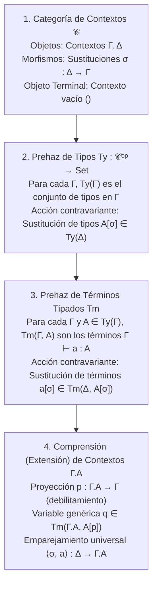

# Lección 09: Semántica Categórica de la Teoría de Tipos Dependientes — Categorías con Familias (CwF), Modelos de Grupoides y Teoría de Tipos Cúbica

> **Navegación del Mini-Curso:** [⬅️ Lección 08: Lenguajes con Tipos Dependientes](08_lenguajes_comparativa_y_aplicaciones.md) | [🏠 Índice](00_indice_minicurso_ttd.md) | [➡️ Lección 10: Implementación de un Typechecker y NbE](10_implementacion_typechecker_nbe_y_elaboracion.md)
>
> **Ampliación avanzada del Mini-Curso:** Modelos matemáticos de la Teoría de Tipos Dependientes, pruebas de consistencia e independencia (Hofmann-Streicher, Voevodsky) y semántica computacional de la Univalencia (Teoría de Tipos Cúbica).
>
> **Módulos ejecutables relacionados:** [`LeanTT/M22_CategoryTheoryAndFunctors.lean`](../../LeanTT/M22_CategoryTheoryAndFunctors.lean), [`LeanTT/M23_HoTTAndHomotopyPaths.lean`](../../LeanTT/M23_HoTTAndHomotopyPaths.lean) y [`LeanTT/M10_MetatheorySTLC.lean`](../../LeanTT/M10_MetatheorySTLC.lean).

---

## 1. ¿Por Qué Estudiar la Semántica (Modelos) de la Teoría de Tipos Dependientes?

En las Lecciones 01 a 08 hemos estudiado la **sintaxis y las reglas de inferencia** de la Teoría de Tipos Dependientes. Pero como matemáticos e informáticos teóricos nos hacemos tres preguntas fundamentales:

1. **Consistencia lógica:** ¿Cómo sabemos con certeza que en la Teoría de Tipos Dependientes (MLTT / CIC) **no existe** ninguna demostración cerrada del tipo vacío `False` ($\mathbf{0}$)?
2. **Independencia de principios:** ¿Cómo se demuestra que un principio como el *Tercio Excluso* ($P \lor \neg P$), la *Unicidad de Pruebas de Identidad (UIP)* o el *Axioma de Univalencia* **no se puede deducir** ni **contradice** a las reglas básicas de Martin-Löf?
3. **Semántica denotacional:** ¿Qué objetos matemáticos interpretan a los contextos $\Gamma$, las familias dependientes $\Gamma \vdash A\text{ type}$ y los términos $\Gamma \vdash a : A$?

La respuesta a las tres preguntas consiste en construir **Modelos Categóricos** de la teoría de tipos. Si en un modelo el tipo vacío $\llbracket \mathbf{0} \rrbracket$ se interpreta como el conjunto vacío $\emptyset$ y toda regla de inferencia preserva la existencia de elementos, ¡entonces es imposible que exista una derivación de $\vdash t : \mathbf{0}$!

---

## 2. El Problema de la Sustitución y las Categorías con Familias (CwF de Dybjer)

### 2.1 De las Categorías Cartesianas Cerradas (CCC) a los Tipos Dependientes
Para el Cálculo Lambda Simplemente Tipado ($\lambda^\to$), Joachim Lambek descubrió que los modelos exactos son las **Categorías Cartesianas Cerradas (CCC)** (categorías con objeto terminal $1$, productos $A \times B$ y exponenciales $B^A$).

En 1984, **Robert Seely** propuso modelar la Teoría de Tipos Dependientes mediante **Categorías Localmente Cartesianas Cerradas (LCCC)**, donde:
* Un contexto $\Gamma$ es un objeto de la categoría base $\mathcal{C}$.
* Un tipo dependiente $\Gamma \vdash A\text{ type}$ es un morfismo (fibración) $p_A : \Gamma.A \to \Gamma$ en la categoría *slice* $\mathcal{C}/\Gamma$.
* La **sustitución** de variables a lo largo de un morfismo de contextos $\sigma : \Delta \to \Gamma$ se interpreta mediante el **pullback (producto fibrado)** $\sigma^*(p_A)$.

Sin embargo, surgió una sutileza famosa (**el problema de coherencia de Seely**): en la sintaxis de la teoría de tipos, sustituir dos veces seguidas es **estrictamente asociativo** ($A[\tau][\sigma] = A[\tau \circ \sigma]$), mientras que en una categoría ordinaria los pullbacks solo son asociativos **salvo isomorfismo canónico** ($\sigma^*(\tau^* A) \cong (\tau \circ \sigma)^* A$).

### 2.2 La Solución Estándar: Categorías con Familias (*Categories with Families*, CwF — Peter Dybjer, 1996)
Para resolver el problema de coherencia de forma limpia y algebraica, **Peter Dybjer (1996)** introdujo las **Categorías con Familias (CwF)**, que hoy son el estándar universal para formalizar la metateoría de tipos dependientes en Lean, Agda y Coq.

Una **Categoría con Familias (CwF)** consta de cuatro componentes:



Observa la elegancia de las leyes de una CwF:
* **Leyes de Funtorialidad Estricta de la Sustitución:**
  $$A[\text{id}_\Gamma] = A, \qquad A[\sigma \circ \tau] = (A[\sigma])[\tau]$$
  $$a[\text{id}_\Gamma] = a, \qquad a[\sigma \circ \tau] = (a[\sigma])[\tau]$$
* **Propiedad Universal de la Comprensión de Contextos ($\Gamma.A$):**
  Extender un contexto $\Gamma$ con una nueva variable de tipo $A \in \text{Ty}(\Gamma)$ produce un nuevo contexto $\Gamma.A$ equipado con:
  1. Un morfismo de debilitamiento $p_A : \Gamma.A \to \Gamma$ (que olvida la última variable, equivalente a `shift` en De Bruijn).
  2. Un término $q_A \in \text{Tm}(\Gamma.A, A[p_A])$ (que representa la variable recién ligada `var 0` en De Bruijn).
  3. Para cualquier sustitución $\sigma : \Delta \to \Gamma$ y cualquier término $a \in \text{Tm}(\Delta, A[\sigma])$, existe una única sustitución extendida $\langle \sigma, a \rangle : \Delta \to \Gamma.A$ tal que:
     $$p_A \circ \langle \sigma, a \rangle = \sigma \qquad\text{y}\qquad q_A[\langle \sigma, a \rangle] = a$$

---

## 3. Formalización Ejecutable en Lean 4 del Modelo de Conjuntos (Familias) como CwF

En Lean 4 podemos formalizar en unas pocas líneas cómo el universo de tipos `Type u` forma una **Categoría con Familias (el Modelo de Familias / Conjuntos)** donde todas las leyes de sustitución se cumplen **definicionalmente por `rfl`**:

```lean
namespace MiniCursoTTD.Leccion09

/-- En el Modelo Estándar de Familias en Lean 4:
    - Un Contexto `Γ` se interpreta como un tipo `Type` (el conjunto de entornos válidos).
    - Una Sustitución `σ : Sub Δ Γ` es simplemente una función `Δ → Γ`. -/
abbrev CtxModel := Type
abbrev SubModel (Δ Γ : CtxModel) : Type := Δ → Γ

/-- Un Tipo dependiente sobre el contexto `Γ` es una familia `Γ → Type` -/
abbrev TyModel (Γ : CtxModel) : Type 1 := Γ → Type

/-- Un Término de tipo `A` en el contexto `Γ` es una sección dependiente `(γ : Γ) → A γ` -/
abbrev TmModel (Γ : CtxModel) (A : TyModel Γ) : Type := (γ : Γ) → A γ

/-- Sustitución contravariante en tipos: `A[σ]` es la composición `fun δ => A (σ δ)` -/
def substTy {Δ Γ : CtxModel} (A : TyModel Γ) (σ : SubModel Δ Γ) : TyModel Δ :=
  fun δ => A (σ δ)

/-- Sustitución contravariante en términos: `a[σ]` es `fun δ => a (σ δ)` -/
def substTm {Δ Γ : CtxModel} {A : TyModel Γ} (a : TmModel Γ A) (σ : SubModel Δ Γ) :
    TmModel Δ (substTy A σ) :=
  fun δ => a (σ δ)

/-- Comprensión de contextos `Γ.A`: se interpreta como la suma dependiente `(γ : Γ) × A γ`! -/
def extCtx (Γ : CtxModel) (A : TyModel Γ) : CtxModel :=
  (γ : Γ) × A γ

/-- Morfismo de debilitamiento `p : Γ.A → Γ` (primera proyección) -/
def pWk (Γ : CtxModel) (A : TyModel Γ) : SubModel (extCtx Γ A) Γ :=
  fun ⟨γ, _⟩ => γ

/-- Última variable `q : Tm(Γ.A, A[p])` (segunda proyección) -/
def qVar (Γ : CtxModel) (A : TyModel Γ) : TmModel (extCtx Γ A) (substTy A (pWk Γ A)) :=
  fun ⟨_, x⟩ => x

/-- Emparejamiento de sustitución `⟨σ, a⟩ : Δ → Γ.A` -/
def extendSub {Δ Γ : CtxModel} {A : TyModel Γ}
    (σ : SubModel Δ Γ) (a : TmModel Δ (substTy A σ)) : SubModel Δ (extCtx Γ A) :=
  fun δ => ⟨σ δ, a δ⟩

/-- TEOREMA: Las leyes de coherencia de una CwF se cumplen definicionalmente por `rfl`! -/
theorem cwf_substTy_comp {Θ Δ Γ : CtxModel} (A : TyModel Γ)
    (σ : SubModel Δ Γ) (τ : SubModel Θ Δ) :
    substTy (substTy A σ) τ = substTy A (fun θ => σ (τ θ)) :=
  rfl

theorem cwf_p_extend {Δ Γ : CtxModel} {A : TyModel Γ}
    (σ : SubModel Δ Γ) (a : TmModel Δ (substTy A σ)) :
    (fun δ => pWk Γ A (extendSub σ a δ)) = σ :=
  rfl

theorem cwf_q_extend {Δ Γ : CtxModel} {A : TyModel Γ}
    (σ : SubModel Δ Γ) (a : TmModel Δ (substTy A σ)) :
    substTm (qVar Γ A) (extendSub σ a) = a :=
  rfl

end MiniCursoTTD.Leccion09
```

---

## 4. Los Cuatro Grandes Modelos Históricos de la Teoría de Tipos Dependientes

Cambiar la categoría donde interpretamos los contextos y las familias nos permite descubrir propiedades sorprendentes de la Teoría de Tipos Dependientes:

| Modelo Semántico | Autores y Año | ¿Cómo se interpreta un Tipo $A$? | ¿Qué Principios Valen o Fallan en el Modelo? |
| :--- | :--- | :--- | :--- |
| **1. Modelo de Conjuntos / Familias ($\mathbf{Set}$)** | Martin-Löf / Dybjer | Como un conjunto (o familia de conjuntos $A(\gamma)$). | Valen **UIP** (hay a lo sumo una igualdad $a = b$), **Extensionalidad Funcional (`funext`)** y (si el metanivel es clásico) el Tercio Excluso. **No** vale la Univalencia para tipos con más de 1 elemento. |
| **2. Modelos de Realizabilidad ($\mathbf{Eff}$ / Kleene)** | Kleene (1945), Hyland (1982), Streicher | Como un conjunto de códigos de máquinas de Turing (o términos $\lambda$) que computan los testigos. | **Falla el Tercio Excluso clásico** (demuestra que MLTT es compatible con que *toda función $\mathbb{N} \to \mathbb{N}$ sea computable por máquina de Turing*, el Axioma de Church-Turing). |
| **3. Modelo de Grupoides ($\mathbf{Grpd}$)** | **Hofmann y Streicher (1994)** | Como un **grupoide** (una categoría donde todos los morfismos son isomorfismos $p : a \xrightarrow{\sim} b$). | **Refutó UIP (Axioma $K$):** En un grupoide puede haber múltiples automorfismos distintos $p \neq q : a \to a$ (p. ej., $\mathbb{Z}/2\mathbb{Z}$). Demostró por primera vez que la igualdad intensional contiene información geométrica no trivial. |
| **4. Modelos Simpliciales ($\mathbf{sSet}$) y Cúbicos ($\mathbf{Cubical}$)** | **Voevodsky (2009)**, Coquand-Cohen-Huber-Mörtberg (**CCHM, 2016**) | Como un **complejo de Kan** ($\infty$-grupoide topológico) o un **conjunto cúbico** con operación de composición de cajas abiertas (`hcomp`). | **Vale el Axioma de Univalencia $(A \simeq B) \simeq (A = B)$** y los Tipos Inductivos Superiores (HITs como el círculo $S^1$). En el modelo **cúbico**, la univalencia tiene además reducción computacional canónica. |

---

## 5. Introducción a la Teoría de Tipos Cúbica (CCHM): Hacer Computacional la Univalencia

En la Lección 07 vimos que en la Teoría Homotópica de Tipos (HoTT) original del *HoTT Book* (2013), el **Axioma de Univalencia** de Voevodsky se postulaba como una constante axiomática sin regla de $\beta$-reducción, lo que podía atascar la evaluación de términos cerrados que transportaban datos a lo largo de una equivalencia.

En **2015–2018**, Thierry Coquand, Cyril Cohen, Simon Huber y Anders Mörtberg (**CCHM**, implementado en `agda --cubical`), junto con las variantes cartesianas de Angiuli-Harper-Wilson (`RedTT` / `cooltt`), resolvieron este problema creando la **Teoría de Tipos Cúbica (*Cubical Type Theory*)**:

1. **El Intervalo Formal $\mathbb{I}$:** Se añade al contexto una nueva clase de variables de dimensión $i, j : \mathbb{I}$ que recorren un intervalo formal con extremos $0_{\mathbb{I}}, 1_{\mathbb{I}} : \mathbb{I}$ y operaciones de **álgebra de De Morgan** (mínimo $i \wedge j$, máximo $i \vee j$ e inversión $1 - i$).
2. **Los Caminos son Funciones desde el Intervalo (`PathP`):** En lugar de definir la igualdad como una familia inductiva generada por `rfl`, un camino entre $a_0 : A(0_{\mathbb{I}})$ y $a_1 : A(1_{\mathbb{I}})$ es literalmente una **función dependiente del intervalo** $p : (i : \mathbb{I}) \to A(i)$ tal que $p(0_{\mathbb{I}}) \equiv a_0$ y $p(1_{\mathbb{I}}) \equiv a_1$.
   * **Consecuencia mágica 1:** ¡La **extensionalidad funcional (`funext`)** se demuestra en una sola línea intercambiando argumentos: `funext h := λ i x => h x i`!
   * **Consecuencia mágica 2:** Mediante el tipo **`Glue`** (que pega una equivalencia $e : A \simeq B$ sobre el extremo $i = 0$ de un intervalo cuyo extremo $i = 1$ es $B$) y la operación de transporte generalizado (`transp` / `hcomp`), **la Univalencia se convierte en un teorema computable**: transportar un elemento $a : A$ a lo largo del camino inducido por una equivalencia $e : A \simeq B$ ¡se reduce computacionalmente a aplicar la función $e(a) : B$!

---

## 6. Ejercicios Prácticos de la Lección 09 (en Lean 4)

### Ejercicio 9.1: Interpretar el Tipo $\Pi$ en nuestra Categoría con Familias (CwF)
Usando las definiciones `CtxModel`, `TyModel` y `TmModel` de la Sección 3, define el constructor de tipos $\Pi$ semántico (`PiModel`), la abstracción $\lambda$ semántica (`lamModel`) y la aplicación semántica (`appModel`), y demuestra que el tipo $\Pi$ conmuta estrictamente con la sustitución de contextos (`substTy (PiModel A B) σ = PiModel (substTy A σ) ...`).

<details>
<summary>💡 <b>Ver Solución Comentada en Lean 4</b></summary>

```lean
open MiniCursoTTD.Leccion09

/-- Formación del tipo Π en la CwF del Modelo de Familias: -/
def PiModel {Γ : CtxModel} (A : TyModel Γ) (B : TyModel (extCtx Γ A)) : TyModel Γ :=
  fun γ => (x : A γ) → B ⟨γ, x⟩

/-- Introducción (λ) en la CwF: -/
def lamModel {Γ : CtxModel} {A : TyModel Γ} {B : TyModel (extCtx Γ A)}
    (b : TmModel (extCtx Γ A) B) : TmModel Γ (PiModel A B) :=
  fun γ x => b ⟨γ, x⟩

/-- Eliminación (aplicación) en la CwF: -/
def appModel {Γ : CtxModel} {A : TyModel Γ} {B : TyModel (extCtx Γ A)}
    (f : TmModel Γ (PiModel A B)) (a : TmModel Γ A) :
    TmModel Γ (fun γ => B ⟨γ, a γ⟩) :=
  fun γ => f γ (a γ)
```
</details>

---

👉 **Siguiente lección:** [**Lección 10 — Cómo Implementar un Verificador de Tipos Dependientes: De Bruijn, NbE, Tipado Bidireccional y Unificación**](10_implementacion_typechecker_nbe_y_elaboracion.md)
