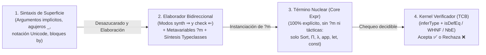

# Lección 10: Cómo Implementar un Asistente de Tipos Dependientes — De Bruijn, NbE, Tipado Bidireccional y Unificación

> **Navegación del Mini-Curso:** [⬅️ Lección 09: Semántica Categórica, CwF y Modelos](09_semantica_categorica_cwf_y_modelos.md) | [🏠 Índice del Mini-Curso](00_indice_minicurso_ttd.md)
>
> **Ampliación de Ingeniería del Mini-Curso:** Arquitectura completa de un asistente de demostraciones real (como Lean 4, Agda o Coq) desde el código fuente escrito por el usuario hasta el chequeo final en el Kernel.
>
> **Módulos ejecutables relacionados:** [`LeanTT/M27_NormalizationByEvaluation.lean`](../../LeanTT/M27_NormalizationByEvaluation.lean), [`LeanTT/M40_MiniDependentTypeChecker.lean`](../../LeanTT/M40_MiniDependentTypeChecker.lean), [`LeanTT/M50_BidirectionalElaboratorAndUnification.lean`](../../LeanTT/M50_BidirectionalElaboratorAndUnification.lean) y [`LeanTT/M60_UniversePolymorphicKernelAndInductives.lean`](../../LeanTT/M60_UniversePolymorphicKernelAndInductives.lean).

---

## 1. La Arquitectura en 4 Fases de un Asistente de Tipos Dependientes Moderno

¿Cómo pasa Lean 4 desde el texto que escribe una persona en VS Code (`theorem T (x : _) : ... := by simp`) hasta la garantía matemática absoluta de que el teorema es correcto?

Todos los asistentes modernos basados en el **Criterio de De Bruijn** (según el cual la confianza del sistema debe residir exclusivamente en un verificador nuclear pequeño y auditable) dividen su arquitectura en **dos mundos separados**:
1. **El Frontend Rico (Parser + Macros + Elaborador Bidireccional + Tácticas + Unificador):** Puede ser tan sofisticado y heurístico como queramos porque su único objetivo es **producir un término del Kernel completamente explícito**.
2. **El Kernel Minimalista (Comprobador de Conversión + Inferencia de Tipos):** No confía en nada de lo que hizo el Elaborador; vuelve a verificar desde cero que el término resultante cumple las reglas del Cálculo de Construcciones Inductivas.



---

## 2. Fase I: Representación Libre de Captura — Índices vs. Niveles de De Bruijn

El primer escollo al programar un verificador de tipos dependientes es evitar la **captura accidental de variables** durante la $\beta$-reducción $(\lambda y.\, t)[s/x]$ y decidir la $\alpha$-equivalencia $(\lambda x.\, x) \equiv_\alpha (\lambda y.\, y)$ en tiempo $O(1)$.

En 1972, **N. G. de Bruijn** inventó la representación posicional sin nombres, que en los implementadores modernos combina **Índices** (en la sintaxis) y **Niveles** (en los valores semánticos de NbE):

| Representación | ¿Desde dónde cuenta? | Ejemplo en $\lambda x.\, \lambda y.\, x\; y$ | ¿Por qué se usa en esa fase? |
| :--- | :--- | :--- | :--- |
| **Índices de De Bruijn** (`bvar i`) | **De adentro hacia afuera:** `0` es el $\lambda$ más cercano (más interno); `1` es el siguiente hacia afuera. | $\lambda.\, \lambda.\, 1\; 0$ | **Ideal para la sintaxis abstracta (`Expr`):** un subtérmino cerrado tiene exactamente la misma representación independientemente de cuántos $\lambda$ lo rodeen. |
| **Niveles de De Bruijn** (`lvl l`) | **De afuera hacia adentro:** `0` es la primera variable del contexto raíz $\Gamma$; `1` es la segunda, etc. | $\lambda.\, \lambda.\, 0\; 1$ | **Ideal durante la evaluación (NbE):** al entrar bajo un nuevo $\lambda$, el nivel de las variables existentes **no cambia** (¡no hace falta aplicar `shift` al entorno semántico!). |

Fórmula de conversión instantánea entre Índice $i$ y Nivel $l$ en un contexto de longitud $|\Gamma| = d$:
$$l = d - i - 1 \qquad\Longleftrightarrow\qquad i = d - l - 1$$

---

## 3. Fase II: Normalización por Evaluación (NbE) y Chequeo de Igualdad Definicional (`isDefEq`)

En un verificador de tipos simples, para comprobar si el argumento de `f a` tiene el tipo esperado `A`, basta comparar dos árboles sintácticos `A == A'`.
Pero en **Teoría de Tipos Dependientes**, los tipos contienen programas arbitrarios (`Vec α (2 + n)` vs `Vec α (1 + (1 + n))`). Para implementar la **Regla de Conversión**:
$$
\frac{\Gamma \vdash a : A \qquad \Gamma \vdash A \equiv B}{\Gamma \vdash a : B}
$$
el verificador necesita un algoritmo **`isDefEq Γ A B`** que decida si $A$ y $B$ son definicionalmente iguales ($\alpha\beta\delta\iota\zeta\eta$-convertibles).

### 3.1 Estrategia 1: Reducción Perezosa a Forma Normal Débil de Cabeza (`whnf`)
Usada en el kernel de Lean 4 (y formalizada en nuestro **[Módulo 40](../../LeanTT/M40_MiniDependentTypeChecker.lean)** y **[Módulo 60](../../LeanTT/M60_UniversePolymorphicKernelAndInductives.lean)**):
1. Reducimos $A$ y $B$ únicamente en la cabeza (`whnf`) hasta exponer su constructor externo (por ejemplo, $\Pi x:A_1, B_1$ o una variable aplicada a argumentos $x\; u_1 \dots u_k$).
2. Si ambos tienen la misma cabeza, comparamos recursivamente sus componentes. Si uno es $\lambda x.\, t$ y el otro es $f$, aplicamos $\eta$-expansión al vuelo: comparamos $t$ con $f\; x$.

### 3.2 Estrategia 2: Normalización por Evaluación (`NbE` — Berger & Schwichtenberg, 1991; Coquand, 1996)
Formalizada íntegramente en nuestro **[Módulo 27 (`M27_NormalizationByEvaluation.lean`)](../../LeanTT/M27_NormalizationByEvaluation.lean)**:
1. **`eval` (Sintaxis $\to$ Semántica):** Evaluamos el término sintáctico en un dominio semántico de valores donde las abstracciones $\lambda$ son funciones (o clausuras) y las variables libres son **términos neutros** (`Ne`) etiquetados con niveles de De Bruijn.
2. **`reify` / `quote` (Semántica $\to$ Forma Normal $\beta\eta$):** Reificamos el valor semántico de vuelta a la sintaxis (`Nf`), aplicando las funciones semánticas a variables frescas (`reflect`), lo que produce automáticamente formas normales $\beta$-reducidas y $\eta$-expandidas.

---

## 4. Fase III: El Algoritmo de Chequeo Bidireccional de Thierry Coquand (1996)

Como vimos en el **[Módulo 50 (`M50_BidirectionalElaboratorAndUnification.lean`)](../../LeanTT/M50_BidirectionalElaboratorAndUnification.lean)**, en lugar de intentar adivinar el tipo de una abstracción sin anotación `fun x => body` desde abajo, el algoritmo bidireccional separa dos juicios algorítmicos:

1. **Modo Síntesis (`Γ ⊢ e ⇒ A`):** El tipo $A$ es una **salida** calculada a partir de $e$. Se usa para variables $x$, constantes, universos $\mathcal{U}_i$, tipos $\Pi$, anotaciones $(e : A)$ y aplicaciones $f\; a$ (sintetizando primero el tipo $\Pi x:A, B(x)$ de $f$, comprobando $a \Leftarrow A$ y devolviendo $B[a/x]$).
2. **Modo Comprobación (`Γ ⊢ e ⇐ A`):** El tipo esperado $A$ es una **entrada** conocida de antemano.
   * **Regla de comprobación de $\lambda$:** Para comprobar $\Gamma \vdash (\lambda x.\, t) \Leftarrow T$, primero reducimos $T$ a `whnf`. Si $\text{whnf}(T) = \Pi (x : A), B(x)$, extendemos el contexto con $x : A$ y comprobamos $\Gamma, x : A \vdash t \Leftarrow B(x)$ ¡sin necesidad de anotar el tipo de $x$ en la $\lambda$!
   * **Regla de cambio de modo (*Switch / Conversion*):** Si una expresión $e$ no tiene regla de comprobación específica, sintetizamos su tipo $\Gamma \vdash e \Rightarrow A'$ y verificamos mediante el algoritmo de conversión que $\text{isDefEq}(\Gamma, A', A) = \texttt{true}$.

---

## 5. Fase IV: Metavariables Contextuales y Unificación de Patrones (Dale Miller, 1991)

Cuando el usuario escribe en Lean 4 un argumento implícito o un guion bajo `_` (o cuando ejecuta una táctica como `apply h`), el elaborador crea una **metavariable contextual** `?m` cuyo tipo puede depender de todas las variables locales $x_1 : A_1, \dots, x_k : A_k$ del contexto actual $\Gamma$.

Durante el chequeo bidireccional, la llamada `isDefEq` se encuentra con ecuaciones de unificación donde un lado tiene una metavariable aplicada a argumentos:
$$?m\; t_1\; t_2 \dots t_k \;\doteq\; rhs$$

En general, la unificación de orden superior es indecidible (Goldfarb, 1981). Sin embargo, **Dale Miller (1991)** descubrió un fragmento **decidible, unitario (con unificador más general único) y lineal**: el **Fragmento de Patrones (*Pattern Unification*)**:

> **Condición de Patrón de Miller:** Si los argumentos $t_1, \dots, t_k$ aplicados a la metavariable $?m$ son **variables ligadas distintas entre sí** ($y_1, \dots, y_k$), y todas las variables libres que aparecen en $rhs$ pertenecen al conjunto $\{y_1, \dots, y_k\}$ (además de que $?m$ no ocurra dentro de $rhs$ — *occurs check*), entonces la ecuación tiene una **única solución canónica**:
> $$?m \;:=\; \lambda y_1 \dots \lambda y_k.\, rhs$$

Si una ecuación de unificación no cae dentro del fragmento de patrones en ese instante (por ejemplo, $?m\; (a + b) \doteq c + d$), el elaborador de Lean 4 la **pospone** en una cola de restricciones pendientes hasta que otros argumentos instancien más metavariables y la reduzcan a un patrón válido.

---

## 6. Mapa de los Tres Proyectos Cumbre de Implementación en Este Repositorio

En la carpeta [`LeanTT/`](../../LeanTT/) tienes implementados y formalmente verificados los **tres componentes nucleares** de un asistente de tipos dependientes real:

| Proyecto Cumbre | Archivo Ejecutable en `LeanTT/` | Qué Implementa y Verifica en Lean 4 |
| :---: | :--- | :--- |
| **Cumbre I** | [**M40_MiniDependentTypeChecker.lean**](../../LeanTT/M40_MiniDependentTypeChecker.lean) | **El Kernel Base:** Sintaxis unificada términos/tipos (`Expr`) con índices de De Bruijn, `shift`, `subst`, evaluación a `whnf` e `inferType` para $\Pi$-types. |
| **Cumbre II** | [**M50_BidirectionalElaboratorAndUnification.lean**](../../LeanTT/M50_BidirectionalElaboratorAndUnification.lean) | **El Elaborador Bidireccional:** Tipos con metavariables `MetaTy`, leyes de monoide de las sustituciones (`applySubst_id`, `applySubst_comp`) y modos mutuamente recursivos `synth` ($\Rightarrow$) / `check` ($\Leftarrow$) que rellenan tipos ausentes en $\lambda$. |
| **Cumbre III** | [**M60_UniversePolymorphicKernelAndInductives.lean**](../../LeanTT/M60_UniversePolymorphicKernelAndInductives.lean) | **El Kernel Polimórfico con Universos e Inductivos:** Jerarquía de universos `Sort u`, función de impredicatividad `imaxLevel`, eliminador dependiente `boolRec` ($\iota$-reducción) y verificación nuclear de *Large Elimination*. |

---

## 7. Ejercicio Práctico de la Lección 10 (en Lean 4)

### Ejercicio 10.1: Resolutor del Fragmento de Patrones de Miller en 1 Variable
Implementa en Lean 4 una función `resolverPatron1Var (varId : Nat) (rhs : CoreExpr) : Option CoreExpr` que, dada la ecuación de unificación $?m(\text{var } \text{varId}) \doteq rhs$, compruebe si `rhs` solo menciona la variable `varId` y en tal caso devuelva la solución $\lambda x.\, rhs[0 / \text{varId}]$.

<details>
<summary>💡 <b>Ver Solución Comentada en Lean 4</b></summary>

```lean
inductive MiniExpr where
  | fvar   : Nat → MiniExpr -- Variable libre del contexto con ID `x`
  | bvar0  : MiniExpr       -- Variable ligada por la λ recién creada
  | litNat : Nat → MiniExpr
  | add    : MiniExpr → MiniExpr → MiniExpr
  | lam    : MiniExpr → MiniExpr
  deriving Repr, DecidableEq

/-- Abstrae la variable libre `targetId` convirtiéndola en `bvar0`;
    falla (`none`) si `rhs` contiene cualquier otra variable libre que no estaba entre los argumentos de `?m`: -/
def abstraerVariable (targetId : Nat) : MiniExpr → Option MiniExpr
  | .fvar id  => if id == targetId then some .bvar0 else none
  | .bvar0    => some .bvar0
  | .litNat n => some (.litNat n)
  | .add a b  => do
    let a' ← abstraerVariable targetId a
    let b' ← abstraerVariable targetId b
    some (.add a' b')
  | .lam body => do
    let body' ← abstraerVariable targetId body
    some (.lam body')

/-- Resuelve `?m (fvar targetId) ≐ rhs` devolviendo `some (lam body)` si cumple la condición de patrón de Miller: -/
def resolverPatronMiller1 (targetId : Nat) (rhs : MiniExpr) : Option MiniExpr := do
  let body ← abstraerVariable targetId rhs
  some (.lam body)

-- Éxito: `?m x ≐ x + 10` tiene solución única `?m := fun z => z + 10`
#eval resolverPatronMiller1 7 (.add (.fvar 7) (.litNat 10))
-- Resultado: some (MiniExpr.lam (MiniExpr.add (MiniExpr.bvar0) (MiniExpr.litNat 10)))

-- Fallo de alcance (Escape check): `?m x ≐ x + y` no tiene solución porque `y` (id 99) no es argumento de `?m`
#eval resolverPatronMiller1 7 (.add (.fvar 7) (.fvar 99))
-- Resultado: none
```
</details>

---

⬅️ [**Volver al Índice General del Mini-Curso (`00_indice_minicurso_ttd.md`)**](00_indice_minicurso_ttd.md)
